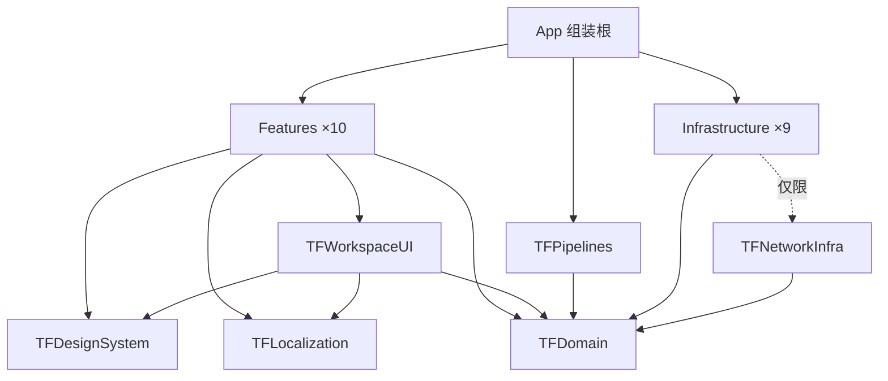
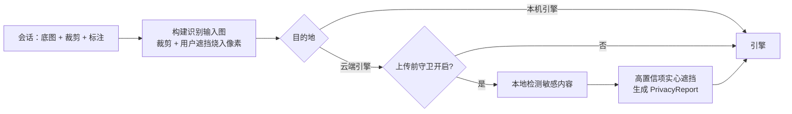

# TransFrame 2 · 架构冻结定稿

- 日期：2026-11-23 ｜ 状态：**定稿**
- 项目根：`/Volumes/external/worktrees/TransFrame2`（本文件所在目录；Phase 1 在此 `git init` 为独立仓库）
- v1 仓库：`/Volumes/external/Projects/TransFrame`，只读取证；对等基线钉在 `main@8ff10ba7`
- 本文由 Phase 0 工作稿（v1 仓库 `docs/refactor/` 下 22 个文件，提交 `743f027c`）合并而成，并应用了两条新裁决（D28、D29）。**本文是唯一权威规格**，工作稿不再更新。
- 章节引用规则：`§00`–`§06` 指本文对应章节；`ADR-XXXX` 指附录里的决策记录；`file:line` 形式的证据路径相对 v1 仓库根、对应基线提交。

## 本次修订（相对 Phase 0 工作稿）

| # | 裁决 | 内容 | 落点 |
|---|---|---|---|
| D28 | 项目位置 | 项目根为 `/Volumes/external/worktrees/TransFrame2`，v1 仓库之外的独立目录；取代原「同仓库 `macos/`」方案（D8、X1）。v1 仓库不需要配合改动，发布 2.0 时在 GitHub 标记归档即可 | §01 §1、ADR-0001 |
| D29 | 升级范围 | 不做 v1→v2 的任何升级通道：不迁移数据、不接管 v1 更新源、不在 1.x 内提示；2.0 只管 2.x 自己的后续升级 | §03 §15 E3、ADR-0014 |

## 冻结摘要

**身份**：独立目录 `/Volumes/external/worktrees/TransFrame2`，应用「TransFrame 2」（`com.transframe.v2`），与 1.x 并存，不导入其数据，不做 v1→v2 升级。v1 仓库原样保留、只读取证，发布 2.0 时标记归档。

**分层**（本地 Swift Package，依赖写错就编译不过；白名单见 §01 §2.1）
- L0 `TFDomain`：值类型与协议，只依赖 Foundation 与 CoreGraphics。
- L1 `TFPipelines`（编排、会话、缓存、渲染布局、外发出口）和 9 个 Infrastructure 模块，都只依赖 Domain。
- L1–L2 `TFLocalization`、`TFDesignSystem`、`TFWorkspaceUI`（共享的画布、标注交互、结果抽屉）。
- L3 10 个 Feature 模块，互不依赖，只认 Domain 协议与设计系统。
- L4 App：唯一的组装根；跨 Feature 只走 `AppRoute`。

**关键规则**
- App 之外不允许单例；界面在主 actor，重活在各自的 actor；跨边界只传 `Sendable` 值。
- 结果写回前核对会话号、输入修订号、操作号；取消传到底层，且不触发备用引擎。
- 一份渲染计划、一个执行器：预览、导出、钉图逐像素一致；隐私遮挡永远最后合成。
- 外发只有一个出口：用户遮挡烧入像素；云端请求前在本机检测并遮挡高置信敏感内容。
- macOS 26 的能力只出现在 4 个模块里，以「引擎」的形式暴露；部署目标恒为 15.0。

**预算**（本机 M4 Pro 是唯一阻断门禁；全部是目标值，尚未实测）
- 触发 → 冻结可见：单屏 P95 ≤ 150 ms，双屏 ≤ 250 ms；输入 → 可见更新 ≤ 2 个刷新周期。
- 主线程停顿 ≥ 100 ms 即阻断；确认 → 编辑器首帧 P95 ≤ 150 ms；取消后底层停止 P95 ≤ 1 s。
- Vision 识别（1080p 夹具）P95 ≤ 500 ms；渲染执行（4K 底图 + 100 段译文）P95 ≤ 200 ms。
- 暖路径 ≥ 50 次、冷路径 ≥ 10 次，分组统计；比基线恶化超过 10% 即阻断；放宽必须有 ADR。

**构建顺序**（每个 PR 可启动、只增不破）
1 地基 → 2 截图 → 3 文档与标注 → 4 识别与翻译（主链路打通）→ 5 文本翻译 → 6 历史与周边 → 7 AI native（两波）→ 8 收尾与归档。

**范围**：对等矩阵 212 行。对等 180；修正 7；补齐 10（原位渲染、翻译写历史、历史导出、图床设置、导出格式、OCR 引擎选择等）；新增 15（AI native 7 项及其引擎入口、上传前守卫、滚动长截图等）。已批准的例外 3 条：不导入 1.x 数据；Apple 翻译仅 26 以上；不做 v1→v2 升级通道。

**最大风险**
1. 范围：全量对等加补齐加 7 项 AI，第 7 阶段最可能拖期。
2. 基线系统没有人工验证：macOS 15 与 x86_64 只有 CI，15 上的界面观感与授权流程未验证。
3. 原位渲染是新做的核心能力，覆盖模式在复杂背景上质量有限。
4. 发布后不可逆的三项：bundle ID、更新源地址、Sparkle 签名密钥，发布前要再确认一次。

## 追问裁决记录（9 轮 32 题 + 定稿 2 题）

`/grillme` 技能本机不存在，按其规程用提问工具等价执行。D = 用户裁决；X = 架构师默认决策，可否决。

| # | 议题 | 裁决 | 落点 |
|---|---|---|---|
| D1 | 阶段划分与 AI 清单由谁定 | 架构师提案，用户审 | ADR-0008、ADR-0011 |
| D2 | TDD 文档范围 | 00–05 + ADR + 06 测试先行规程 | §06 |
| D3 | 本轮交付边界 | 只出文档；骨架与依赖脚本留到审批后的第一个 PR | §01 §10 |
| D4 | 产物位置 | 新 worktree + 本地提交，不推送 | v1 仓库分支 `v2/phase-0-architecture-freeze` |
| D5 | 模块边界 | 本地 Swift Package，多 target，编译器强制 | ADR-0002 |
| D6 | Apple 翻译 | 维持 macOS 26+ 专属；15–25 断网可用范围不含翻译 | ADR-0007 |
| D7 | 历史存储 | SwiftData，上限可配置，默认 500 | ADR-0009 |
| D8 | 交付方式 | **经 D28 修订**：独立目录 `/Volumes/external/worktrees/TransFrame2`；v1 仓库发布时标记归档，不移除代码 | ADR-0001 |
| D9 | 身份 | 新 App「TransFrame 2」，`com.transframe.v2`，与 1.x 并存 | ADR-0001 |
| D10 | 1.x 数据导入 | 不做；「无损迁移」在 2.0 不成立 | ADR-0001、§03 §15 |
| D11 | PR #101 | 清理无关文件后合并；对等基线钉 `8ff10ba7` | §00 §5 |
| D12 | Windows 耦合 | 契约只约束 macOS | §02 §0 |
| D13 | 补齐项 | 历史导出、图床上传设置入口、滚动长截图，三项都做 | §03 §8 |
| D14 | 菜单栏形态 | 原生 NSMenu | §05 §3 |
| D15 | 上传前隐私 | 默认自动遮挡高置信敏感内容，非阻塞可撤销，本地引擎不触发，可关闭 | ADR-0010 |
| D16 | 语言切换 | 全部立即生效 | ADR-0012 |
| D17 | AI native 范围 | 结构保真翻译、智能动作、智能选区、术语表与上下文、语义历史检索、输入框翻译增强、截图自动命名；截图问答不做 | ADR-0011 |
| D18 | AI 引擎来源 | 统一抽象；macOS 26 端侧模型为可选的零配置离线引擎 | ADR-0011 |
| D19 | 验证环境 | 只有 CI 上的 macOS 15；无虚拟机、无 Rosetta、无实体机 | ADR-0013 |
| D20 | 真实引擎验收 | 本地服务、大模型云端、图床实测；传统云翻译只做夹具契约测试 | §06 §7 |
| D21 | 测试框架 | Swift Testing + swift-snapshot-testing（仅测试依赖）+ XCTest measure | ADR-0013 |
| D22 | 1.x 用户告知 | 只靠 README 与发布页；不做应用内或更新源层面的引导（D29） | ADR-0014 |
| D23 | 性能基准机 | 本机为唯一阻断门禁；CI 只记趋势 | §04 §2 |
| D24 | 默认快捷键 | 沿用 1.x，启动时检测冲突 | ADR-0001 |
| D25 | 原位渲染 | 文字抽屉与图上原位可切换；图上支持「原文下方」「覆盖原文」，默认原文下方 | ADR-0006 |
| D26 | 历史写入范围 | 截图翻译、划词翻译、翻译并插入；纯截图不记 | ADR-0009 |
| D27 | 隐藏设置 | 暴露导出格式与质量、OCR 引擎选择 | §03 §8 |
| **D28** | 项目位置 | 项目根 `/Volumes/external/worktrees/TransFrame2`，v1 仓库之外的独立目录与独立仓库 | §01 §1、ADR-0001 |
| **D29** | 升级范围 | 不做 v1→v2 升级通道；只管 2.x 自己的后续升级 | §03 §15 E3、ADR-0014 |

### 架构师默认决策（未单独提问，审阅时可否决）

| # | 默认决策 | 理由 |
|---|---|---|
| X1 | ~~新项目目录名 `macos/`~~ **已被 D28 取代** | 用户改裁为独立目录 |
| X2 | 全屏截图改为截取**指针所在显示器** | 1.x 固定截主屏，多屏用户在副屏按键得到主屏图，判为缺陷 |
| X3 | 编辑器里 Enter = 复制并关闭、数字键 1–9 = 工具栏顺序 | 沿用 1.x 现行行为；README 写的是 Enter 保存、2/3/4 = 手绘/箭头/文字，2.0 发布时更正 README |
| X4 | AI 与云端请求一律由用户显式触发；自动行为只用本地能力 | 延续 1.x「自动检查不消耗付费配额」原则 |
| X5 | 2.0 用新的更新源文件与新的 Sparkle 签名密钥 | 两个产品的更新互不通用；独立仓库后 `appcast.xml` 放在自己的 `latest` 即可 |
| X6 | 关闭 App Sandbox，发布签名启用 Hardened Runtime | 与 1.x 相同；辅助功能与全局事件无法在沙盒内工作 |
| X7 | 编译下限为 CI 上的 Xcode 26.2；禁止使用 macOS 27 SDK 独有 API | 本机 Xcode 27.2 能编过不代表 CI 能编过 |
| X8 | 文档会话只在内存；原始截图不默认落盘 | 继承 10-21 规划 |
| X9 | 无遥测 | 与 1.x 相同 |
| X10 | 钉图上限 10 张 | 以 1.x 代码为准（10-21 规划写的是 5） |

## Phase 0 自审（提示词 §4.7）

- [x] **依赖方向无环，可用脚本验证**：§01 §2 给出允许边的白名单表与检查算法；按 D3 工作稿阶段只交脚本设计，脚本本体与首次运行结果在 Phase 1 的第一个 PR 交付。**未实际运行。**
- [x] **parity matrix 覆盖 README 全部条目，无「待定」**：§03 §1 逐条对照 README；每行都有目标模块、回归方式和阶段；8 处 README 与代码不符已逐条给出处置。
- [x] **每个预算都有测量方法，不是形容词**：§04 §3 每条预算含起止信号、工具、样本量、阈值。预算数字是目标值，**尚未在新项目上实测**。
- [x] **每个 AI native 提案都有架构落点**：ADR-0011 的落点表覆盖 7 项 AI 能力与上传前隐私守卫，对应契约见 §02 §11。
- [x] **构建顺序保证任意 PR 结束时 app 可启动**：ADR-0008；Phase 1 的第一个 PR 即可启动的空壳，之后每个 PR 只增不破，CI 含启动冒烟。

## 目录

- §00 基线：现状、矛盾点、不可动约束
- §01 目标架构：分层、模块、状态所有权、并发、错误、缓存、隐私、构建顺序
- §02 契约：冻结的核心值类型与协议（带版本号）
- §03 对等矩阵：逐条用户可见能力（212 行，验收唯一依据）
- §04 性能预算：预算、测量方法、样本量、夹具、回归阈值、超标流程
- §05 设计系统：Token、组件库、15/26 差异矩阵、可访问性、本地化
- §06 测试策略：测试先行规程、分层、夹具、门禁、真实引擎验收
- 附录：ADR-0001 至 ADR-0014 架构决策记录

---

## 00 · 基线：现状、矛盾点、不可动约束

- 日期：2026-11-23 ｜ 对等基线：`main@8ff10ba7`（PR #101 合并后）
- 取证方式：必读文档全文 + 源码结构化扫描（`rg` 计数与定位）+ 一次隔离构建与测试。未启动 1.x 做界面操作。
- 本文所有 `file:line` 都相对仓库根，对应基线提交。

### 1. 一页结论

1. 1.x 是一个单 target、181 个 Swift 文件、47,274 行的菜单栏应用。截图冻结、类型化坐标、引擎链与对比、真实健康探测、安全的翻译并插入，这几块做得扎实，直接继承其行为与测试思路。
2. 最大的问题不在界面，而在**主链路断线**：现行流程里译文不会画到截图上，翻译也不会写入历史。这两条都是 README 的承诺，其中前者是硬约束 9 定义的核心链路。
3. 结构性债务集中在五处：53 处 `static let shared`、编排逻辑写在视图里、5 套标注渲染、两套撤销、两套文档模型。
4. 用户已裁决 2.0 作为**新项目**在独立目录 `/Volumes/external/worktrees/TransFrame2` 重写（位于 v1 仓库之外，Phase 1 初始化为独立 git 仓库），以新 App「TransFrame 2」（`com.transframe.v2`）发布，与 1.x 并存、不导入 1.x 数据、不做 v1→v2 升级通道。v1 代码只读取证，发布 2.0 时把 v1 仓库在 GitHub 标记归档，不移除代码。
5. 基线系统 macOS 15 和 x86_64 只有 CI 一条验证途径，运行态界面在 15 上无人工验证环境，这是已接受的风险。

### 2. 实测基线

| 项 | 实测值（2026-11-23） | 提示词 §3 的说法 | 说明 |
|---|---|---|---|
| Swift 源文件 | 181 个，47,274 行 | 177 个，约 46,000 行 | PR #101 合入后新增 4 个取色历史文件 |
| 测试文件 | 32 个，6,979 行 | 31 个 | 新增 `ColorHistoryStoreTests` |
| 目录 | App 5 / Features 77 / Services 66 / Models 25 / Extensions 5 / Errors 1 / Utilities 1 / Resources 1 | 同 | Features 下 13 个子目录，不是 17 个 |
| 部署目标 | `MACOSX_DEPLOYMENT_TARGET = 15.0`，Swift 6.0，`SWIFT_STRICT_CONCURRENCY = complete` | 同 | `project.pbxproj` |
| 依赖 | Sparkle ≥ 2.9.0、PermissionFlow ≥ 1.0.0 | — | 无其它第三方 |
| 沙盒 | `ENABLE_APP_SANDBOX = NO`，entitlements 为空 | — | 发布时 `codesign --options runtime` |
| 本地化 | 10 个 `.lproj`；en 与 zh-Hans 各 702 行，其余 700 行；按唯一键算 10 种语言都是 700 个，互相没有缺失 | 10 个 | 多出的 2 行是 en 与 zh-Hans 里重复定义的 `tool.calloutBubble`、`tool.privacyRedaction` |
| 最大文件 | `SelectionOverlayWindow` 2143、`SettingsViewModel` 1363、`Annotation` 1214、`AppSettings` 1208、`PaddleOCREngine` 1068、`MultiEngineSettingsSection` 953、`OpenAIVLMProvider` 921 | 基本一致 | `SettingsViewModel`、`AppSettings` 因 PR #101 略增 |
| 发布流水线 | `release.yml`：`macos-15` + Xcode 26.2，`ARCHS="arm64 x86_64"`，签名、公证、staple、Sparkle appcast | — | 没有 macOS 的 PR 检查 |
| 本机 | Apple M4 Pro、48 GiB、macOS 27.2.1、Xcode 27.2、Swift 6.4.2；外接 4K（1920×1080 @144Hz HiDPI，主屏）+ 内建 3024×1964 | — | 性能门禁基准机（D23） |

#### 2.1 UI 债务计数（基线提交重扫）

提示词 §3 引用的是 2026-10-29 审计数据，其中一部分已在后续提交里修掉。以本表为准。

| 指标 | 现值 | 10-29 审计值 | 状态 |
|---|---|---|---|
| `glassEffect` | 0 | 0 | 未变 |
| Features 内引用 `DesignSystem.` | 7 | 1 | 略增，仍接近死代码 |
| 字面量圆角 | 73 处，7 种值（3/4/5/6/8/9/12；其中 4 有 24 处、8 有 39 处） | 58 处 9 种 | 值收敛了，数量增加 |
| 固定字号 `.system(size:)` | 60 | 50 | 增加 |
| `.buttonStyle(.plain)` | 59 | 53 | 增加 |
| `foregroundColor` / `foregroundStyle` | 0 / 224 | 41 / 186 | **已修** |
| 本地化机制 | `NSLocalizedString` 337、`String(localized:)` 226、自定义 `localized()` 217 | 327 / 199 / 179 | 三套仍并存 |
| `ForEach(id: \.offset)` | 0 | 1 | **已修** |
| `frameAutosaveName` | 9 处引用 | 0 | **已修**（Settings、History、ColorHistory） |
| `level = .floating` | 4（翻译气泡、钉图 ×2、预览窗） | Settings/History 也是 | Settings、History 已改 `.normal` |
| `NSAlert()` / SwiftUI `.alert` | 8 / 11 | 9 / 9 | 仍混用 |
| 硬编码界面文案 | 就地工具条里 "SM"、"P"、"OCR"、"Translate"、"Save"、"Upload"、"Copy"；`HistoryCategory.displayName` 四个英文 | ≥14 | 位置变了，问题仍在 |

#### 2.2 结构指标

| 指标 | 值 |
|---|---|
| `static let shared` | 53 处（Features 19 个文件、Services 30、Models 3） |
| `AppSettings.shared` 引用 | 57 |
| `ObservableObject` / `@Observable` | 3 / 16 |
| `NotificationCenter` post / addObserver | 9 / 9 |
| `@unchecked Sendable` / `nonisolated(unsafe)` / `@preconcurrency` | 9 / 5 / 6 |
| `DispatchQueue.main` / `Task { @MainActor` | 16 / 55 |
| 构建警告（PR 头构建日志） | 256 条，其中 214 条是自家迁移源类型的弃用警告，其余主要是 actor 隔离警告 |

#### 2.3 测试基线

在 PR #101 的头提交 `c0b171b8` 上做了一次隔离运行：`build-for-testing` 通过，`test-without-building` 324 个用例通过、0 失败。合并提交 `8ff10ba7` 只比它多一个删除无关文件的提交，产品与测试代码相同。

两点必须说明：

- 我显式跳过了 `PipelineSmokeTests/testSettingsViewModelReloadsEditingStateOnUnlock`。它会向真实钥匙串（服务名 `com.transframe.credentials`）写入测试密钥，再用 `defer` 里的一个脱管 `Task` 恢复，进程提前退出就可能留下测试值（`PipelineSmokeTests.swift:311-325`）。
- 测试宿主的 bundle ID 与已安装的 1.x 相同，`EngineSettingsMigrationTests`、`LanguageManagerInitializationTests` 会改写并删除真实偏好设置域里的键。我用构建参数把宿主 bundle ID 换成 `com.transframe.app.prcheck` 才跑的，运行前后真实偏好文件的修改时间没有变化。

结论：1.x 的全量测试在开发者自己的机器上**不是无副作用的**。新项目的测试隔离规则见 `§06` §3。

### 3. 现状复述

#### 3.1 形态与入口

1.x 是 `LSUIElement` 菜单栏应用，SwiftUI `App` 壳加 `NSApplicationDelegate`。`AppDelegate` 创建三个协调器（截图、文本翻译、快捷键）和菜单栏控制器，启动时检查 PaddleOCR、用 Touch ID 或系统密码解锁一次钥匙串访问、按需弹引导（`AppDelegate.swift:44-90`）。全局快捷键 6 个，走 Carbon `RegisterEventHotKey`（`HotkeyManager.swift:75`）。菜单是标准 `NSMenu`（`MenuBarController.swift:80-215`）。

#### 3.2 截图链路

快捷键触发后先并行抓取所有显示器的静态帧，再在每块屏上盖一个显示冻结帧的全屏面板（`CaptureSessionController.swift:52`、`SnapshotCaptureService.swift:112`）。选区、窗口吸附、放大镜、取色都只读冻结帧，确认时从冻结帧裁切，不再重新采屏（`SnapshotCaptureService.swift:197`）。坐标用带空间标签的矩形类型在 Cocoa、Quartz、显示器局部、像素之间转换（`CoordinateMapper.swift:9-61`）。这部分落实了 10-21 规划的 M1，是继承的重点。

选区层同时是一个完整的轻量编辑器：10 种标注工具、撤销重做、就地文字编辑、智能马赛克、美化预览、OCR 与翻译的结果抽屉，全部在同一个 2143 行的 `NSView` 里（`SelectionOverlayWindow.swift`）。

#### 3.3 编辑、钉图、导出

确认后的图可以进预览编辑器（11 种工具，多一个气泡标注）、钉在屏幕上、复制、保存、上传。钉图支持滚轮缩放、⌥ 滚轮调透明度、点击穿透、返回编辑（`PinnedWindow.swift:182-290`）。

同一份标注有 5 套绘制实现：选区层 `drawAnnotation`、预览 `AnnotationCanvas`、`ClipboardService`、`ImageExporter+AnnotationRendering`、`DocumentRenderer`。撤销也有两套：选区层用事务式 `EditHistory`（30 级），预览用整图快照栈（15 级，`PreviewViewModel.swift:268`）。文档模型同样两套：新的 `CaptureDocument` 在进入预览和钉图前被 `toLegacyScreenshot()` 转回旧的 `Screenshot`（`CaptureCoordinator.swift`、`CaptureDocument.swift:91`）。

#### 3.4 识别与翻译

「识别」动作走 `OCRService`，按设置项 `ocrEngine` 选 Vision 或 PaddleOCR（`OCREngineProtocol.swift:32`）。「翻译」动作走 `ImageTranslationPipeline`：先用视觉模型分析（OpenAI 兼容、Claude、Gemini、本地模型、PaddleOCR-VL 五选一，`ScreenCoderEngine.swift:170-178`），分析结果为空或只回吐提示词时回退到 OCR（`AnalysisPipeline.swift:41-52`），过滤噪声后交给翻译服务。

翻译服务支持两种收敛模式：顺序链最多 5 个引擎逐级退避，对比组 2 到 4 个引擎并行（`EngineSelectionV2.swift:69-73`、`TranslationService.swift:475,608`）。引擎共 8 张内置卡片加最多 5 个兼容接口实例。状态点由 `EngineHealthChecker` 真实探测，结果缓存 60 秒，只打免费端点（`EngineHealthChecker.swift:13-77`）。Apple 翻译只在 macOS 26 以上可用（`AppleTranslationProvider.swift:27`）。

#### 3.5 文本翻译

划词翻译：模拟 ⌘C 取选中文本并恢复剪贴板，翻译后弹窗展示，对比模式下按引擎分段显示耗时（`TextSelectionService.swift:152-198`、`TextTranslationPopupView.swift:133-162`）。翻译并插入：取词时用辅助功能接口绑定目标输入框，写回前复核焦点和选区，绑定不上就退回锚定前台进程的粘贴（`TextInsertionTarget.swift:107,158`、`TextTranslationCoordinator.swift:245-253`）。这条链路的安全设计是继承重点。

#### 3.6 历史、设置、安全

历史是偏好设置里的一个 JSON 块，硬上限 50 条（`HistoryStore.swift:20`），有搜索、分类、收藏、逐条复制与删除。PR #101 新增独立的取色历史窗口和取色快捷键。设置窗口 6 个标签页。密钥存钥匙串，会话级解锁（`CredentialAuthManager.swift:50-83`）。界面语言 10 种，可在应用内切换，但只有走自定义 `localized()` 的那部分文案即时刷新。

### 4. 矛盾点

#### 4.1 README 承诺与现行代码不符（8 处）

| # | README 的说法 | 代码事实 | 证据 |
|---|---|---|---|
| M1 | 覆盖层显示：译文直接渲染在截图上 | 两条现行翻译流程只输出文字。出图的 `OverlayRenderer` 只被 `TranslationFlowController` 调用，后者在 app 内零引用；而且它画的是「原图加译文列表」的拼接图，不是原位 | `SelectionOverlayWindow.swift:1637-1727`、`PreviewViewModel+Translation.swift:13-85`、`TranslationFlowController.swift:102,294` |
| M2 | 翻译历史：保存翻译记录 | 唯一的写入点 `addTranslation` 只被那条零引用流程调用。现行流程下历史里只会出现取色记录 | `TranslationFlowController.swift:354`、`HistoryStore.swift:85,260` |
| M3 | 翻译历史支持导出 | 没有任何导出代码 | `HistoryView.swift`、`HistoryStore.swift` 全文 |
| M4 | 预览窗 `Enter` 保存 | `Enter` 是复制并关闭，保存只有 `⌘S` | `PreviewWindow.swift:249-256` |
| M5 | 手绘 `D/2`、箭头 `A/3`、文字 `T/4` | 数字键按工具枚举顺序映射：2 椭圆、3 直线、4 箭头、5 手绘、8 文字 | `PreviewWindow.swift:334-342`、`PreviewViewModel.swift:501-512` |
| M6 | 所有功能均可通过菜单栏访问 | 划词翻译、翻译并插入没有菜单项，只能用快捷键 | `MenuBarController.swift:80-215` |
| M7 | 多显示器支持 | 区域截图覆盖所有屏；全屏截图固定取主屏 | `CaptureSessionController.swift:75-77` |
| M8 | OCR 可选 PaddleOCR | 「识别」动作读的设置项 `ocrEngine` 没有任何界面入口，实际固定 Vision；PaddleOCR 只能在截图翻译的分析环节选 | `OCREngineProtocol.swift:32`、`SettingsViewModel.swift:295` 无视图绑定 |

处置见 `§03` §2。M1、M2、M3、M8 用户已裁决在 2.0 实做（D25、D26、D13、D27）；M4、M5 沿用代码行为并在发布时更正 README；M6 补菜单项；M7 改为截取指针所在显示器。

#### 4.2 设置模型里存在、界面没有入口的项

`defaultFormat`、`jpegQuality`、`heicQuality`、`translationMode`、`translationAutoDetect`、`ocrEngine`、`preferredTranslationEngine` 在 `SettingsViewModel` 里有读写属性，但没有任何视图绑定它们。后果是导出格式实际固定 PNG，显示模式固定「原文下方」且不被现行流程消费。`mtranServerHost`、`mtranServerPort`、`paddleOCRServerAddress` 在 Features 下零引用。图床设置 `ImageHostSettings` 只在服务文件里出现，所以上传按钮永远不显示（`SelectionInPlaceToolbar.swift:357`）。

#### 4.3 文档之间互相矛盾

| 文档 | 说法 | 实际 |
|---|---|---|
| `docs/architecture.md`、`docs/README.md` | macOS 13+；分层图里是 `ScreenCaptureApp`、`RecentCapturesStore`；性能目标「截图延迟 <50ms」 | 部署目标 15.0；这些类型不存在；继承的预算是 P95 ≤150ms |
| `docs/user-guide.md` | 有「默认格式」「JPEG 质量」「最近截图」设置 | 界面里没有 |
| 10-29 审计 spec | 以部署目标 26.0 判罪，全面要求 Liquid Glass | 部署目标已降回 15.0，玻璃只能是 26 上的增强 |
| 10-21 升级规划 | 状态「尚未实施」；钉图上限 5 张；撤销 15 级 | M1 冻结与坐标已落地，M2 文档模型落了一半；钉图上限是 10（`PinnedWindowsManager.swift:22`） |
| 提示词 §3 | UI 债务数字 | 见 §2.1，四项已修 |

新项目不修订这些旧文档。它们随 v1 仓库一起标记归档，由本规格与新的用户文档取代。

#### 4.4 架构性矛盾

1. **编排写在视图里。** 分析、翻译、取消、代际校验的逻辑分别在 `SelectionOverlayView.runInPlaceAnalysis` 和 `PreviewViewModel.performTranslation` 里各写了一遍。历史写入就是在这次分叉里丢的（M2）。
2. **规划的组件建了但没接。** `AnalysisRequestCoordinator`、`MainThreadMonitor`、`ScrollCaptureSession`、`TranslationPopoverController`、`AccessibilityPermissionChecker`、`LocalizedText`、`ImageExporter.saveWithTranslations` 在 app 内零引用。`CaptureCoordinator` 持有的 `DisplaySelector` 从未被调用。
3. **状态所有权不清。** 53 个单例互相直接调用；设置、钥匙串、历史都是全局可写；跨模块通知靠 `NotificationCenter`（取色、上传完成、语言切换、快捷键变更）。
4. **隐私边界只做了一半。** `AnalysisInputBuilder` 能把隐私遮挡烧进像素再外发，但现行翻译流程直接把裁切图交给管线，没有经过它；智能马赛克本身依赖云端视觉模型，检测时就已经把原图发出去了（`SmartPrivacyRedactionService.swift:45-52`）。
5. **取消只停在 Swift 任务层。** 界面用代际计数丢弃过期结果，这是对的；但 Vision 请求和 Paddle 子进程是否真正停止没有统一保证。

#### 4.5 约束之间的冲突与裁决

| 冲突 | 裁决 |
|---|---|
| 硬约束 5 要求断网可用 Apple 翻译；该接口的直连用法只在 macOS 26+ | D6：维持 26+ 专属。15–25 的离线路径是截图、Vision OCR、标注、历史，不含翻译 |
| 硬约束 3 要求 100% 对等；README 有「无损迁移」 | D10：2.0 是新 App，不导入 1.x 数据。这是经批准的对等例外，记入 `03` §9 |
| 硬约束 9 不改产品定位；D9 改了应用名和 bundle ID | 定位不变，仍是菜单栏截图翻译工具；变的是发行身份 |
| 提示词 §4.1 的「逐纵切替换旧实现」；D8/D28 定为独立目录的新项目 | 迁移策略改为全新构建；「旧代码在纵切验收后删除」不适用：v1 仓库原样保留，发布 2.0 时标记归档 |
| 硬约束 4 要求 AI native 同批交付；用户选了 7 项 | 7 项全部进 2.0，排在 Phase 7，内部分两波，见 ADR-0008 |

### 5. 本轮已执行的仓库动作

这些不是文档工作，但改变了仓库状态，逐条记录。

1. **合并 PR #101。** 先在 PR 头上验证 macOS 构建与测试（§2.3），再按授权向 `hubo/feat-windows` 推送提交 `c9478183`，移除被误提交的 `hubert/`（38 个文件）和 `.design/`（2 个文件）并把 `.design/` 加进 `.gitignore`，然后以 merge commit `8ff10ba7` 合并。合并时 Windows CI 有 7 组任务失败，其中便携检查是真实的链接错误（`tf::core::loc::tw` 未定义）；这一点合并前已告知并获确认。
2. **取消了一次 CI 运行。** 我的推送触发了 OpenCodeReview 工作流，合并后它的输出已无用，为避免消耗模型配额我把它取消了（run 45152210961）。同一次推送触发的 `windows-ci` 我没有动。
3. **本地主检出快进到 `8ff10ba7`。** 你本地的 `feat-windows` worktree 仍停在 `132cab20`，没有碰。
4. **新建 worktree** `/Volumes/external/worktrees/TransFrame/v2-phase0`，分支 `v2/phase-0-architecture-freeze`。
5. **构建产物的副作用。** 本机 Xcode 把产物目录设成了全局共享的 `/Volumes/external/Xcode/DerivedData/Build/Products`，`-derivedDataPath` 不改变它。我那次验证构建覆盖了其中的 `Debug/TransFrame.app`，现在那里是一个 bundle ID 为 `com.transframe.app.prcheck` 的未签名构建，你下次自己构建会覆盖它。新项目的脚本必须显式传 `SYMROOT` 和 `OBJROOT`。
6. **已清理：** 临时验证 worktree、`/tmp` 下的派生数据和结果包、`com.transframe.app.prcheck` 偏好域。保留了两份日志：`/tmp/tf-pr101-build.log`、`/tmp/tf-pr101-test.log`。

### 6. 不可动约束（按裁决修订后）

1. **平台基线** macOS 15.0，universal，Swift 6 语言模式严格并发，SwiftUI + AppKit，ScreenCaptureKit、Vision、Translation、Sparkle 2。
2. **26 增强不抬基线。** `MACOSX_DEPLOYMENT_TARGET` 恒为 15.0；26 的接口只出现在白名单模块里并带可用性守卫（ADR-0007）。
3. **功能对等**以 `§03` 为唯一依据。两条已批准例外：不导入 1.x 数据；Apple 翻译维持 26+。
4. **AI native 7 项与重写同批交付**，不进 backlog。
5. **离线路径**：15–25 上截图、Vision OCR、标注、历史可用；26+ 再加 Apple 翻译和系统文档识别。
6. **性能预算不静默放宽。** 改数字必须有证据和 ADR。
7. **每个 PR 可构建、可运行、测试全绿、可回滚。**
8. **不提交密钥**；测试不碰真实偏好设置、钥匙串和历史；最终验收跑真实引擎。
9. **产品定位不变**：菜单栏常驻，截图 → 识别 → 翻译 → 原位双语渲染，外加划词翻译与输入框翻译。
10. **1.x 只读。** 基线钉在 `8ff10ba7`；此后 `TransFrame/` 下任何用户可见改动都必须同步登记进 parity matrix，否则视为基线漂移。

### 7. 直接继承的既有决策

| 来源 | 继承内容 |
|---|---|
| 10-21 升级规划 §4 | 一次性快照冻结、确认后只裁底图；时间字段诚实（无校准帧时间戳就留空）；所有屏成功后一次提交；失败不回退到实时采屏 |
| 10-21 §4.3 | 带空间标签的矩形；最小边向下取整、最大边向上取整；越界是错误而不是静默钳制 |
| 10-21 §5.2–5.3 | `documentID` 不随裁切变化；`editRevision` 与 `analysisInputRevision` 分开；撤销也生成新修订；任务按文档和类型归属，提交前核对修订与操作号；配置在请求发起时冻结 |
| 10-21 §5.4 | 三种识别输入（安全图、原图、当前显示图）；马赛克不等于脱敏；遮挡最后合成 |
| 10-21 §6.2 | 段级状态区分已译、同语种跳过、保留原文、失败、取消；取消不触发备用请求；少返回不拿原文冒充 |
| 10-21 §8.3 | 性能预算与取样规则 |
| 引擎收敛 PRD | 顺序链上限 5、对比 2–4；四态健康探测、60 秒缓存、自动探测不耗付费配额；OpenAI 兼容卡片的三个预设 |
| UI 修复计划 | 圆角三到四档、语义字体、系统控件优先、危险操作用 destructive 角色、统一复制反馈、窗口记位置 |
| 取色历史 spec | §4 的交互规格原样作为验收基线 |
| SwiftUI 技能 | `@Observable` + `@MainActor`；`@State` 私有；`ForEach` 用稳定标识；`.animation(_:value:)`；玻璃只用原生接口并带回退 |

### 8. 风险登记

| # | 风险 | 影响 | 应对 |
|---|---|---|---|
| R1 | 范围很大：全量对等 + 5 个补齐项 + 7 项 AI + 隐私守卫 | 交付周期长，后段质量下滑 | 构建顺序把主链路放前面；Phase 7 分两波；每个 PR 都过对等矩阵的行级回归 |
| R2 | macOS 15 运行态只有 CI | 材质回退、授权流程、窗口行为在 15 上可能有问题而无人看见 | CI 在 15 上跑快照与启动冒烟；验收报告把 15 的人工项标为未验证；建议发布前补一台 15 的机器或虚拟机 |
| R3 | x86_64 只有 CI，且 `macos-15-intel` 运行器是否可用未确认 | Intel 切片可能只做到编译验证 | Phase 1 第一件事确认；不可用就在报告里标未实测 |
| R4 | 原位渲染是新做的核心能力，1.x 没有可用实现可参照 | 覆盖模式的擦除与排版质量 | 先做「原文下方」，覆盖模式用采样填充而不做模型修复；溢出走降级规则 |
| R5 | 即时语言切换依赖的查找机制未做技术验证 | Phase 1 可能要换方案 | 先做技术验证；兜底是 1.x 已证明可行的 `.lproj` 子包查找 |
| R6 | SwiftData 在严格并发下的稳定性 | 历史读写出问题 | 藏在协议后面；从第一天起带版本化 schema；容器打不开时旁置重建而不是崩溃 |
| R7 | 本机编译器比 CI 新两个大版本 | 本机能编过、CI 编不过 | 以 CI 的 Xcode 26.2 为编译下限；禁止使用 macOS 27 SDK 独有接口 |
| R8 | 1.x 与 2.0 同时运行时快捷键冲突 | 用户按键无响应或触发错的 App | 启动时检测并提示（D24） |

---

## 01 · 目标架构

- 状态：定稿 ｜ 适用对象：新项目 `/Volumes/external/worktrees/TransFrame2`（下称项目根；TransFrame 2，`com.transframe.v2`）
- 本文写死的是**边界与规则**。类型的字段级定义在 `§02`，取舍理由在 `adr/`。
- 文中的模块、类型、脚本都还不存在，属于冻结的设计；按 D3，本轮不建骨架。

### 1. 仓库布局

```text
/Volumes/external/worktrees/TransFrame2/            # 项目根：v1 仓库之外的独立目录，Phase 1 初始化为独立 git 仓库
├── TransFrame2.xcodeproj        # 只有 app target 和一个界面测试 target
├── App/                         # 入口、组装根、Info.plist、entitlements、应用图标
├── Packages/TransFrameKit/      # 本地 Swift Package，所有模块
│   ├── Package.swift
│   ├── Sources/<模块名>/
│   └── Tests/<模块名>Tests/
├── Fixtures/                    # 合成测试语料与标注
├── PerfBaselines/  PerfReports/ # 性能基线与每次运行的报告
├── Docs/walkthroughs/           # 人工走查脚本与记录
├── Scripts/                     # build / test / perf / acceptance / check-deps / check-l10n / check-design
└── .github/workflows/           # CI（项目独立仓库的工作流）

/Volumes/external/Projects/TransFrame             # v1 仓库：1.x 代码与 docs/refactor/ 工作稿，只读取证，发布 2.0 时标记归档
```

### 2. 分层与依赖方向

提示词给的起点是 `App → Features → Domain ← Infrastructure`。我保留这条主干，做了两处有理由的调整：

- **多一个 Pipelines 层。** 1.x 把「分析 → 翻译 → 写结果」的编排在两个视图里各写了一遍，历史写入就是这样丢的。编排必须有一个不带界面、能用假实现测试的归属。它和 Infrastructure 平级：实现 Domain 里的工作流协议，只依赖 Domain。Features 仍然只认 Domain 协议，铁律不破。
- **Domain 允许 `CoreGraphics`。** 几何类型和不可变的 `CGImage` 是跨层传递像素的唯一合理载体，另造一层句柄只会增加拷贝和间接。除此之外 Domain 不碰任何系统服务或界面框架。



#### 2.1 允许的依赖边（白名单，穷举）

| 层 | 模块 | 允许依赖 | 允许 import 的系统框架 |
|---|---|---|---|
| L0 | `TFDomain` | 无 | Foundation、CoreGraphics、Observation |
| L1 | `TFPipelines` | TFDomain | Foundation、CoreGraphics、CryptoKit、os |
| L1 | `TFNetworkInfra` | TFDomain | Foundation、os |
| L1 | 其余 8 个 Infra 模块 | TFDomain、TFNetworkInfra | 各自的系统框架，见 §3 |
| L1 | `TFLocalization` | 无 | Foundation、SwiftUI（仅 `LocalizedStringResource` 与环境值） |
| L1 | `TFDesignSystem` | TFLocalization | SwiftUI、AppKit |
| L2 | `TFWorkspaceUI` | TFDomain、TFDesignSystem、TFLocalization | SwiftUI、AppKit、QuartzCore |
| L3 | 10 个 Feature 模块 | TFDomain、TFDesignSystem、TFLocalization、TFWorkspaceUI | SwiftUI、AppKit |
| L4 | App target | 全部 | — |
| 测试 | `TFDomainTestSupport` | TFDomain | Foundation、CoreGraphics；只允许被测试 target 依赖 |

铁律，全部由编译器或脚本强制：

1. `TFDomain` 不依赖任何模块。
2. Feature 之间互不依赖；Feature 不依赖任何 Infra 模块，也不依赖 `TFPipelines`。
3. Infra 模块之间互不依赖，唯一例外是都可以依赖 `TFNetworkInfra`。
4. `TFPipelines` 不 import 任何系统服务框架，所以它的全部测试可以用 `swift test` 在秒级跑完。
5. `SwiftUI`、`AppKit` 不得出现在 L0 和 `TFPipelines`；Infra 里只有 `TFSystemInfra`、`TFCaptureInfra`、`TFRenderInfra` 可以 import AppKit，且不得创建窗口或视图（Sparkle 与 PermissionFlow 自带的界面除外）。

#### 2.2 依赖方向检查脚本（设计，Phase 1 第一个 PR 交付）

`Scripts/check-deps.sh`（项目根下），四项检查，任一失败退出码非零，CI 与本地提交前都跑：

1. **边白名单。** `swift package dump-package` 取每个 target 的依赖，逐条比对 §2.1；不在表里的边即违规。SwiftPM 本身拒绝环，白名单再保证方向。
2. **import 白名单。** 扫描每个模块源文件的 `import` 行，对照 §2.1 第四列。
3. **禁用符号。** 在 `App/` 以外出现 `static let shared`、`UserDefaults.standard`、`DispatchQueue`、`NotificationCenter.default.post`、`print(` 即违规；`@unchecked Sendable` 与 `nonisolated(unsafe)` 只允许出现在登记表 `Scripts/unsafe-allowlist.txt` 列出的位置，每条带理由。
4. **26 边界。** `#available(macOS 26` 与 `@available(macOS 26` 只允许出现在 ADR-0007 列出的四个模块里。

### 3. 模块清单与归属

#### 3.1 L0–L2

| 模块 | 拥有什么 | 对外暴露 | 禁止 |
|---|---|---|---|
| `TFDomain` | 全部值类型、错误类型、能力协议、工作流协议、路由协议 | `§02` 的全部内容 | 持有状态；I/O；任何 `class` 实现 |
| `TFPipelines` | 文档会话存储、结果缓存、识别/翻译编排、引擎路由（顺序链、对比）、渲染布局规划、隐私守卫编排、历史记录器、智能动作推导、术语应用 | Domain 工作流协议的实现类型（只在组装根里被引用） | 系统框架；读设置单例（配置只从请求参数进来） |
| `TFLocalization` | 唯一的 String Catalog、`Localizer`（当前语言与区域）、类型化的键 | `L10n` 键、`Localizer`、`.localized(_:)` 环境注入 | 业务逻辑；引用 Domain |
| `TFDesignSystem` | Token、组件、材质与玻璃的唯一封装、统一的反馈组件 | `§05` 的组件清单 | 引用 Domain；产品文案（文案由调用方传入） |
| `TFWorkspaceUI` | 文档画布视图、标注交互控制器、标注工具条与样式条、结果抽屉 | `DocumentCanvasView`、`AnnotationToolbar`、`ResultsDrawer` | 自己发起识别或翻译（只调用注入的工作流协议）；持有会话的权威状态 |

另有 `TFDomainTestSupport`：每个 Domain 协议的可编程假实现（可设定返回值、延迟、错误，并记录调用），只被测试 target 依赖，不进发布产物。

`TFWorkspaceUI` 存在的原因：选区层、编辑器、钉图三处都要画同一份文档、用同一套标注交互、显示同一个结果抽屉。Feature 之间不能互相依赖，所以共享界面下沉到这一层。

#### 3.2 Infrastructure（每个都只实现 Domain 协议）

| 模块 | 系统框架 | 实现的 Domain 协议 | 第三方依赖 |
|---|---|---|---|
| `TFCaptureInfra` | ScreenCaptureKit、CoreGraphics、AppKit（仅 `NSScreen`） | `SnapshotCapturing`、`DisplayTopologyProviding`、`WindowEnumerating`、`ScrollCapturing` | — |
| `TFRecognitionInfra` | Vision、ImageIO、NaturalLanguage | `RecognitionEngine`（Vision、系统文档识别、PaddleOCR 本地与云端、各视觉大模型）、`SensitiveContentDetecting`、`ContentBlockDetecting` | — |
| `TFTranslationInfra` | Translation、NaturalLanguage | `TranslationEngine`（Apple、MTranServer、各大模型、Google、DeepL、百度、兼容实例）、`EngineHealthProbing`、`ModelDiscovering` | — |
| `TFAIInfra` | FoundationModels、NaturalLanguage | `TextGenerating`、`TextEmbedding` | — |
| `TFNetworkInfra` | Foundation | `HTTPTransport`、大模型线协议客户端（OpenAI 兼容、Anthropic、Gemini） | — |
| `TFRenderInfra` | CoreGraphics、CoreText、CoreImage、ImageIO、AppKit（仅字体与颜色） | `RenderPlanExecuting`、`TextMeasuring`、`AnalysisInputRendering`、`ImageEncoding`、`Thumbnailing` | — |
| `TFPersistenceInfra` | SwiftData、Security、Foundation | `SettingsProviding`、`HistoryStoring`、`CredentialStoring`、`GlossaryStoring`、`EmbeddingIndexStoring`、`FileExporting` | — |
| `TFSystemInfra` | Carbon、ApplicationServices、AppKit、LocalAuthentication | `HotkeyRegistering`、`PasteboardAccessing`、`SelectedTextCapturing`、`TextInserting`、`PermissionChecking`、`PermissionGuiding`、`ColorSampling`、`AppUpdating`、`CredentialUnlocking`、`RunningAppDetecting` | Sparkle、PermissionFlow |
| `TFUploadInfra` | Foundation、CryptoKit | `ImageUploading`（PicGo、阿里云 OSS、腾讯云 COS、七牛） | — |

#### 3.3 Features（每个能力域一个模块）

| 模块 | 能力域 | 拥有的状态 | 入口协议 | 禁止 |
|---|---|---|---|---|
| `CaptureFeature` | 冻结选区、窗口与内容块吸附、放大镜、就地工具条宿主、滚动长截图界面 | 一次截图会话的界面状态（选区、悬停候选、草稿） | `CaptureCoordinating` | 直接采屏；直接调用引擎；确认后保留全屏底图 |
| `EditorFeature` | 编辑器窗口、裁剪、导出动作 | 编辑器窗口集合、视口状态 | `EditorCoordinating` | 自己保存文档内容的权威副本 |
| `PinFeature` | 钉图窗口与管理 | 钉图窗口集合、每窗的视图状态（缩放、透明度、穿透、置顶） | `PinCoordinating` | 修改文档内容 |
| `TextTranslationFeature` | 划词翻译弹窗、翻译并插入的进度浮层、语气预设 | 一次文本翻译的界面状态 | `TextTranslationCoordinating` | 直接操作辅助功能接口或合成按键 |
| `HistoryFeature` | 历史窗口、语义搜索、导出界面、取色历史窗口、取色提示 | 列表的筛选、分页、选中状态 | `HistoryCoordinating` | 直接访问 SwiftData |
| `SettingsFeature` | 设置窗口全部标签页、引擎卡片与配置表单、术语表编辑、图床设置 | 表单草稿、探测状态的界面镜像 | `SettingsCoordinating` | 直接读写钥匙串或偏好设置 |
| `OnboardingFeature` | 首次引导、授权引导 | 引导步骤 | `OnboardingCoordinating` | 直接调用 TCC 接口 |
| `MenuBarFeature` | 状态栏图标与原生菜单 | 无（菜单按需从设置与路由构建） | `MenuBarCoordinating` | 承载业务逻辑 |
| `AboutFeature` | 关于窗口、致谢、检查更新入口 | 无 | `AboutCoordinating` | 引用 Sparkle |
| `ColorFeature` | 屏幕取色流程（取色器、复制、写历史、提示） | 无 | `ColorPickCoordinating` | — |

Feature 内部统一三件套：`View`（SwiftUI 或必要的 AppKit 视图）、`@MainActor @Observable` 的 ViewModel、一个 Coordinator（拥有窗口，实现上表的入口协议）。ViewModel 只通过构造参数拿 Domain 协议，不取任何全局对象。

### 4. 组装与跨 Feature 通信

- **组装根**在 `App/CompositionRoot.swift`：按顺序创建 Infra 实例 → 用它们创建 Pipelines → 创建各 Feature 的 Coordinator → 交给 `AppCoordinator`。这是全项目唯一允许出现具体 Infra 类型名的地方。不使用依赖注入框架。
- **跨 Feature 只有一条路**：Feature 调用注入的 `AppRouting.route(_:)`，`AppCoordinator` 负责转给目标 Feature 的 Coordinator。路由是值类型 `AppRoute`（见 `02` §12），例如「打开会话 X 的编辑器」「钉住会话 X」「打开设置的引擎页」。
- **不用通知中心传业务事件。** 1.x 靠 `NotificationCenter` 传取色完成、上传完成、语言切换、快捷键变更；新项目里前两者是工作流的返回值，后两者是可观察的设置属性。
- **数据流方向固定**：界面事件 → ViewModel → 工作流协议（Pipelines）→ 能力协议（Infra）→ 结果以值的形式回到会话存储 → 会话快照流 → ViewModel → 界面。

### 5. 状态所有权

| 状态 | 唯一所有者 | 隔离 | 其它方如何读取 |
|---|---|---|---|
| 用户设置（分 14 个段） | `TFPersistenceInfra` 里的一个 `SettingsProviding` 实例 | `@MainActor`，`@Observable` | 注入 `any SettingsProviding`；非主线程代码只接收请求里带的配置快照 |
| 文档会话（底图、裁剪、标注、识别与翻译结果、修订号） | `DocumentSessionStore` | actor | `snapshots(of:)` 异步流；写入只能提交事务 |
| 进行中的任务与取消 | `DocumentSessionStore`（按会话 + 任务类型登记） | actor | 提交结果前核对修订号与操作号 |
| 识别与翻译结果缓存 | `ResultCache` | actor | 只被 Pipelines 内部使用 |
| 历史 | `HistoryStoring` 的 SwiftData 实现 | `@ModelActor` | 只收发值类型，模型对象不出模块 |
| 密钥 | `CredentialStoring`（钥匙串） | actor | 引擎在发请求时按引用取，取到的值不落任何缓存或日志 |
| 钥匙串解锁状态 | `CredentialUnlocking` 的实现 | `@MainActor`，`@Observable` | 设置页与引擎路由读取 |
| 引擎健康状态 | `EngineHealthProbing` 的实现（带 60 秒缓存） | actor | 设置页拉取 |
| 快捷键注册表 | `HotkeyRegistering` 的实现 | actor | 回调以 `AppRoute` 形式送到 `AppCoordinator` |
| 一次截图会话的冻结帧 | `CaptureCoordinator` | `@MainActor` | 选区层只读；确认或取消后立即释放 |
| 窗口、视口、草稿等界面状态 | 各 Feature 的 ViewModel | `@MainActor` | 不外泄 |

规则：

- `App/` 之外不允许 `static let shared`。进程级唯一的东西（设置、快捷键中心、钥匙串）由组装根创建一个实例再注入。
- 设置按段暴露成独立的可观察属性，避免改一个字段刷新所有视图。
- 拖动、缩放这类高频交互只改界面草稿，松手时向会话存储提交**一笔**事务。

### 6. 并发模型

| 规则 | 说明 |
|---|---|
| 界面一律 `@MainActor` | Feature、`TFWorkspaceUI`、`TFDesignSystem` 三类模块把默认隔离设为 `MainActor`（Swift 6.2 的包级设置）；其余模块保持默认的非隔离 |
| 重活一律在 actor 里 | 采集、识别、翻译、渲染执行、持久化各有自己的 actor；`TFPipelines` 里的编排者也是 actor |
| 跨边界只传 `Sendable` 值 | `CGImage` 作为不可变像素容器跨边界；模型对象、视图、`NSImage` 不跨边界 |
| 结构化并发 | 一次用户操作是一棵任务树：根任务登记在会话存储，子任务用任务组；不写 `Task.detached` |
| 取消必须到底 | 网络请求随任务取消；Vision 请求用取消处理器桥接到底层请求；Paddle 子进程在取消时终止。界面在取消瞬间停止采纳结果，底层退出耗时单独计量 |
| 取消不触发备用 | 顺序链遇到取消立即终止，不再尝试下一个引擎；取消不记为失败 |
| 截止时间 | 每次引擎调用带截止时间，来自 `EngineDescriptor.limits`；用任务组竞速实现，超时与取消是两种不同的错误 |
| 排队与限流 | 不支持并发的后端（Paddle 本地）串行；云端引擎每实例并发上限 2；同一请求在途时合并；用户当前操作优先 |
| 过期结果不落地 | 写回前核对 `sessionID`、`analysisInputRevision`、`operationID`，任一不符就丢弃 |
| 禁用项 | `DispatchQueue`、信号量、`Task.sleep` 轮询（授权轮询除外，见 `TFSystemInfra`）、主线程同步 I/O |

主线程预算：选区层的鼠标移动与拖动路径上，单次事件处理不得超过 4 ms；命中测试只读冻结时准备好的不可变数据。

### 7. 错误体系

统一类型 `AppError`（`02` §13）。规则：

1. Infra 把系统与网络错误翻译成 `AppError` 再抛出，上层不出现 `NSError` 的域与码判断。
2. 每个 `AppError` 的叶子 case 对应一条 `UserMessage`：标题键、恢复建议键、可选的恢复动作（打开系统设置的某一页、打开应用设置的某一页、重试、换引擎）。映射是一张表，有测试保证每个 case 都有条目，且两把键在 10 种语言里都存在。
3. `cancelled` 不是失败：不弹提示、不写错误日志、不计入失败率。
4. 多引擎失败聚合成 `translation(.allEnginesFailed([EngineFailure]))`，逐个引擎列出原因。
5. 呈现方式由设计系统统一：可恢复的用就地横幅，阻断流程的用系统警告框，后台成功用提示条。Feature 不自己拼警告框。
6. 日志只写错误类别、引擎标识、耗时、HTTP 状态；不写原文、译文、密钥、图像。

### 8. 缓存与幂等

| 缓存 | 键 | 值 | 上限 |
|---|---|---|---|
| 识别结果 | 识别输入图的 SHA-256 + 识别引擎标识 + 引擎配置摘要（模型、模式、端点主机）+ 语言提示 + 预处理版本 + 结果 schema 版本 | `AnalysisResult` | 64 条且合计不超过 8 MiB，LRU |
| 翻译结果 | 按段落顺序的原文哈希 + 源语言 + 目标语言 + 翻译引擎标识 + 配置摘要 + 提示词模板摘要 + 术语表版本 + 上下文摘要 | `[BilingualSegment]` | 256 条且合计不超过 8 MiB，LRU |

- 「识别输入图」是裁剪并烧入遮挡之后的图，所以改了遮挡就自然不命中。
- 键里永远不含密钥明文；配置摘要只取非机密字段。
- 「强制重试」绕过读缓存，成功后仍然写入。
- 命中缓存的结果带 `provenance.fromCache = true`，界面要能看出来，不把缓存冒充成新一轮请求。
- 缓存只在内存，进程退出即失效；会话关闭时不主动清它的条目，交给 LRU。
- 幂等：同一键的请求在途时，第二个请求等待第一个的结果，不重复外发。
- 对比模式逐引擎各自缓存；顺序链只缓存最终成功的那个引擎的结果。

### 9. 隐私边界

外发指任何离开本机的请求。数据从会话到外发只有一个出口：`PrivacyGuard`（在 `TFPipelines`）。



规则：

1. **遮挡先于上传。** 用户画的隐私遮挡和守卫自动加的遮挡，都在发请求前以实心色块写进像素。马赛克是视觉效果，不算脱敏；标成隐私的马赛克区域按实心处理。
2. **检测只在本机。** 上传前守卫用 Vision 文字识别加规则分类器（密钥、支付卡号、证件号、私钥块），不调用任何云端模型。1.x 的智能马赛克靠云端视觉模型检测，检测本身就外发了原图；2.0 把它改成先本地检测，用户明确选择「用云端模型增强」时才外发。
3. **文本通道同样设防。** 发往云端翻译引擎的段落里，整段是高置信敏感内容的不发送、保留原文；夹在句子里的用占位符替换，译文返回后在本机还原。
4. **可撤销，不阻塞。** 守卫生效后界面给一条非阻塞提示「已遮挡 N 处」，可以一键撤销并重发。撤销是显式的用户动作。
5. **本机引擎不触发守卫**（Vision、系统文档识别、Apple 翻译、端侧模型、回环地址上的服务）。
6. **上下文也是外发数据。** 「术语表与上下文」功能附带的来源应用名和窗口标题只发给大模型类引擎，并且在设置里可以单独关闭。
7. **日志与落盘。** 日志不写原文、译文、密钥、完整图像，只写计数、尺寸、耗时、哈希前 8 位。历史缩略图从识别输入图生成，所以被遮挡的内容不会经缩略图泄露。原始截图不默认落盘。
8. **外发清单可见。** 每条结果的 `provenance` 记录实际外发给了哪个引擎、发了图还是文本、是否经过守卫；结果抽屉里能查看。

### 10. 构建顺序

2.0 是新项目，不存在「替换旧实现」。规则改为：

- Phase 1 的第一个 PR 就是一个能启动的空壳（菜单栏图标 + 菜单 + 退出），同时带上包骨架、`check-deps.sh` 和 CI。
- 此后每个 PR 只增加能力，不破坏已有能力；CI 里有启动冒烟。任何时刻项目根都能构建并启动。
- 1.x 在整个过程中保持原样可构建，直到 Phase 8 归档。

| 阶段 | 内容 | 出口 |
|---|---|---|
| 1 地基 | 工程与包骨架、依赖检查、CI（macOS 15）、设计系统基础、本地化与即时切换、设置存储、错误与日志、性能记录器、菜单栏、快捷键、引导与授权、关于与更新 | 可启动；菜单项逐个点亮；10 语言完整性检查上线 |
| 2 截图 | 冻结快照、选区与调整、窗口识别、坐标、放大镜、裁切、复制与保存、全屏截图、取色、打开本地图片 | 截图类对等行全绿；触发→冻结与交互响应的预算门禁上线 |
| 3 文档与标注 | 会话存储、事务撤销、单一渲染器、标注全套、就地工具条、编辑器、裁剪、导出格式与质量、美化、钉图 | 标注与钉图对等行全绿；预览与导出逐像素一致 |
| 4 识别与翻译 | 识别引擎、引擎设置与健康探测、翻译管线、结果抽屉、原位渲染两种模式、用户遮挡烧入、缓存、取消 | 主链路打通：截图 → 识别 → 翻译 → 原位渲染 |
| 5 文本翻译 | 划词翻译、翻译并插入 | 文本翻译对等行全绿 |
| 6 历史与周边 | SwiftData 历史、搜索与筛选、导出、取色历史、图床上传与设置、滚动长截图 | 补齐项全部可用 |
| 7 AI native | 7a：结构保真翻译、智能动作、上传前隐私守卫、术语表与上下文；7b：智能选区、语义历史检索、输入框翻译增强、截图自动命名 | 7 项 AI 能力全部可用，无模型时入口置灰并可引导 |
| 8 收尾 | 全量对等回归、真实引擎验收、性能报告、可访问性走查、用户文档、发布流水线、v1 仓库标记归档 | 可发布的 2.0 |

依赖关系与每阶段的拆分理由见 ADR-0008。

### 11. 工具链与构建约定

- 编译下限是 CI 上的 Xcode 26.2（Swift 6.2，macOS 26 SDK）；本机是 Xcode 27.2。不得使用 macOS 27 SDK 独有的接口。
- 语言模式 Swift 6，`TFDomain` 与 `TFPipelines` 打开全部严格并发检查并把警告当错误。
- Debug 构建的 bundle ID 是 `com.transframe.v2.dev`，偏好设置、钥匙串服务名、授权记录都和正式版分开。
- 所有脚本显式传 `SYMROOT` 与 `OBJROOT`，不写进本机 Xcode 的共享产物目录。
- 新代码过 SwiftLint 严格模式（沿用仓库 `.swiftlint.yml` 的阈值：文件 ≤ 600 行、类型体 ≤ 500 行、函数体 ≤ 100 行）。

---

## 02 · 契约

- 状态：待审，契约版本 **v1** ｜ 归属模块：`TFDomain`
- 这里冻结的是跨模块传递的值类型和协议。字段名、单位、坐标系、可空性、失败方式一经批准，改动必须走 §15 的变更规则。
- 代码块是规格，不是已存在的源码。为省篇幅省略了 `public` 和显式构造器。

### 0. 范围与通用规则

1. **只约束 macOS。** 这是 Swift 契约。Windows 端继续以自己的 PRD 为准，可以引用 `§03` 的用户可见行为，但不共享类型定义（D12）。
2. 所有类型都是 `Sendable` 的值类型（`struct` 或 `enum`）。协议都继承 `Sendable`。
3. 需要落盘或进缓存键的类型带 `schemaVersion` 字段并遵循 `Codable`；纯内存类型的版本由本文档的契约版本号统一表示，并参与缓存键（`Contracts.version`）。
4. **不伪造数据。** 引擎没给的值就是 `nil`：置信度、帧时间戳、语言、旋转框都如此。
5. **越界是错误，不是静默钳制。** 任何矩形在进入下一层之前都要在源空间内校验。
6. 时间：流程计时用 `ContinuousClock.Instant`（单调时钟）；展示与落盘用 `Date`。时长统一 `Duration`。
7. 标识符是带类型的包装，不裸用 `UUID` 或 `String`，避免把段落号当会话号传。

### 1. 基础类型

#### 1.1 坐标空间

矩形和点都带空间标签，裸 `CGRect` 不得跨模块边界。

```swift
protocol CoordinateSpace: Sendable {}
enum QuartzGlobal: CoordinateSpace {}   // 全局点坐标，原点在主屏左上角，y 向下
enum DisplayLocal: CoordinateSpace {}   // 某块屏内的点坐标，原点在该屏左上角，y 向下
enum FramePixel: CoordinateSpace {}     // 某一帧图像的像素坐标，原点左上角
enum DocumentPixel: CoordinateSpace {}  // 会话底图的像素坐标，原点左上角
enum CanvasPixel: CoordinateSpace {}    // 输出画布的像素坐标，原点左上角

struct SpaceRect<S: CoordinateSpace>: Sendable, Hashable, Codable { var raw: CGRect }
struct SpacePoint<S: CoordinateSpace>: Sendable, Hashable, Codable { var raw: CGPoint }
typealias QuartzRect = SpaceRect<QuartzGlobal>
typealias DocumentRect = SpaceRect<DocumentPixel>   // 其余同理
```

| 空间 | 单位 | 用在哪 | 说明 |
|---|---|---|---|
| `QuartzGlobal` | 点 | 显示器布局、窗口候选、选区 | Domain 内唯一的全局空间 |
| `DisplayLocal` | 点 | 选区层内部交互 | 由全局空间减去该屏原点得到 |
| `FramePixel` | 像素 | 从冻结帧裁切 | 点转像素乘以该帧的实际比例，不假定 2 倍 |
| `DocumentPixel` | 像素 | 标注、识别框、裁剪 | 会话内唯一的内容坐标系；裁剪不改变它 |
| `CanvasPixel` | 像素 | 渲染计划 | 等于文档坐标减去裁剪原点，再加美化留白的偏移 |

- AppKit 的左下角原点坐标（Cocoa 全局）只允许出现在 `TFCaptureInfra`、`TFSystemInfra` 和界面模块内部，进入 Domain 前必须转成 `QuartzGlobal`。
- 引擎返回的归一化坐标（0–1）只允许出现在各引擎适配器内部，出适配器前转成 `DocumentPixel`。
- 点转像素的取整规则：最小边向下取整，最大边向上取整，然后与图像边界求交。
- 视口坐标（缩放、平移后的视图点）属于界面，不进入 Domain。

#### 1.2 标识符、图像、语言

```swift
struct SessionID: Hashable, Sendable, Codable { let raw: UUID }      // SegmentID、BlockID、AnnotationID、
struct OperationID: Hashable, Sendable { let raw: UUID }            // AnalysisResultID、HistoryEntryID 同形
struct EngineID: Hashable, Sendable, Codable { let raw: String }    // 见 §6.1
struct DisplayID: Hashable, Sendable, Codable { let raw: UInt32 }   // CGDirectDisplayID
struct WindowID: Hashable, Sendable { let raw: UInt32 }             // CGWindowID
struct LanguageCode: Hashable, Sendable, Codable { let bcp47: String }  // 例 "en"、"zh-Hans"
struct ContentHash: Hashable, Sendable, Codable { let sha256: Data }    // 32 字节
struct PixelSize: Hashable, Sendable, Codable { let width: Int; let height: Int }

struct PixelImage: Sendable {
    let cgImage: CGImage        // 不可变；8 位每通道，预乘 alpha
    let scale: Double           // 每点多少像素，采集时的实际值，> 0
    var pixelSize: PixelSize { get }
}
```

`PixelImage` 一旦创建不再修改；所有「改图」都是生成新图。内容哈希由使用方按需计算并自行缓存，不放在类型里，避免在主线程上隐式做 SHA-256。

### 2. DisplayTopology

```swift
struct DisplayTopology: Sendable, Equatable {
    let version: Int                    // 进程内单调递增；显示器增减、改分辨率、改排列都 +1
    let displays: [DisplayDescriptor]   // 非空；镜像组只保留一个逻辑源
    let primary: DisplayID
}
struct DisplayDescriptor: Sendable, Equatable, Identifiable {
    let id: DisplayID
    let localizedName: String
    let frame: QuartzRect               // 点
    let pixelSize: PixelSize            // 当前模式的像素尺寸
    let scale: Double                   // pixelSize.width / frame.width
    let rotationDegrees: Int            // 0、90、180、270
    let refreshRateHz: Double?          // 取不到为 nil，按 60 计
    let isBuiltin: Bool
}
```

失败方式：没有任何显示器 → `AppError.capture(.noDisplays)`。会话进行中 `version` 变化 → 该截图会话作废，抛 `capture(.topologyChanged)`；已确认的文档不受影响。主屏用 CoreGraphics 判定，与「鼠标所在屏」「当前焦点屏」是三个概念。

### 3. CaptureRequest、CapturedFrame、FrozenFrameSet

```swift
struct CaptureRequest: Sendable {
    let id: OperationID
    let intent: CaptureIntent           // .region | .regionThenTranslate | .fullDisplay | .scroll
    let trigger: CaptureTrigger         // .hotkey | .menu | .programmatic
    let triggerInstant: ContinuousClock.Instant   // 在快捷键回调入口、任何 actor 跳转之前记录
    let triggerDate: Date               // 仅用于展示
    let pointer: SpacePoint<QuartzGlobal>         // 触发瞬间的指针位置
    let excludedWindows: Set<WindowID>  // 本应用的遮罩与工具条；钉图不排除
}

struct CapturedFrame: Sendable {
    let display: DisplayDescriptor
    let image: PixelImage               // 像素尺寸必须等于 display.pixelSize；不含光标
    let requestedAt: ContinuousClock.Instant
    let completedAt: ContinuousClock.Instant
    let presentationTime: ContinuousClock.Instant?   // 只有经过校准的帧时间戳才填，否则 nil
}

struct FrozenFrameSet: Sendable {
    let request: CaptureRequest
    let topology: DisplayTopology
    let frames: [CapturedFrame]         // 每块参与的屏恰好一帧；全有或全无
    let windows: [WindowCandidate]      // 按 Z 序从前到后
}

struct WindowCandidate: Sendable, Identifiable, Hashable {
    let id: WindowID
    let ownerPID: Int32
    let ownerBundleID: String?
    let ownerName: String
    let title: String?
    let frame: QuartzRect
    let layer: Int
    let kind: WindowKind                // .window | .sheet | .popoverOrMenu | .ownPin
    let isStable: Bool                  // 采集前后两次枚举里位置与层级都没变
}
```

规则与失败方式：

- 采集是一次性快照。所有屏都成功才提交 `FrozenFrameSet`；任一屏失败整体失败，不降级成实时采屏或低清图。
- `presentationTime` 为 `nil` 时，唯一诚实的时间信息是 `[requestedAt, completedAt]` 这个请求区间。
- `isStable == false` 的窗口不参与自动吸附，但仍可手动框选其像素。
- 未授权 → `permission(.screenRecordingDenied)`；超时（默认 2 秒）→ `capture(.timedOut)`；采集中断屏 → `capture(.displayDisconnected(name))`。
- 确认或取消后，持有者必须立即丢弃 `FrozenFrameSet`。双 5K 屏的底图约 112.5 MiB，不得跨会话保留。

### 4. SelectionGeometry

```swift
struct SelectionGeometry: Sendable, Equatable {
    let rect: QuartzRect                // 全局点；可以跨屏
    let source: SelectionSource         // .freeform | .window(WindowID) | .contentBlock(BlockID) | .display(DisplayID)
    let topologyVersion: Int            // 必须等于所属 FrozenFrameSet.topology.version
}

struct ResolvedSelection: Sendable, Equatable {
    let slices: [Slice]                 // 选区与每块屏的交集，非空
    let outputSize: PixelSize
    let outputScale: Double             // 参与切片里最高的比例
    struct Slice: Sendable, Equatable {
        let display: DisplayID
        let local: SpaceRect<DisplayLocal>
        let pixels: SpaceRect<FramePixel>
        let destination: SpaceRect<CanvasPixel>
    }
}

extension SelectionGeometry {
    func resolve(in frames: FrozenFrameSet) throws(AppError) -> ResolvedSelection   // 纯函数
}
```

- 最小尺寸 5×5 点，小于它 → `capture(.selectionTooSmall)`。
- 与任何屏都不相交 → `capture(.selectionOutOfBounds)`；`topologyVersion` 不符 → `capture(.topologyChanged)`。
- 跨屏时低密度部分重采样到 `outputScale`；屏幕之间的空隙是透明像素，导出为 JPEG 时填白。
- 输出像素数超过 2 亿（约 760 MiB 的 BGRA）→ `capture(.outputTooLarge)`，不悄悄缩图。
- `resolve` 不读取任何实时状态，所以同一输入永远得到同一输出。这是「确认后不再采屏」的类型层保证。

### 5. DocumentSession

```swift
struct DocumentSession: Sendable, Identifiable {
    let id: SessionID
    let createdAt: Date
    let origin: SessionOrigin           // .capture(CaptureProvenance) | .importedFile(name: String) | .scroll
    let baseImage: PixelImage           // 会话存续期间不变
    let context: CaptureContext?        // 来源应用与窗口标题；导入的图片为 nil
    var crop: DocumentRect?             // nil 表示全图；非破坏
    var annotations: [Annotation]       // 自底向上
    var analysis: AnalysisResult?
    var translation: TranslationOutcome?
    var presentation: PresentationOptions   // 译文图层开关与模式、美化开关
    var suggestedName: String?          // 截图自动命名的结果
    var editRevision: Int               // 任何内容编辑 +1，撤销与重做也 +1
    var analysisInputRevision: Int      // 只有裁剪、隐私遮挡变化时 +1
    var lastSavedRevision: Int?         // 从未保存为 nil
    var hasUnsavedEdits: Bool { get }   // lastSavedRevision != editRevision
}

struct CaptureContext: Sendable, Equatable {
    let appBundleID: String?
    let appName: String?
    let windowTitle: String?
}
```

修订号语义：

| 事件 | `editRevision` | `analysisInputRevision` | 识别结果 | 译文 |
|---|---|---|---|---|
| 加、改、删装饰类标注 | +1 | 不变 | 保留 | 保留 |
| 加、改、删隐私遮挡 | +1 | +1 | 失效 | 失效 |
| 改裁剪 | +1 | +1 | 失效 | 失效 |
| 修订某段识别文本 | +1 | 不变 | 该段带修订稿 | 只有该段失效 |
| 换目标语言或翻译引擎 | 不变 | 不变 | 保留 | 重新翻译 |
| 撤销、重做 | +1 | 视被撤销的编辑而定 | 按内容指纹可命中缓存 | 同左 |

会话只能通过事务修改：

```swift
struct EditTransaction: Sendable {
    let id: OperationID
    let label: String                   // 本地化键，用于「撤销 xxx」
    let forward: [SessionEdit]
    let inverse: [SessionEdit]
}
enum SessionEdit: Sendable {
    case insertAnnotation(Annotation, at: Int)
    case replaceAnnotation(Annotation)
    case removeAnnotation(AnnotationID)
    case moveAnnotation(AnnotationID, to: Int)
    case setCrop(DocumentRect?)
    case setPresentation(PresentationOptions)
    case reviseSegment(SegmentID, text: String?)
    case setSuggestedName(String?)
}
```

- 一次拖动、一次缩放、一次滑块拖动提交一笔事务。撤销栈深度 50，以事务为单位，不保存整图副本。
- 会话只在内存。关闭最后一个引用它的窗口（编辑器、钉图）时取消其全部任务并释放。
- `origin`、`baseImage` 不可变，所以「恢复原图」永远可行。

#### 5.1 标注

```swift
enum Annotation: Sendable, Equatable, Identifiable {
    case rectangle(ShapeAnnotation)     case ellipse(ShapeAnnotation)
    case line(LineAnnotation)           case arrow(LineAnnotation)
    case freehand(PathAnnotation)       case highlight(ShapeAnnotation)
    case text(TextAnnotation)           case numberLabel(NumberLabelAnnotation)
    case callout(CalloutAnnotation)     case mosaic(MosaicAnnotation)
    case redaction(RedactionAnnotation)
    var id: AnnotationID { get }
    var role: AnnotationRole { get }    // .decoration | .redaction
}
```

| 种类 | 几何（文档像素） | 样式 | 角色 |
|---|---|---|---|
| 矩形、椭圆 | 外接矩形 | 线色、线宽、是否填充、填充色 | 装饰 |
| 直线、箭头 | 起点、终点 | 线色、线宽 | 装饰 |
| 手绘 | 点序列 | 线色、线宽 | 装饰 |
| 高亮 | 外接矩形 | 颜色（固定半透明） | 装饰 |
| 文字 | 锚点、最大宽度；多行 | 颜色、字号、字体名 | 装饰 |
| 编号 | 中心点、序号 | 颜色、直径 | 装饰 |
| 气泡 | 气泡矩形、指向点、文字 | 同文字加填充色 | 装饰 |
| 马赛克 | 外接矩形 | 块大小；`isPrivacy` 标志 | `isPrivacy` 为真时算遮挡 |
| 隐私遮挡 | 外接矩形 | 实心填充色；`source`（用户或自动守卫） | 遮挡 |

线宽、字号、块大小都以**文档像素**存储，界面在显示时按视口比例换算。标注用 `AnnotationID` 选择和引用，不用数组下标。

### 6. EngineDescriptor

```swift
struct EngineDescriptor: Sendable, Identifiable, Hashable {
    let id: EngineID
    let roles: Set<EngineRole>          // .recognition | .translation | .textGeneration | .embedding | .imageHost
    let name: EngineName                // .localized(key) | .userDefined(String)
    let locality: EngineLocality        // .onDevice | .localNetwork | .cloud
    let capabilities: Set<EngineCapability>
    let requirements: EngineRequirements
    let limits: EngineLimits
    let billing: EngineBilling          // .free | .metered
    let probe: HealthProbeKind          // .alwaysAvailable | .freeEndpoint | .none
    let configDigest: String            // 非机密配置的摘要，进缓存键
}
struct EngineRequirements: Sendable, Hashable {
    let minimumOS: OSVersion?           // 例：Apple 翻译为 26.0
    let needsCredential: Bool
    let needsEndpoint: Bool
    let needsModelAssets: Bool          // 语言包、端侧模型等
}
struct EngineLimits: Sendable, Hashable {
    let timeout: Duration
    let maxConcurrent: Int
    let maxImageEdge: Int?              // 像素；超过则分块
    let maxBatchCharacters: Int?
}
enum EngineCapability: String, Sendable, Codable {
    case boundingBoxes, confidence, structure, handwriting          // 识别
    case batch, segmentIDs, autoDetectSource, glossary, context     // 翻译
    case imageInput, streaming                                      // 生成
}
```

#### 6.1 引擎标识

| `EngineID` | 角色 | 位置 | 最低系统 |
|---|---|---|---|
| `vision.text` | 识别 | 本机 | 15 |
| `vision.document` | 识别（带结构） | 本机 | 26 |
| `paddle.local` / `paddle.cloud` | 识别 | 本机 / 云端 | 15 |
| `apple.translation` | 翻译 | 本机 | 26 |
| `mtran` | 翻译 | 局域网或本机 | 15 |
| `openai-compatible` | 翻译、识别、生成 | 视端点而定 | 15 |
| `claude`、`gemini` | 翻译、识别、生成 | 云端 | 15 |
| `google`、`deepl`、`baidu` | 翻译 | 云端 | 15 |
| `compatible:<uuid>` | 翻译、识别、生成 | 视端点而定 | 15 |
| `apple.foundation` | 生成 | 本机 | 26，且设备支持并已开启 |
| `nl.embedding` | 嵌入 | 本机 | 15 |
| `host.picgo`、`host.oss`、`host.cos`、`host.kodo` | 图床 | 局域网 / 云端 | 15 |

- `locality` 按端点主机在运行时判定：回环地址是 `.onDevice`，私网地址是 `.localNetwork`，其余是 `.cloud`。它决定是否触发上传前守卫。
- `billing == .metered` 的引擎永远不被自动调用（健康探测、后台预热都不行）。
- 当前系统低于 `minimumOS` 时，引擎仍然列出但状态为不可用，并说明原因。

#### 6.2 健康状态

```swift
enum EngineHealth: Sendable, Equatable {
    case available                      // 绿
    case failing(reason: String)        // 红：已配置但探测失败
    case unconfigured                   // 橙：缺凭证或必填项
    case unverified                     // 灰：没有免费探测端点
    case checking
}
```

探测结果缓存 60 秒；探测超时 5 秒；只打模型列表、用量这类免费端点。

### 7. AnalysisRequest、AnalysisResult、TextSegment

```swift
struct AnalysisRequest: Sendable {
    let operation: OperationID
    let session: SessionID
    let inputRevision: Int              // 发起时的 analysisInputRevision
    let region: DocumentRect?           // nil 表示当前裁剪；必须落在裁剪内
    let input: AnalysisInputPolicy      // .safe（默认）| .original | .asDisplayed
    let engine: EngineID
    let languageHints: [LanguageCode]   // 空表示自动
    let detail: AnalysisDetail          // .lines | .structured
    let cache: CachePolicy              // .normal | .forceRefresh
}

struct AnalysisResult: Sendable, Codable, Equatable {
    let schemaVersion: Int              // 1
    let id: AnalysisResultID
    let session: SessionID
    let inputRevision: Int
    let inputFingerprint: ContentHash   // 实际送入引擎的那张图
    let region: DocumentRect
    let segments: [TextSegment]         // 数组顺序即阅读顺序
    let blocks: [ContentBlock]          // 结构树；引擎不提供结构时为空
    let excluded: [ExcludedSegment]     // 被过滤的段及原因，可恢复
    let languages: [LanguageCode]
    let provenance: Provenance
}

struct Provenance: Sendable, Codable, Equatable {
    let engine: EngineID
    let configDigest: String
    let locality: EngineLocality
    let fromCache: Bool
    let fallbackFrom: EngineID?         // 由哪个引擎降级而来
    let duration: Duration
    let sent: SentPayload               // .nothing | .image | .text
    let privacy: PrivacyReport?         // 上传前守卫是否生效，见 §11.5
}
```

#### 7.1 TextSegment

```swift
struct TextSegment: Sendable, Codable, Identifiable, Equatable {
    let id: SegmentID                   // 在一次识别结果内稳定
    let kind: SegmentKind
    let text: String                    // 引擎识别出的文本
    var revisedText: String?            // 用户修订稿；nil 表示未修订
    let box: DocumentRect               // 轴对齐外接框
    let quad: Quad?                     // 四角点；引擎不提供时为 nil
    let lines: [LineFragment]?          // 视觉行（框与文本范围）；不提供时为 nil
    let confidence: Double?             // 0...1；引擎不提供时为 nil
    let language: LanguageCode?
    let parent: BlockID?                // 所属结构块
    let translatability: Translatability
    let style: SegmentStyleHint?        // 估计的字号、前景色、背景色、对齐，供原位渲染
    var effectiveText: String { revisedText ?? text }
}

enum SegmentKind: Sendable, Codable, Equatable {
    case text                           // 普通文本
    case heading(level: Int)
    case listItem(level: Int, marker: String?)
    case tableCell(TableCellRef)
    case formula(latex: String?)        // 拿不到 LaTeX 时为 nil，text 是尽力而为的线性化
    case code(language: String?)        // text 保留空白与换行
    case handwriting
    case caption
}

enum Translatability: Sendable, Codable, Equatable {
    case translate
    case keepOriginal(KeepReason)       // .formula | .code | .numeric | .identifier | .userLocked
}

struct TableCellRef: Sendable, Codable, Equatable {
    let table: BlockID
    let row: Int                        // 从 0 起
    let column: Int
    let rowSpan: Int                    // ≥ 1
    let columnSpan: Int
    let isHeader: Bool
}

struct ContentBlock: Sendable, Codable, Identifiable, Equatable {
    let id: BlockID
    let kind: BlockKind                 // .paragraph | .table(rows, columns) | .list(ordered) | .codeBlock | .formulaBlock | .figure | .handwriting
    let box: DocumentRect
    let parent: BlockID?
    let children: [BlockChild]          // .block(BlockID) | .segment(SegmentID)，按阅读顺序
}

struct ExcludedSegment: Sendable, Codable, Equatable {
    let segment: TextSegment
    let reason: ExclusionReason         // .noise | .promptLeakage | .lowConfidence | .duplicate | .userHidden
}
```

结构关系怎么表达：

- **层级**：`TextSegment.parent` 指向所属块，`ContentBlock.children` 反向列出子节点，二者必须一致（有校验函数与测试）。
- **表格**：一个 `.table` 块加若干 `.tableCell` 段，单元格用行、列、跨度定位；空单元格不产生段。
- **公式与代码**：自成一段，`translatability` 是 `keepOriginal`，翻译时跳过并原样保留。
- **手写**：`kind == .handwriting`；置信度通常偏低，界面按低置信样式提示，不因此丢弃。
- **阅读顺序**：`segments` 的数组顺序。对结构树做深度优先遍历必须得到同一顺序。

规则与失败方式：

- 没识别到文字是**成功的空结果**：`segments` 为空、`excluded` 可能非空。它与「识别失败」是两回事，界面文案也不同。
- 纯数字、金额、日期不因关键词被永久丢弃；被过滤的进 `excluded` 并带原因，用户可以恢复。
- 引擎不支持结构时：`blocks` 为空，所有段的 `kind` 为 `.text`、`parent` 为 `nil`。下游功能必须在这种输入下仍然可用。
- `region` 越出裁剪 → `recognition(.regionOutOfBounds)`。
- 修订号不符的结果不得写回会话（由会话存储强制）。
- 局部重识别只替换被 `region` 完全包含的旧段；部分相交的段保留旧稿并标记冲突，不自动丢弃用户修订。

### 8. TranslationJob、BilingualSegment、TranslationOutcome

```swift
struct TranslationJob: Sendable {
    let operation: OperationID
    let source: TranslationSource       // .analysis(SessionID, AnalysisResultID) | .plainText(purpose: .popup | .insert)
    let units: [TranslationUnit]        // 只含需要翻译的段，按阅读顺序
    let from: LanguageCode?             // nil 表示自动检测
    let to: LanguageCode
    let routing: EngineRouting          // .ordered([EngineID]) 1...5 | .compare([EngineID]) 2...4
    let prompt: PromptSnapshot?         // 模板全文与摘要；只对大模型类引擎生效
    let glossary: GlossarySnapshot?     // 本次命中的条目与术语表版本
    let context: TranslationContext?    // 来源应用、窗口标题；关闭时为 nil
    let tone: ToneStyle?                // 只用于输入框翻译增强
    let cache: CachePolicy
}
struct TranslationUnit: Sendable, Equatable {
    let id: SegmentID
    let text: String                    // TextSegment.effectiveText
    let kind: SegmentKind
}

struct BilingualSegment: Sendable, Codable, Identifiable, Equatable {
    let id: SegmentID                   // 与来源段相同
    let source: String
    let translated: String?             // 只有 status == .translated 时非 nil
    let status: SegmentStatus
    let from: LanguageCode?
    let to: LanguageCode
    let glossaryHits: [GlossaryEntryID]
}
enum SegmentStatus: Sendable, Codable, Equatable {
    case translated
    case sameLanguageSkipped
    case keptOriginal(KeepReason)
    case failed(SegmentFailure)         // .missingInResponse | .emptyOutput | .invalidOutput | .withheldByPrivacyGuard
    case cancelled
}

struct EngineResult: Sendable, Identifiable {
    let id: EngineID
    let segments: [BilingualSegment]    // 成功或部分成功时与 job.units 一一对应
    let error: AppError?                // 整体失败时非 nil
    let skipped: SkipReason?            // .unconfigured | .unavailableOnThisOS | .instanceDeleted
    let duration: Duration
    let fromCache: Bool
}
struct TranslationOutcome: Sendable {
    let operation: OperationID
    let routing: EngineRouting
    let results: [EngineResult]         // 顺序链：按尝试顺序；对比：按配置顺序
    var effective: EngineID?            // 顺序链：第一个成功者；对比：用户当前选中者，默认第一个成功者
}
```

规则与失败方式：

- **一一对应。** 每个引擎结果里，`segments` 的数量和 `id` 必须与 `job.units` 完全一致。引擎少返回的段标记 `failed(.missingInResponse)`，不拿原文冒充译文，也不让后面的段错位。
- **顺序链**：某个引擎失败（网络、接口、超时）就试下一个；未配置的成员跳过并记入 `results`；全部失败 → `translation(.allEnginesFailed)`，逐个列出原因。
- **对比**：全部并行；至少一个成功即整体成功；切换查看的引擎只改 `effective`，不重新请求。
- **取消**：立即终止，不再尝试后续引擎；已完成的段保留，未完成的段标 `cancelled`。
- 源语言与目标语言相同的段标 `sameLanguageSkipped`，与翻译成功在界面上要能区分：图上不画译文，结果抽屉只显示原文一行。截图翻译中本机语言识别有把握判定为目标语言的行不发给引擎；引擎返回的译文与原文在忽略全半角、空白和标点后相同，同样按此处理。
- 不带段落号能力（`segmentIDs`）的引擎由适配器按顺序与数量严格核对；核对不上的整批判失败并可重试，不做猜测性对齐。
- `prompt`、`glossary`、`context`、`tone` 的摘要都进缓存键。

### 9. RenderPlan

渲染计划是「最终那张图长什么样」的完整描述，与设备无关。预览、钉图、剪贴板、文件、历史缩略图都由同一份计划经同一个执行器画出来。

```swift
struct RenderPlan: Sendable, Equatable {
    let session: SessionID
    let editRevision: Int
    let canvas: PixelSize               // 输出像素尺寸
    let scale: Double                   // 每点多少像素
    let background: CanvasBackground    // .transparent | .white | .beautify(BeautifyStyle)
    let layers: [RenderLayer]           // 自底向上，顺序固定
}
enum RenderLayer: Sendable, Equatable {
    case base(source: DocumentRect, destination: SpaceRect<CanvasPixel>)
    case translation(TranslationLayer)
    case decorations([PlacedAnnotation])
    case redactions([PlacedRedaction])  // 永远是最后一个内容图层
}
struct TranslationLayer: Sendable, Equatable {
    let mode: OverlayMode               // .belowOriginal | .replaceOriginal
    let placements: [TranslationPlacement]
}
struct TranslationPlacement: Sendable, Equatable {
    let segment: SegmentID
    let text: String
    let frame: SpaceRect<CanvasPixel>
    let fontSize: Double                // 画布像素
    let color: RGBA
    let backdrop: Backdrop              // .none | .fill(RGBA) | .sampled(RGBA)
    let alignment: TextAlignment
    let fit: FitDecision                // .fits | .shrunk | .wrapped | .omitted
}
```

- 图层顺序写死：底图 → 译文 → 装饰标注 → 隐私遮挡。遮挡最后合成，译文不可能盖回敏感内容。
- 选择手柄、悬停高亮、十字线属于界面叠加层，不在计划里，所以永远不会被导出。
- 计划由 `TFPipelines` 里的纯函数生成，依赖注入的 `TextMeasuring` 做文字测量。同样的会话快照与选项必然得到同样的计划（`Equatable` 用于测试断言）。
- `fit == .omitted` 表示这段译文在图上放不下：图上不画，界面提示改看文字抽屉。字号不会被无限缩小，下限是原文估计字号的 60%，且不小于 9 点对应的像素。
- 导出 JPEG 时 `background` 取 `.white`；美化开启时取 `.beautify`，画布尺寸相应加上留白。
- 失败方式：画布像素数超限 → `render(.canvasTooLarge)`；位图上下文创建失败 → `render(.contextUnavailable)`。失败时会话与编辑状态不受影响。

### 10. 协议

#### 10.1 能力协议（Infrastructure 实现）

只列签名的要点；完整签名在实现 PR 里与测试替身一起提交。

```swift
protocol SnapshotCapturing: Sendable {
    func freeze(_ request: CaptureRequest) async throws(AppError) -> FrozenFrameSet
}
protocol RecognitionEngine: Sendable {
    var descriptor: EngineDescriptor { get }
    func recognize(_ image: PixelImage, hints: [LanguageCode], detail: AnalysisDetail) async throws(AppError) -> RawRecognition
}
protocol TranslationEngine: Sendable {
    var descriptor: EngineDescriptor { get }
    func translate(_ batch: TranslationBatch) async throws(AppError) -> [TranslatedUnit]
}
protocol RenderPlanExecuting: Sendable {
    func image(for plan: RenderPlan, base: PixelImage) async throws(AppError) -> PixelImage
    func draw(_ plan: RenderPlan, base: PixelImage, in context: CGContext)   // 屏幕与导出共用
}
protocol TextMeasuring: Sendable {
    func measure(_ text: String, fontSize: Double, maxWidth: Double) -> TextMetrics
}
protocol SettingsProviding: AnyObject, Sendable { /* @MainActor，按段暴露可观察属性，见 §14.2 */ }
protocol CredentialStoring: Sendable {
    func secret(for ref: CredentialRef) async throws(AppError) -> String?
    func store(_ secret: String, for ref: CredentialRef) async throws(AppError)
    func remove(_ ref: CredentialRef) async throws(AppError)
}
```

其余能力协议（名称见 `01` §3.2）同样遵守三条：参数与返回值都是本文定义的值类型；错误类型固定为 `AppError`；每个协议在 `TFDomain` 的测试支持目录里有一个可编程的假实现。

`RawRecognition` 是引擎适配器的输出：坐标已经转成输入图的像素坐标，但还没有段落号、过滤和阅读顺序。把它规整成 `AnalysisResult` 是 `TFPipelines` 的职责，所有引擎共用一套规整逻辑。

#### 10.2 工作流协议（TFPipelines 实现，Features 调用）

```swift
protocol SessionManaging: Sendable {
    func create(from frames: FrozenFrameSet, selection: SelectionGeometry) async throws(AppError) -> SessionID
    func create(importing image: PixelImage, name: String) async -> SessionID
    func snapshot(of id: SessionID) async throws(AppError) -> DocumentSession
    func snapshots(of id: SessionID) -> AsyncStream<DocumentSession>
    func apply(_ transaction: EditTransaction, to id: SessionID) async throws(AppError)
    func undo(_ id: SessionID) async -> Bool
    func redo(_ id: SessionID) async -> Bool
    func retain(_ id: SessionID, by owner: SessionOwner) async
    func release(_ id: SessionID, by owner: SessionOwner) async
}
protocol RecognitionWorkflow: Sendable {
    func recognize(_ request: AnalysisRequest) async throws(AppError) -> AnalysisResult
}
protocol TranslationWorkflow: Sendable {
    func translate(_ job: TranslationJob) -> AsyncThrowingStream<TranslationEvent, any Error>
}
enum TranslationEvent: Sendable {
    case engineStarted(EngineID)
    case engineFinished(EngineResult)
    case finished(TranslationOutcome)
}
protocol RenderWorkflow: Sendable {
    func plan(for id: SessionID, purpose: RenderPurpose) async throws(AppError) -> RenderPlan
    func image(for id: SessionID, purpose: RenderPurpose) async throws(AppError) -> PixelImage
}
protocol ExportWorkflow: Sendable {
    func copyImage(of id: SessionID) async throws(AppError)
    func save(_ id: SessionID, as format: ExportFormat?) async throws(AppError) -> URL
    func upload(_ id: SessionID) async throws(AppError) -> UploadReceipt
}
protocol TextTranslationWorkflow: Sendable {
    func translateSelection() async throws(AppError) -> TextTranslationResult
    func translateAndInsert(tone: ToneStyle?) -> AsyncThrowingStream<InsertProgress, any Error>
}
protocol HistoryWorkflow: Sendable {
    func page(_ query: HistoryQuery) async throws(AppError) -> HistoryPage
    func search(semantic text: String, limit: Int) async throws(AppError) -> [HistoryEntry]
    func setFavorite(_ id: HistoryEntryID, _ on: Bool) async throws(AppError)
    func remove(_ ids: [HistoryEntryID]) async throws(AppError)
    func clear(_ scope: HistoryScope) async throws(AppError)
    func export(_ query: HistoryQuery, as format: HistoryExportFormat, to url: URL) async throws(AppError)
}
```

`RenderPurpose`：`.screen`、`.clipboard`、`.file(ExportFormat)`、`.pin`、`.thumbnail`、`.analysisInput(AnalysisInputPolicy)`。同一会话在不同用途下只差背景与图层开关，几何与文字布局相同。

写回规则：`RecognitionWorkflow` 与 `TranslationWorkflow` 在把结果写进会话前，必须核对会话号、`analysisInputRevision`、操作号；不符就丢弃并返回 `cancelled`。历史写入由 `TFPipelines` 在翻译成功后统一执行，Feature 不参与。

### 11. AI native 契约

#### 11.1 智能动作

```swift
struct SmartAction: Sendable, Identifiable, Equatable {
    let id: String
    let kind: SmartActionKind
    let target: SmartActionTarget       // .block(BlockID) | .segments([SegmentID]) | .session
    let requires: Set<EngineRole>       // 空表示纯本地
}
enum SmartActionKind: Sendable, Equatable {
    case copyTableAsMarkdown, copyTableAsCSV
    case copyFormulaAsLaTeX
    case copyCode
    case openLink(URL), composeEmail(String), openQRCode(URL)
    case addEvent(DateInterval)
}
protocol SmartActionDeriving: Sendable {
    func actions(for result: AnalysisResult) -> [SmartAction]     // 纯函数，不调用任何引擎
}
```

#### 11.2 智能选区

```swift
protocol ContentBlockDetecting: Sendable {
    func blocks(in frame: CapturedFrame) async throws(AppError) -> [SelectionCandidate]
}
struct SelectionCandidate: Sendable, Identifiable, Equatable {
    let id: BlockID
    let kind: BlockKind
    let rect: QuartzRect
    let score: Double                   // 0...1，用于排序
}
```

检测在冻结帧提交之后异步进行，结果晚到不影响已经开始的手动框选。只用本机能力。

#### 11.3 术语表与上下文

```swift
struct GlossaryEntry: Sendable, Codable, Identifiable, Equatable {
    let id: GlossaryEntryID
    let source: String
    let target: String
    let from: LanguageCode?             // nil 表示任意源语言
    let to: LanguageCode
    let caseSensitive: Bool
    let scope: GlossaryScope            // .global | .app(bundleID)
}
struct GlossarySnapshot: Sendable, Equatable {
    let version: Int                    // 术语表每次修改 +1，进缓存键
    let matched: [GlossaryEntry]        // 只含本次原文命中的条目
}
struct TranslationContext: Sendable, Equatable {
    let appName: String?
    let windowTitle: String?
}
```

带 `glossary` 能力的引擎把命中条目写进提示词；不带的引擎由 `TFPipelines` 在译文上做确定性的后置替换。两种方式都要回填 `glossaryHits`。

#### 11.4 生成与嵌入

```swift
protocol TextGenerating: Sendable {
    var descriptor: EngineDescriptor { get }
    func generate(_ request: GenerationRequest) async throws(AppError) -> String
}
struct GenerationRequest: Sendable {
    let task: GenerationTask            // .rewrite(tone) | .polish | .suggestFileName | .structureRepair
    let input: String
    let image: PixelImage?              // 只有带 imageInput 能力的引擎才可非 nil
    let maxOutputCharacters: Int
}
protocol TextEmbedding: Sendable {
    var descriptor: EngineDescriptor { get }
    var dimension: Int { get }
    func embed(_ texts: [String], language: LanguageCode?) async throws(AppError) -> [[Float]]
}
enum ToneStyle: String, Sendable, Codable { case formal, casual, concise }
```

没有可用的生成引擎时，依赖它的入口置灰并给出配置引导；依赖嵌入的语义搜索退回到普通文本搜索。任何 AI 能力不可用都不得影响对等功能。

#### 11.5 上传前隐私守卫

```swift
protocol SensitiveContentDetecting: Sendable {
    func detect(in image: PixelImage) async throws(AppError) -> [SensitiveFinding]   // 只用本机能力
}
struct SensitiveFinding: Sendable, Equatable {
    let category: SensitiveCategory     // .apiKey | .paymentCard | .nationalID | .privateKey | .password | .email | .phone
    let box: SpaceRect<FramePixel>
    let confidence: Double              // 0...1
}
struct PrivacyReport: Sendable, Codable, Equatable {
    let applied: Bool
    let redactedCount: Int
    let categories: [SensitiveCategory]
    let overriddenByUser: Bool          // 用户撤销守卫后重发
}
```

默认只自动遮挡高置信类别：密钥、支付卡号（过校验位）、证件号、私钥块。邮箱、电话只提示不遮挡，避免把正常要翻译的内容抹掉。类别与阈值在设置里可调。

### 12. 路由

```swift
enum AppRoute: Sendable, Equatable {
    case capture(CaptureIntent)
    case pickColor
    case openImage(URL?)                // nil 表示先弹文件选择
    case translateSelectedText
    case translateAndInsert
    case openEditor(SessionID, focus: EditorFocus?)   // .ocr | .translation
    case pin(SessionID)
    case restorePinInteractions, showAllPins
    case openHistory(HistoryQuery?)
    case openColorHistory
    case openSettings(SettingsPage?)
    case openOnboarding
    case openAbout
    case checkForUpdates
    case quit
}
@MainActor protocol AppRouting: AnyObject {
    func route(_ route: AppRoute)
}
```

菜单项、全局快捷键、Feature 之间的跳转都归结为一条 `AppRoute`。它是值类型，可以直接断言。

### 13. AppError

```swift
enum AppError: Error, Sendable, Equatable {
    case permission(PermissionError)    // .screenRecordingDenied | .accessibilityDenied
    case capture(CaptureError)          // .noDisplays | .displayDisconnected | .timedOut | .topologyChanged
                                        // .selectionTooSmall | .selectionOutOfBounds | .outputTooLarge | .sessionBusy
    case engine(EngineError)            // 见下
    case recognition(RecognitionError)  // .regionOutOfBounds | .imageUnreadable
    case translation(TranslationError)  // .allEnginesFailed([EngineFailure]) | .noTranslatableText | .unsupportedPair
    case render(RenderError)            // .canvasTooLarge | .contextUnavailable
    case export(ExportError)            // .invalidLocation | .diskFull | .encodingFailed | .clipboardWriteFailed
    case upload(UploadError)            // .notConfigured | .rejected(status) | .network
    case textInput(TextInputError)      // .noSelection | .targetChanged | .targetUnavailable | .notVerified
    case hotkey(HotkeyError)            // .registrationFailed | .conflict(with)
    case persistence(PersistenceError)  // .storeUnavailable | .migrationFailed | .writeFailed
    case cancelled
    case invariant(String)              // 不应发生；只进日志，对用户显示通用文案
}
enum EngineError: Sendable, Equatable {
    case notConfigured(EngineID)
    case credentialLocked
    case authenticationFailed(EngineID)
    case rateLimited(EngineID, retryAfter: Duration?)
    case timedOut(EngineID)
    case unreachable(EngineID)
    case invalidResponse(EngineID, detail: String)   // detail 不得含原文或密钥
    case unavailableOnThisOS(EngineID, minimum: OSVersion)
    case assetsMissing(EngineID)        // 语言包、端侧模型、Paddle 可执行文件
    case quotaExceeded(EngineID)
}

struct UserMessage: Sendable, Equatable {
    let titleKey: String
    let suggestionKey: String
    let recovery: RecoveryAction?       // .openSystemSettings(pane) | .route(AppRoute) | .retry | .none
    let presentation: Presentation      // .banner | .alert | .silent
}
extension AppError { var userMessage: UserMessage { get } }
```

- 每个叶子 case 恰好对应一条 `UserMessage`；`cancelled` 的呈现方式是 `.silent`。
- 可重试性由类型决定：`rateLimited`、`timedOut`、`unreachable` 可自动退避重试一次；`authenticationFailed`、`notConfigured`、`unavailableOnThisOS` 不重试。
- 关联值里不放原文、译文、密钥、路径以外的用户数据。

### 14. 持久化类型

#### 14.1 历史

```swift
struct HistoryEntry: Sendable, Codable, Identifiable, Equatable {
    let schemaVersion: Int              // 1
    let id: HistoryEntryID
    let kind: HistoryKind               // .screenshotTranslation | .textTranslation | .insertTranslation | .color | .upload
    let createdAt: Date
    let source: String                  // 原文；取色为空；上传为 Markdown 片段
    let result: String                  // 译文；取色为 #RRGGBB；上传为 URL
    let from: LanguageCode?
    let to: LanguageCode?
    let engine: EngineID?
    let thumbnail: Data?                // JPEG，最长边 128 像素，不超过 10 KiB
    let tags: [String]                  // 自动命名产生的标签
    var isFavorite: Bool
}
```

上限默认 500 条，可在设置里改；超过时淘汰最旧且未收藏的条目。缩略图由识别输入图生成。嵌入向量存在旁表里，以条目号关联，不进这个类型。

#### 14.2 设置分段

设置按 14 个段组织，每段是一个 `Codable & Sendable & Equatable` 的结构体，各带 `schemaVersion`，独立存取：

`general`（保存位置、界面语言、提示音）、`export`（格式、质量）、`shortcuts`（6 个全局快捷键）、`annotationDefaults`、`languages`（截图翻译与翻译并插入各一对）、`recognition`（识别引擎、Paddle 配置、分析引擎）、`engines`（内置引擎配置、兼容实例、顺序链、对比组、模式）、`prompts`、`presentation`（原位渲染模式）、`privacy`（守卫开关、类别、上下文外发）、`ai`（生成引擎选择、语气预设、自动命名、语义搜索）、`history`（上限）、`imageHost`（图床配置）、`onboarding`（引导完成状态）。

密钥不在任何设置段里，只存钥匙串，设置里只保存 `CredentialRef`。2.0 不读取 1.x 的偏好设置与钥匙串条目（D10）。

### 15. 变更规则

| 变更 | 要求 |
|---|---|
| 新增可选字段、新增 enum case（不改变既有语义） | 更新本文档与受影响的测试；落盘类型的 `schemaVersion` 不变，解码缺省值必须有测试 |
| 改字段语义、单位、坐标系、可空性；删除字段或 case | 新 ADR；`Contracts.version` +1（使全部内存缓存失效）；落盘类型 `schemaVersion` +1 并提供迁移与回读测试 |
| 新增协议方法 | 必须带默认实现，或在同一个 PR 里更新全部实现与假实现 |
| 新增模块间依赖 | 修改 `01` §2.1 的白名单并附理由；`check-deps.sh` 随之更新 |

契约测试放在 `TFDomainTests`：编解码往返、旧版本样本回读、`resolve` 的坐标算例、结构树一致性校验、`AppError` 到 `UserMessage` 的全覆盖。

---

## 03 · 功能对等矩阵

- 状态：待审 ｜ 对等基线：`main@8ff10ba7` ｜ 这是 2.0 验收的唯一依据
- 证据列的路径相对 `TransFrame/`，行号对应基线提交。取证方式是源码定位，**没有启动 1.x 逐项操作**；行为描述以代码为准。
- 目标模块见 `§01` §3，阶段见 §10。

### 0. 读法

| 列 | 含义 |
|---|---|
| 类别 | **对等**：2.0 行为必须与 1.x 一致。**修正**：1.x 行为判为缺陷，2.0 改掉并在此写明。**补齐**：文档承诺或代码已有但 1.x 用户够不着，2.0 做成可用。**新增**：1.x 没有。 |
| 回归 | **U** 纯逻辑单元测试 · **C** 引擎契约测试（假传输 + 录制夹具）· **S** 图像快照 · **I** 注入假后端的流程测试 · **P** 性能预算 · **M** 本机人工走查（步骤化脚本）· **R** 真实引擎验收 |
| 状态 | ☐ 未开始 · ◐ 进行中 · ☑ 已回归。本轮全部为 ☐，从 Phase 1 起随 PR 更新。 |

一行只有在它列出的每种回归方式都通过后才能标 ☑。标 M 的行必须附走查记录（日期、系统版本、结果）。

### 1. README 逐条对照

README 的每一条功能都落在下面的行上；标 ⚠ 的是 README 与代码不符，处置见 §2。

| README 条目 | 对应行 |
|---|---|
| 区域截图 | CAP-04、CAP-08、CAP-13 |
| 全屏截图 | CAP-16 ⚠M7 |
| 翻译模式 | CAP-21 |
| 多显示器支持 | CAP-01、CAP-02、CAP-17 |
| Retina 优化 | CAP-18 |
| 文本选择翻译 | TXT-01 至 TXT-05 |
| 翻译并插入（目标复核、粘贴兜底） | TXT-06 至 TXT-09 |
| 独立语言设置 | TXT-10 |
| Apple Vision OCR | OCR-01、OCR-02 |
| PaddleOCR | OCR-03 至 OCR-06 ⚠M8 |
| 顺序退避（最多 5 个） | TRN-07、TRN-09、TRN-10 |
| 并行对比（2–4 个，切换不重译） | TRN-08、EDT-11、TXT-03 |
| Apple 翻译（需 macOS 26） | TRN-01、TRN-18 |
| MTranServer | TRN-02 |
| OpenAI 兼容（含本地免密钥） | TRN-03、TRN-17 |
| Claude、Gemini、Google、DeepL、百度 | TRN-04、TRN-05 |
| 真实可用性探测 | TRN-11 |
| 无损迁移 | 例外 E1（§9） |
| 矩形、椭圆、直线、箭头、手绘、文字 | ANN-01 |
| 智能马赛克 / 隐私擦除 | INP-08、ANN-01 |
| 内嵌结果面板 | INP-11、EDT-10 |
| 裁剪、撤销重做、⌘ 拖拽约束、文字可拖动 | EDT-04、ANN-11、ANN-12、ANN-09 |
| 翻译历史（搜索、导出） | HIS-01 至 HIS-09、N-05 ⚠M2、N-06 ⚠M3 |
| 双语对照（按视觉行） | RES-01 |
| 覆盖层显示 | N-01 至 N-04 ⚠M1 |
| 自动更新 | ONB-05 |
| 自定义快捷键 | APP-04、APP-05、SET-08 |
| 菜单栏快捷操作 | APP-02、N-12 ⚠M6 |
| 多语言界面（10 种，跟随系统） | L10N-01、L10N-02 |
| 全局快捷键表（⌘⇧3 / 4 / T / Y / I） | APP-04 |
| 预览窗快捷键表 | EDT-02 至 EDT-08 ⚠M4 ⚠M5 |
| 系统要求、授权 | ONB-02、ONB-03、CAP-20、TXT-13 |
| 签名、公证、Sparkle | ONB-05、ADR-0014 |

### 2. README 与代码不符的处置

| # | 不符之处 | 2.0 的做法 | 依据 |
|---|---|---|---|
| M1 | 译文渲染到截图上：1.x 路径零引用 | 实做，两种模式，见 N-01 至 N-04 | D25 |
| M2 | 翻译不写入历史 | 实做，见 N-05 | D26 |
| M3 | 历史导出不存在 | 实做，见 N-06 | D13 |
| M4 | README 写 `Enter` 保存，代码是复制并关闭 | 沿用代码行为；2.0 的 README 改为「`Enter` 复制并关闭，`⌘S` 保存」 | X3 |
| M5 | README 写 `D/2`、`A/3`、`T/4`，代码按工具栏顺序 | 沿用代码行为；README 改为「字母键选工具，数字键 1–9 按工具栏顺序」 | X3 |
| M6 | 划词翻译、翻译并插入没有菜单项 | 补两个菜单项，见 N-12 | README 承诺 |
| M7 | 全屏截图固定取主屏 | 改为指针所在显示器，见 CAP-16 | X2 |
| M8 | 「识别」动作无法选 PaddleOCR | 补设置入口，见 N-11 | D27 |

### 3. 应用形态与入口

| ID | 能力 | 1.x 证据 | 目标模块 | 回归 | 阶段 | 类别 | 状态 |
|---|---|---|---|---|---|---|---|
| APP-01 | 菜单栏常驻，无 Dock 图标 | `Supporting Files/Info.plist:29`、`App/AppDelegate.swift:51`、`Features/MenuBar/MenuBarController.swift:45` | App、MenuBarFeature | M | 1 | 对等 | ☐ |
| APP-02 | 菜单项：全屏截图、区域截图、翻译模式、屏幕取色、打开图片（⌘O）、翻译历史（⌘⇧H）、取色历史、钉图子菜单、设置（⌘,）、关于、退出（⌘Q） | `Features/MenuBar/MenuBarController.swift:80-215` | MenuBarFeature | U+M | 1 | 对等 | ☐ |
| APP-03 | 菜单随界面语言、快捷键变更即时重建，并显示当前快捷键 | `Features/MenuBar/MenuBarController.swift:21,31,67` | MenuBarFeature | U | 1 | 对等 | ☐ |
| APP-04 | 6 个全局快捷键，默认 ⌘⇧3、⌘⇧4、⌘⇧T、⌘⇧Y、⌘⇧I、⌃⌘C | `App/Coordinators/HotkeyCoordinator.swift:73-129`、`Models/KeyboardShortcut.swift:29-64` | TFSystemInfra、App | U+M | 1 | 对等 | ☐ |
| APP-05 | 改快捷键后立即重新注册，无需重启 | `App/Coordinators/HotkeyCoordinator.swift:150` | TFSystemInfra | I | 1 | 对等 | ☐ |
| APP-06 | 有已存密钥时，启动时用 Touch ID 或系统密码解锁一次，本次运行内有效 | `App/AppDelegate.swift:77`、`Services/Security/CredentialAuthManager.swift:50-83` | TFSystemInfra | I+M | 1 | 对等 | ☐ |
| APP-07 | 首次启动弹引导；引导结束后才初始化更新器 | `App/AppDelegate.swift:82-91` | OnboardingFeature、App | I | 1 | 对等 | ☐ |
| APP-08 | 打开本地图片进入编辑器（菜单、文件打开事件） | `App/AppDelegate.swift:233,245,275` | EditorFeature | I | 2 | 对等 | ☐ |
| APP-09 | 错误提示带恢复动作：去系统设置授权、重试、去应用设置 | `App/AppDelegate.swift:297-345` | TFDesignSystem、App | U+S | 1 | 对等 | ☐ |
| APP-10 | 退出时注销全部快捷键 | `App/AppDelegate.swift:118` | App | I | 1 | 对等 | ☐ |

### 4. 截图

| ID | 能力 | 1.x 证据 | 目标模块 | 回归 | 阶段 | 类别 | 状态 |
|---|---|---|---|---|---|---|---|
| CAP-01 | 触发后先抓取所有显示器的静态帧，之后的选区、放大镜、裁切都只读这份冻结帧 | `Features/Capture/CaptureSessionController.swift:52`、`Services/SnapshotCaptureService.swift:112,159,197` | TFCaptureInfra、CaptureFeature | I+P+M | 2 | 对等 | ☐ |
| CAP-02 | 每块屏一个冻结遮罩，指针所在屏获得键盘焦点；遮罩跨 Space、可盖在全屏应用上 | `Features/Capture/CaptureSessionController.swift:99-115`、`Features/Capture/SelectionOverlayWindow.swift:86-93` | CaptureFeature | M | 2 | 对等 | ☐ |
| CAP-03 | 截图会话互斥：进行中再次触发被忽略 | `Features/Capture/CaptureSessionController.swift:54` | CaptureFeature | I | 2 | 对等 | ☐ |
| CAP-04 | 拖拽框选任意矩形 | `Features/Capture/SelectionOverlayWindow.swift:875,981,1035` | CaptureFeature | U+M | 2 | 对等 | ☐ |
| CAP-05 | 悬停自动识别窗口并高亮，单击即选中该窗口的可见矩形 | `Features/Capture/SelectionOverlayWindow.swift:828-851`、`Services/WindowDetector.swift:106` | CaptureFeature、TFCaptureInfra | U+M | 2 | 对等 | ☐ |
| CAP-06 | `Tab` 在指针下重叠的窗口候选间轮换 | `Features/Capture/SelectionOverlayWindow.swift:1925` | CaptureFeature | U | 2 | 对等 | ☐ |
| CAP-07 | 空格切换「窗口吸附」与「自由框选」 | `Features/Capture/SelectionOverlayWindow.swift:1931` | CaptureFeature | U | 2 | 对等 | ☐ |
| CAP-08 | 选区确定后可移动、八向拖拽调整 | `Features/Capture/SelectionOverlayWindow.swift:149,1994,2005` | CaptureFeature | U+M | 2 | 对等 | ☐ |
| CAP-09 | 方向键微调 1 点，加 `Shift` 为 10 点 | `Features/Capture/SelectionOverlayWindow.swift:1941-1960` | CaptureFeature | U | 2 | 对等 | ☐ |
| CAP-10 | 选区尺寸标签 | `Features/Capture/SelectionOverlayWindow.swift:483` | CaptureFeature | S | 2 | 对等 | ☐ |
| CAP-11 | 像素放大镜 | `Features/Capture/SelectionOverlayWindow.swift:505` | CaptureFeature | S+P | 2 | 对等 | ☐ |
| CAP-12 | `C` 复制指针处像素的 HEX 色值 | `Features/Capture/SelectionOverlayWindow.swift:1935,1963` | CaptureFeature | U | 2 | 对等 | ☐ |
| CAP-13 | 双击复制到剪贴板：已框选时复制选区，未框选时复制悬停窗口，无候选时复制指针所在整屏 | `Features/Capture/SelectionOverlayWindow.swift:883,1109-1150` | CaptureFeature | U | 2 | 对等 | ☐ |
| CAP-14 | 选区外左键单击、右键或按 `Esc` 取消截图，应用未激活时有全局 `Esc` 兜底 | `Features/Capture/SelectionOverlayWindow.swift:1898,863`、`Features/Capture/CaptureSessionController.swift:280` | CaptureFeature | I+M | 2 | 修正 | ☐ |
| CAP-15 | 冻结期间滚轮不透传到底下的应用 | `Features/Capture/SelectionOverlayWindow.swift:824` | CaptureFeature | M | 2 | 对等 | ☐ |
| CAP-16 | 全屏截图：不进选区界面，直接成图、复制到剪贴板并打开编辑器 | `Features/Capture/CaptureSessionController.swift:75-93` | CaptureFeature | I+M | 2 | 修正 | ☐ |
| CAP-17 | 多屏、混合缩放、负坐标布局下选区与输出一致；跨屏选区按最高密度拼接 | `Services/SnapshotCaptureService.swift:197-260`、`Services/CoordinateMapper.swift:61-174` | TFDomain、TFCaptureInfra | U+M | 2 | 对等 | ☐ |
| CAP-18 | 按实际像素采集，不含光标 | `Services/SnapshotCaptureService.swift:154-156` | TFCaptureInfra | I | 2 | 对等 | ☐ |
| CAP-19 | 复制、保存、钉图、上传时播放截图提示音 | `Features/Capture/CaptureSessionController.swift:317` | CaptureFeature | M | 2 | 对等 | ☐ |
| CAP-20 | 未授权屏幕录制时不进入截图，转授权引导 | `App/Coordinators/CaptureCoordinator.swift:77`、`Services/PermissionManager.swift:293` | CaptureFeature、TFSystemInfra | I+M | 2 | 对等 | ☐ |
| CAP-21 | 翻译模式：与区域截图同一套冻结与选区，确认后自动执行翻译 | `Features/Capture/CaptureSessionController.swift:22`、`Features/Capture/SelectionOverlayWindow.swift:1623` | CaptureFeature | I | 4 | 对等 | ☐ |
| CAP-22 | 窗口候选排除本次截图的遮罩与若干系统进程；钉图可被选中 | `Services/WindowDetector.swift:106-160` | TFCaptureInfra | U | 2 | 对等 | ☐ |

CAP-16 的修正：1.x 固定取主屏（`CaptureSessionController.swift:77`）。2.0 取触发瞬间指针所在的显示器，其余行为不变。

### 5. 选区层动作与结果抽屉

| ID | 能力 | 1.x 证据 | 目标模块 | 回归 | 阶段 | 类别 | 状态 |
|---|---|---|---|---|---|---|---|
| INP-01 | 选区确定后显示就地工具条，随选区移动重排 | `Features/Capture/SelectionOverlayWindow.swift:1402,1434` | CaptureFeature、TFWorkspaceUI | S+M | 3 | 对等 | ☐ |
| INP-02 | 复制（`Enter`） | `Features/Capture/SelectionOverlayWindow.swift:1916`、`Features/Capture/CaptureSessionController.swift:190` | CaptureFeature | I | 2 | 对等 | ☐ |
| INP-03 | 保存到保存位置（`⌘S`） | `Features/Capture/SelectionOverlayWindow.swift:1911`、`Features/Capture/CaptureSessionController.swift:227` | CaptureFeature | I | 2 | 对等 | ☐ |
| INP-04 | 钉图（`P`） | `Features/Capture/SelectionOverlayWindow.swift:1919`、`Features/Capture/CaptureSessionController.swift:208` | CaptureFeature、PinFeature | I | 3 | 对等 | ☐ |
| INP-05 | 识别：不离开选区界面，就地展开结果抽屉 | `Features/Capture/SelectionOverlayWindow.swift:1443,1637,1670` | CaptureFeature、TFWorkspaceUI | I+S | 4 | 对等 | ☐ |
| INP-06 | 翻译（`T`）：同上 | `Features/Capture/SelectionOverlayWindow.swift:1922,1637` | CaptureFeature、TFWorkspaceUI | I+S | 4 | 对等 | ☐ |
| INP-07 | 美化开关：圆角 12、阴影，圆角外保留 36 的透明留白（不加背景，JPEG 以白色衬底）；选区内实时预览 | `Features/Capture/SelectionOverlayWindow.swift:1458,392`、`Services/BeautifyRenderer.swift:6-90` | TFRenderInfra、TFWorkspaceUI | S | 3 | 对等 | ☐ |
| INP-08 | 智能马赛克：一键检测敏感区域并加马赛克，可撤销；检测时画面显示扫描动画，完成后逐个高亮检出区域，提示「已完成打码，共 N 处」或「未检测到隐私信息」 | `Features/Capture/SelectionOverlayWindow.swift:1465,1518`、`Services/SmartPrivacyRedactionService.swift:45` | TFPipelines、TFRecognitionInfra | I+S | 4 | 修正 | ☐ |
| INP-09 | 上传到图床（1.x 因无设置入口而永不显示） | `Features/Capture/SelectionInPlaceToolbar.swift:357`、`Features/Capture/CaptureSessionController.swift:249` | CaptureFeature、TFUploadInfra | I+R | 6 | 补齐 | ☐ |
| INP-10 | 取消按钮 | `Features/Capture/SelectionInPlaceToolbar.swift:370` | CaptureFeature | U | 2 | 对等 | ☐ |
| INP-11 | 结果抽屉：识别与翻译两个标签；重跑；复制全部、原文、译文；逐行复制；目标语言快速切换 | `Features/Capture/InPlaceResultsPanel.swift:8,90,104,172,250` | TFWorkspaceUI | S+I | 4 | 对等 | ☐ |
| INP-12 | 结果抽屉有键盘焦点时，`Esc` 关闭整个截图 | `Features/Capture/SelectionOverlayWindow.swift:1864` | CaptureFeature | U | 4 | 修正 | ☐ |
| INP-13 | 就地状态消息（成功、错误） | `Features/Capture/SelectionOverlayWindow.swift:1583` | TFDesignSystem | S | 3 | 对等 | ☐ |
| INP-14 | 新一轮识别或翻译取消旧一轮；旧结果不得覆盖新结果 | `Features/Capture/SelectionOverlayWindow.swift:1655-1657` | TFPipelines | I | 4 | 对等 | ☐ |

INP-08 的修正：1.x 用云端视觉模型做检测，检测时已经把原图发出去了。2.0 默认用本机检测，用户明确选择时才用云端模型增强（ADR-0010）。

### 6. 标注

选区层与编辑器共用一套标注能力；2.0 由 `TFWorkspaceUI` 提供单一实现，会话与撤销在 `TFPipelines`。

| ID | 能力 | 1.x 证据 | 目标模块 | 回归 | 阶段 | 类别 | 状态 |
|---|---|---|---|---|---|---|---|
| ANN-01 | 10 种工具：矩形、椭圆、直线、箭头、手绘、文字、编号、高亮、马赛克、隐私遮挡 | `Features/Capture/SelectionInPlaceToolbar.swift:310-319`、`Models/Annotation.swift:7-18` | TFWorkspaceUI、TFDomain | U+S | 3 | 对等 | ☐ |
| ANN-02 | 气泡标注（1.x 只在编辑器里有） | `Features/Preview/PreviewViewModel.swift:511`、`Features/Preview/PreviewWindow.swift:328` | TFWorkspaceUI | U+S | 3 | 对等 | ☐ |
| ANN-03 | 颜色：预置色板、屏幕取色器、系统取色板 | `Features/Capture/SelectionInPlaceToolbar.swift:432,441`、`Features/Preview/PreviewToolBar.swift:149,238` | TFWorkspaceUI | S+M | 3 | 对等 | ☐ |
| ANN-04 | 线宽调节 | `Features/Capture/SelectionOverlayWindow.swift:1832`、`Features/Preview/PreviewToolBar.swift:292` | TFWorkspaceUI | U | 3 | 对等 | ☐ |
| ANN-05 | 马赛克强度调节 | `Features/Capture/SelectionOverlayWindow.swift:1820`、`Features/Preview/PreviewToolBar.swift:111` | TFWorkspaceUI | U+S | 3 | 对等 | ☐ |
| ANN-06 | 矩形与椭圆的填充开关与填充色 | `Features/Preview/PreviewToolBar.swift:256-281` | TFWorkspaceUI | U+S | 3 | 对等 | ☐ |
| ANN-07 | 文字字号调节 | `Features/Preview/PreviewViewModel+Drawing.swift:555` | TFWorkspaceUI | U+S | 3 | 对等 | ☐ |
| ANN-08 | 文字就地输入：`Enter` 提交，双击已有文字重新编辑。编辑器内 `Esc` 取消输入，截图时 `Esc` 退出截图 | `Features/Capture/SelectionOverlayWindow.swift:1222,1277,1321,883`、`Features/Preview/PreviewViewModel+Drawing.swift:656` | TFWorkspaceUI | U+M | 3 | 修正 | ☐ |
| ANN-09 | 选中已有标注后移动、用手柄缩放或调端点；文字提交后可拖动 | `Features/Capture/SelectionOverlayWindow.swift:869,900-940`、`Features/Preview/PreviewViewModel+Drawing.swift:306,355,403` | TFWorkspaceUI | U+M | 3 | 对等 | ☐ |
| ANN-10 | `Delete` 删除选中的标注 | `Features/Capture/SelectionOverlayWindow.swift:1902`、`Features/Preview/PreviewWindow.swift:239` | TFWorkspaceUI | U | 3 | 对等 | ☐ |
| ANN-11 | 撤销与重做（`⌘Z`、`⌘⇧Z`、工具条按钮） | `Features/Capture/SelectionOverlayWindow.swift:1888,1356`、`Features/Preview/PreviewViewModel.swift:307,322` | TFPipelines | U | 3 | 对等 | ☐ |
| ANN-12 | 按住 `⌘` 拖拽：矩形与椭圆约束为正方形与正圆，缩放时保持比例 | `Features/Capture/SelectionOverlayWindow.swift:1167,1018`、`Models/Annotation.swift:606` | TFWorkspaceUI | U | 3 | 对等 | ☐ |
| ANN-13 | 修改选中标注的样式：颜色、线宽、字号、填充、块大小 | `Features/Preview/PreviewViewModel+Drawing.swift:455-650` | TFWorkspaceUI | U | 3 | 对等 | ☐ |
| ANN-14 | 光标随工具变化 | `Features/Capture/SelectionInPlaceToolbar.swift:108-116`、`Features/Preview/PreviewViewModel.swift:566` | TFWorkspaceUI | M | 3 | 对等 | ☐ |
| ANN-15 | 记住上次的线色、线宽、字号、填充、马赛克块大小 | `Models/AppSettings.swift:165-195` | TFPersistenceInfra | U | 3 | 对等 | ☐ |
| ANN-16 | 编号标注自动递增 | `Features/Annotations/NumberLabelTool.swift` | TFWorkspaceUI | U | 3 | 对等 | ☐ |

两处有意的统一，不算行为变化但需要知情：

- 撤销深度：1.x 选区层 30 级事务、编辑器 15 级整图快照（`EditHistory.swift:24`、`PreviewViewModel.swift:268`）。2.0 统一为 50 级事务，移动与缩放也进撤销栈。
- 气泡标注：2.0 在选区层也可用，因为两处共用一个工具条。

### 7. 编辑器与钉图

| ID | 能力 | 1.x 证据 | 目标模块 | 回归 | 阶段 | 类别 | 状态 |
|---|---|---|---|---|---|---|---|
| EDT-01 | 编辑器窗口：浮在普通窗口之上、跨 Space、可拖背景移动、最小 300×200、随图片尺寸调整 | `Features/Preview/PreviewWindow.swift:66,75,79,116` | EditorFeature | M | 3 | 对等 | ☐ |
| EDT-02 | 工具快捷键 `R` `O` `L` `D` `A` `H` `M` `T` `N` `X` `B`，再按一次取消 | `Features/Preview/PreviewWindow.swift:298-328,349` | EditorFeature | U | 3 | 对等 | ☐ |
| EDT-03 | 数字键 `1`–`9` 按工具栏顺序选工具 | `Features/Preview/PreviewWindow.swift:334-342` | EditorFeature | U | 3 | 对等 | ☐ |
| EDT-04 | `C` 进入裁剪，拖拽选区，`Enter` 应用，`Esc` 取消；裁剪框显示尺寸 | `Features/Preview/PreviewWindow.swift:292,249`、`Features/Preview/PreviewViewModel+Crop.swift:5,37`、`Features/Preview/PreviewAnnotatedImageView.swift:422` | EditorFeature、TFPipelines | U+S | 3 | 修正 | ☐ |
| EDT-05 | `Enter` 与 `⌘C`：复制到剪贴板并关闭 | `Features/Preview/PreviewWindow.swift:249-256,270` | EditorFeature | I | 3 | 对等 | ☐ |
| EDT-06 | `⌘S` 保存到保存位置 | `Features/Preview/PreviewWindow.swift:267`、`Features/Preview/PreviewViewModel+Export.swift:42,54` | EditorFeature | I | 3 | 对等 | ☐ |
| EDT-07 | `P` 钉图 | `Features/Preview/PreviewWindow.swift:331`、`Features/Preview/PreviewViewModel.swift:486` | EditorFeature | I | 3 | 对等 | ☐ |
| EDT-08 | `Esc` 逐级退出：文字输入 → 取消选中 → 取消工具 → 关闭窗口 | `Features/Preview/PreviewWindow.swift:223-236` | EditorFeature | U | 3 | 对等 | ☐ |
| EDT-09 | 动作按钮：裁剪、钉图、撤销、重做、保存、识别、翻译、智能马赛克、确认 | `Features/Preview/PreviewActionButtons.swift:58-186` | EditorFeature | S | 3 | 对等 | ☐ |
| EDT-10 | 内嵌结果面板：识别标签逐行按位置排序；翻译标签按视觉行双语对照 | `Features/Preview/PreviewResultsPanel.swift:116,147,151`、`Services/Translation/VisualLineGrouping.swift:21` | TFWorkspaceUI | S+I | 4 | 对等 | ☐ |
| EDT-11 | 对比模式：按引擎切换结果，显示各引擎耗时与失败原因，切换不重新翻译 | `Features/Preview/PreviewResultsPanel.swift:202-226`、`Features/Preview/PreviewViewModel.swift:104` | TFWorkspaceUI | I+S | 4 | 对等 | ☐ |
| EDT-12 | 面板复制：全部、原文、译文、逐行，带反馈 | `Features/Preview/PreviewResultsPanel.swift:311-319,346` | TFWorkspaceUI | U | 4 | 对等 | ☐ |
| EDT-13 | 面板内快速切换目标语言并重译 | `Features/Preview/PreviewResultsPanel.swift:251` | TFWorkspaceUI | I | 4 | 对等 | ☐ |
| EDT-14 | 保存失败时给出原因（磁盘已满、位置无效）并保留编辑状态 | `Features/Preview/PreviewViewModel+Export.swift:99`、`Services/ImageExporter.swift:157` | EditorFeature | I | 3 | 对等 | ☐ |
| EDT-15 | 图片大于窗口时可滚动查看 | `Features/Preview/PreviewContentView.swift:24` | EditorFeature | M | 3 | 对等 | ☐ |
| PIN-01 | 从选区层或编辑器把截图钉在屏幕上 | `Features/Pinned/PinnedWindowsManager.swift:35,62` | PinFeature | I+M | 3 | 对等 | ☐ |
| PIN-02 | 钉图置顶、跨 Space、可拖动、带阴影 | `Features/Pinned/PinnedWindow.swift:101-106` | PinFeature | M | 3 | 对等 | ☐ |
| PIN-03 | 滚轮缩放 25%–400% | `Features/Pinned/PinnedWindow.swift:194,269` | PinFeature | U | 3 | 对等 | ☐ |
| PIN-04 | `⌥` 加滚轮调透明度 20%–100% | `Features/Pinned/PinnedWindow.swift:270-274` | PinFeature | U | 3 | 对等 | ☐ |
| PIN-05 | 点击穿透开关，穿透时半透明 | `Features/Pinned/PinnedWindow.swift:182-192` | PinFeature | U+M | 3 | 对等 | ☐ |
| PIN-06 | 置顶开关 | `Features/Pinned/PinnedWindow.swift:127-131,385` | PinFeature | U | 3 | 对等 | ☐ |
| PIN-07 | `E` 或按钮返回编辑器 | `Features/Pinned/PinnedWindow.swift:253,366` | PinFeature | I | 3 | 对等 | ☐ |
| PIN-08 | `⌘C` 或按钮复制含标注的图 | `Features/Pinned/PinnedWindow.swift:262,292,413` | PinFeature | I | 3 | 对等 | ☐ |
| PIN-09 | `Esc`、`Delete` 或按钮关闭 | `Features/Pinned/PinnedWindow.swift:245,424` | PinFeature | U | 3 | 对等 | ☐ |
| PIN-10 | 最多 10 张，超出时提示 | `Features/Pinned/PinnedWindowsManager.swift:22,166` | PinFeature | U | 3 | 对等 | ☐ |
| PIN-11 | 菜单：恢复所有钉图的交互、把全部钉图带到前面 | `Features/Pinned/PinnedWindowsManager.swift:134,143` | PinFeature | I | 3 | 对等 | ☐ |
| PIN-12 | 文档变化后钉图内容随之更新 | `Features/Pinned/PinnedWindow.swift:165` | PinFeature、TFPipelines | I | 3 | 对等 | ☐ |

EDT-04 的修正：1.x 的裁剪会重建截图对象，丢掉裁剪框外的标注和已有的识别结果。2.0 的裁剪是非破坏的，可撤销，被裁掉的标注仍保留在文档里（继承 10-21 规划 A02）。

### 8. 识别与翻译

| ID | 能力 | 1.x 证据 | 目标模块 | 回归 | 阶段 | 类别 | 状态 |
|---|---|---|---|---|---|---|---|
| OCR-01 | Vision 识别：精确级别、语言纠错、指定语言或自动检测 | `Services/OCREngine.swift:238-249` | TFRecognitionInfra | I+P | 4 | 对等 | ☐ |
| OCR-02 | 识别语言跟随源语言设置，自动或不支持时回退自动检测 | `Features/Capture/SelectionOverlayWindow.swift:1670-1676` | TFPipelines | U | 4 | 对等 | ☐ |
| OCR-03 | PaddleOCR 本地：快速与精确两种模式 | `Services/PaddleOCREngine.swift:475,490,526` | TFRecognitionInfra | C+R | 4 | 对等 | ☐ |
| OCR-04 | PaddleOCR 云端接口 | `Services/PaddleOCREngine.swift:258` | TFRecognitionInfra | C | 4 | 对等 | ☐ |
| OCR-05 | PaddleOCR 精确模式的本地模型目录 | `Services/PaddleOCREngine.swift:499`、`Models/AppSettings.swift:496` | TFRecognitionInfra、SettingsFeature | C+R | 4 | 对等 | ☐ |
| OCR-06 | 检测 PaddleOCR 是否安装并显示版本；未安装时给安装按钮与可复制的命令 | `Models/OCREngineType.swift:53-69`、`Features/Settings/EngineSettingsTab.swift:307-464` | TFRecognitionInfra、SettingsFeature | I+R | 4 | 对等 | ☐ |
| OCR-07 | 截图翻译的分析引擎五选一：OpenAI 兼容、Claude、Gemini、本地模型、PaddleOCR | `Services/ScreenCoderEngine.swift:170-178`、`Features/Settings/EngineSettingsTab.swift:44` | TFRecognitionInfra、SettingsFeature | C+R | 4 | 对等 | ☐ |
| OCR-08 | OpenAI 接口模式可选 Chat 或 Responses | `Models/VLMProviderType.swift:114`、`Features/Settings/EngineSettingsTab.swift:66` | TFNetworkInfra | C | 4 | 对等 | ☐ |
| OCR-09 | 本地模型端点预设 | `Features/Settings/EngineSettingsTab.swift:125-129` | SettingsFeature | U | 4 | 对等 | ☐ |
| OCR-10 | 大图分块分析（单边上限 2000 像素，重叠 48）再合并 | `Services/AnalysisImageTiling.swift:11,31`、`Services/AnalysisImageEncoder.swift:16` | TFPipelines | U | 4 | 对等 | ☐ |
| OCR-11 | 模型响应被截断时自动续写（最多 3 次）并去重 | `Services/OpenAIVLMProvider.swift:98,143`、`Services/VLMTextDeduplicator.swift:14` | TFRecognitionInfra | C | 4 | 对等 | ☐ |
| OCR-12 | 分析结果为空或只回吐提示词时回退到 OCR | `Services/Pipelines/AnalysisPipeline.swift:41-52` | TFPipelines | U | 4 | 对等 | ☐ |
| OCR-13 | 过滤噪声与提示词泄漏 | `Models/ScreenAnalysisResult.swift:66,113,276` | TFPipelines | U | 4 | 修正 | ☐ |
| OCR-14 | 分析引擎配置：密钥（可显示明文）、端点、模型、拉取模型列表、保存、连接测试、未保存提示 | `Features/Settings/EngineSettingsTab.swift:83-243` | SettingsFeature | I+S | 4 | 对等 | ☐ |
| TRN-01 | Apple 翻译：macOS 26 以上可用；更低系统显示不可用并让链路降级 | `Services/AppleTranslationProvider.swift:27,57`、`Services/EngineHealthChecker.swift:83` | TFTranslationInfra | I+R | 4 | 对等 | ☐ |
| TRN-02 | MTranServer | `Services/MTranServerEngine.swift:171` | TFTranslationInfra | C+R | 4 | 对等 | ☐ |
| TRN-03 | OpenAI 兼容卡片，三个预设：OpenAI 官方、Ollama 本地、自定义 | `Features/Settings/EngineConfigSheet.swift:207,633` | TFTranslationInfra、SettingsFeature | C+R | 4 | 对等 | ☐ |
| TRN-04 | Claude、Gemini | `Services/Translation/Providers/LLMTranslationProvider.swift:273,286` | TFTranslationInfra | C+R | 4 | 对等 | ☐ |
| TRN-05 | Google、DeepL、百度 | `Services/Translation/Providers/GoogleTranslationProvider.swift:25`、`DeepLTranslationProvider.swift:32`、`BaiduTranslationProvider.swift:26` | TFTranslationInfra | C | 4 | 对等 | ☐ |
| TRN-06 | 兼容接口实例最多 5 个，可加入顺序链或对比组 | `Features/Settings/MultiEngineSettingsSection.swift:482,656`、`Services/Translation/Providers/CompatibleTranslationProvider.swift:38` | TFTranslationInfra、SettingsFeature | U+C | 4 | 对等 | ☐ |
| TRN-07 | 顺序链 1–5 个引擎，上下移动排序；失败逐级退避 | `Models/EngineSelectionV2.swift:70`、`Features/Settings/MultiEngineSettingsSection.swift:249`、`Services/TranslationService.swift:475` | TFPipelines、SettingsFeature | U | 4 | 对等 | ☐ |
| TRN-08 | 对比组 2–4 个引擎并行；至少一个成功即成功 | `Models/EngineSelectionV2.swift:71-72`、`Services/TranslationService.swift:608` | TFPipelines | U | 4 | 对等 | ☐ |
| TRN-09 | 链中未配置的成员跳过；全部失败时给出逐引擎的失败原因 | `Services/TranslationService.swift:472,530` | TFPipelines | U | 4 | 对等 | ☐ |
| TRN-10 | 取消后不再尝试后续引擎 | `Services/TranslationService.swift:514` | TFPipelines | U | 4 | 对等 | ☐ |
| TRN-11 | 引擎状态点四态（可用、异常、未配置、未验证）；60 秒缓存；手动刷新；自动探测只打免费端点 | `Services/EngineHealthChecker.swift:13-77`、`Features/Settings/MultiEngineSettingsSection.swift:354,806-822` | TFTranslationInfra、SettingsFeature | U+C | 4 | 对等 | ☐ |
| TRN-12 | 引擎配置表单：启用、密钥、端点、模型、拉取模型列表、测试翻译 | `Features/Settings/EngineConfigSheet.swift:73,126,229,328,340,367` | SettingsFeature | I+S | 4 | 对等 | ☐ |
| TRN-13 | 自定义提示词：按引擎、按兼容实例、按场景（截图、划词、翻译并插入）；变量插入；恢复默认 | `Features/Settings/PromptSettingsView.swift:54,95,132,173,333`、`Models/TranslationPromptConfig.swift:32-87` | SettingsFeature、TFPipelines | U+S | 4 | 对等 | ☐ |
| TRN-14 | 源语言与目标语言（29 种加自动）；目标语言可跟随系统 | `Services/TranslationEngine.swift:11-41`、`Features/Settings/LanguageSettingsTab.swift:58,82` | SettingsFeature | U | 4 | 对等 | ☐ |
| TRN-15 | 源语言与目标语言相同的段跳过（含截图中已是目标语言的行、与原文相同的译文）；清洗明显损坏的译文 | `Services/TranslationService.swift:262,355,406` | TFPipelines | U | 4 | 对等 | ☐ |
| TRN-16 | 大模型按批翻译并解析结构化响应 | `Services/Translation/LLMTranslationBatching.swift:7`、`Services/Translation/LLMTranslationResponseParser.swift` | TFTranslationInfra | C | 4 | 对等 | ☐ |
| TRN-17 | 本地端点（Ollama 预设、回环地址的自定义端点）不要求密钥 | `Features/Settings/EngineConfigSheet.swift:84-85,411` | TFTranslationInfra | U+C | 4 | 对等 | ☐ |
| TRN-18 | Apple 翻译在翻译前检查语言对是否已安装 | `Services/TranslationEngine.swift:351-395` | TFTranslationInfra | I | 4 | 对等 | ☐ |
| RES-01 | 双语对照文本，按视觉行分组，CJK 与标识符的拼接规则 | `Services/Translation/VisualLineGrouping.swift:21,93` | TFPipelines、TFWorkspaceUI | U | 4 | 对等 | ☐ |

OCR-13 的修正：1.x 过滤掉的段直接丢弃。2.0 把它们放进结果的 `excluded` 并带原因，纯数字、金额、日期不因关键词被丢，用户可以恢复（继承 10-21 规划 §6.1）。

### 9. 文本翻译

| ID | 能力 | 1.x 证据 | 目标模块 | 回归 | 阶段 | 类别 | 状态 |
|---|---|---|---|---|---|---|---|
| TXT-01 | 划词翻译：快捷键触发，读取当前应用里选中的文本 | `App/Coordinators/TextTranslationCoordinator.swift:48,98`、`Services/TextSelectionService.swift:152-198` | TFSystemInfra、TextTranslationFeature | I+M | 5 | 对等 | ☐ |
| TXT-02 | 结果弹窗：原文与译文分区显示，文本可选中，窗口可调整大小，跨 Space | `Features/TextTranslation/TextTranslationPopupWindow.swift:43,74,85`、`Features/TextTranslation/TextTranslationPopupView.swift:73-119` | TextTranslationFeature | S+M | 5 | 对等 | ☐ |
| TXT-03 | 对比模式下按引擎分段显示译文、成功或失败、耗时 | `Features/TextTranslation/TextTranslationPopupView.swift:25,133-162` | TextTranslationFeature | S+I | 5 | 对等 | ☐ |
| TXT-04 | 复制译文并给出反馈；`Esc` 关闭 | `Features/TextTranslation/TextTranslationPopupView.swift:67,204-218` | TextTranslationFeature | U | 5 | 对等 | ☐ |
| TXT-05 | 从右到左的语言按正确方向排版 | `Features/TextTranslation/TextTranslationPopupView.swift:30,224,233` | TextTranslationFeature | S | 5 | 对等 | ☐ |
| TXT-06 | 翻译并插入：取词时绑定目标输入框，翻译后把选中文本替换成译文 | `App/Coordinators/TextTranslationCoordinator.swift:65,168-262`、`Services/TextInsertionTarget.swift:158` | TFSystemInfra、TFPipelines | I+M | 5 | 对等 | ☐ |
| TXT-07 | 写回前复核：焦点还在原输入框、选区没变，否则放弃写回 | `Services/TextInsertionTarget.swift:107` | TFSystemInfra | U | 5 | 对等 | ☐ |
| TXT-08 | 绑定不上输入框时（如部分 Electron 应用）退回锚定前台进程的粘贴 | `App/Coordinators/TextTranslationCoordinator.swift:251`、`Services/TextInsertService.swift:167` | TFSystemInfra | I+M | 5 | 对等 | ☐ |
| TXT-09 | 插入失败时提示原因，并把译文放进剪贴板 | `App/Coordinators/TextTranslationCoordinator.swift:259-285` | TextTranslationFeature | I | 5 | 对等 | ☐ |
| TXT-10 | 翻译并插入有独立的源语言与目标语言 | `Models/AppSettings.swift:391,396`、`Features/Settings/LanguageSettingsTab.swift:102,121` | SettingsFeature、TFPipelines | U | 5 | 对等 | ☐ |
| TXT-11 | 输入光标附近的进度浮层，依次显示取词、翻译、插入 | `Features/TextTranslation/TextInsertionProgressController.swift:22,142` | TextTranslationFeature | S+M | 5 | 对等 | ☐ |
| TXT-12 | 没有选中文本时给出提示 | `App/Coordinators/TextTranslationCoordinator.swift:328` | TextTranslationFeature | I | 5 | 对等 | ☐ |
| TXT-13 | 未授权辅助功能时转授权引导 | `App/Coordinators/TextTranslationCoordinator.swift:85`、`Services/PermissionManager.swift:324` | TFSystemInfra | I+M | 5 | 对等 | ☐ |
| TXT-14 | 翻译进行中再次触发被忽略；弹窗 0.3 秒防抖 | `App/Coordinators/TextTranslationCoordinator.swift:49,66`、`Features/TextTranslation/TextTranslationPopupWindow.swift:34,104` | TextTranslationFeature | U | 5 | 对等 | ☐ |
| TXT-15 | 划词翻译等待期间有加载反馈 | `App/Coordinators/TextTranslationCoordinator.swift:303` | TextTranslationFeature | S | 5 | 对等 | ☐ |
| TXT-16 | 取词和粘贴兜底之后恢复用户原来的剪贴板内容 | `Services/TextSelectionService.swift:175-179`、`Services/TextInsertService.swift:446` | TFSystemInfra | U | 5 | 对等 | ☐ |

TXT-15 的实现会变：1.x 借用双语结果窗显示加载占位图，2.0 改用与 TXT-11 相同的光标旁浮层，触发后立即出现。

### 10. 历史与取色

| ID | 能力 | 1.x 证据 | 目标模块 | 回归 | 阶段 | 类别 | 状态 |
|---|---|---|---|---|---|---|---|
| HIS-01 | 历史窗口，普通层级，从菜单或 ⌘⇧H 打开 | `Features/History/HistoryWindowController.swift:32` | HistoryFeature | M | 6 | 对等 | ☐ |
| HIS-02 | 按原文或译文搜索 | `Features/History/HistoryView.swift:60`、`Services/HistoryStore.swift:266` | HistoryFeature、TFPersistenceInfra | U | 6 | 对等 | ☐ |
| HIS-03 | 分类筛选 | `Features/History/HistoryView.swift:118-121` | HistoryFeature | U | 6 | 对等 | ☐ |
| HIS-04 | 收藏与只看收藏 | `Features/History/HistoryView.swift:126,254`、`Services/HistoryStore.swift:109` | HistoryFeature | U | 6 | 对等 | ☐ |
| HIS-05 | 条目显示原文、译文、语言、时间、缩略图 | `Features/History/HistoryView.swift:225-340` | HistoryFeature | S | 6 | 对等 | ☐ |
| HIS-06 | 右键菜单：复制译文、复制原文、复制两者、删除 | `Features/History/HistoryView.swift:366-389`、`Services/HistoryStore.swift:186,279-293` | HistoryFeature | U | 6 | 对等 | ☐ |
| HIS-07 | 清空全部，带二次确认 | `Features/History/HistoryView.swift:85-106`、`Services/HistoryStore.swift:201` | HistoryFeature | U | 6 | 对等 | ☐ |
| HIS-08 | 滚动到底加载更多 | `Features/History/HistoryView.swift:29`、`Services/HistoryStore.swift:272` | HistoryFeature | U | 6 | 对等 | ☐ |
| HIS-09 | 空状态与清除搜索 | `Features/History/HistoryView.swift:173-205` | HistoryFeature | S | 6 | 对等 | ☐ |
| HIS-10 | 内容完全相同的条目合并，保留收藏状态 | `Services/HistoryStore.swift:121-127` | TFPersistenceInfra | U | 6 | 对等 | ☐ |
| HIS-11 | 缩略图最长边 128 像素、不超过 10 KiB | `Services/HistoryStore.swift:8-10,353` | TFRenderInfra | U | 6 | 对等 | ☐ |
| HIS-12 | 取色与上传完成后各记一条历史 | `Services/HistoryStore.swift:79-103,260` | TFPipelines | U | 6 | 对等 | ☐ |
| COL-01 | 屏幕取色：菜单或 ⌃⌘C，系统取色器，复制 HEX | `App/AppDelegate.swift:218`、`Features/History/ColorPickFlow.swift:25-40` | ColorFeature、TFSystemInfra | I+M | 2 | 对等 | ☐ |
| COL-02 | 取色完成提示：显示已复制的色值和「查看历史」入口，自动消失 | `Features/History/ColorPickToastController.swift:34-57` | ColorFeature | S | 2 | 对等 | ☐ |
| COL-03 | 取色历史窗口：可缩放，记住位置与尺寸，最小 420×320 | `Features/History/ColorHistoryWindowController.swift:41-79` | HistoryFeature | M | 6 | 对等 | ☐ |
| COL-04 | 色块网格（每格不小于 48 点），色块下方等宽显示 HEX | `Features/History/ColorHistoryView.swift:291-314,374` | HistoryFeature | S | 6 | 对等 | ☐ |
| COL-05 | 按 HEX 片段搜索，不区分大小写 | `Features/History/ColorHistoryView.swift:223`、`Services/HistoryStore.swift:219` | HistoryFeature | U | 6 | 对等 | ☐ |
| COL-06 | 只看收藏的颜色 | `Features/History/ColorHistoryView.swift:250` | HistoryFeature | U | 6 | 对等 | ☐ |
| COL-07 | 复制格式 HEX 或 RGB，记住选择 | `Features/History/ColorHistoryView.swift:14,77,260` | HistoryFeature | U | 6 | 对等 | ☐ |
| COL-08 | 单击色块复制；右键与悬停操作：复制 HEX、复制 RGB、收藏、删除 | `Features/History/ColorHistoryView.swift:430-455,510-522` | HistoryFeature | U+S | 6 | 对等 | ☐ |
| COL-09 | 键盘操作：`Enter` 复制、空格收藏、`Delete` 删除、`Tab` 导航、`Esc` 清空搜索 | `Features/History/ColorHistoryView.swift:475-484`、`docs/specs/color-history-window.md` §4.4 | HistoryFeature | U+M | 6 | 对等 | ☐ |
| COL-10 | 清空全部颜色，带二次确认，不影响其它历史 | `Features/History/ColorHistoryView.swift:142-151,270`、`Services/HistoryStore.swift:236` | HistoryFeature | U | 6 | 对等 | ☐ |
| COL-11 | 标注工具条里的取色器取到的颜色也进历史，但不改剪贴板 | `Features/Preview/PreviewToolBar.swift:238-243`、`Features/History/ColorPickFlow.swift:25` | TFWorkspaceUI、ColorFeature | U | 3 | 对等 | ☐ |
| COL-12 | 取色历史为空时的引导与快捷键提示 | `docs/specs/color-history-window.md` §4.2 | HistoryFeature | S | 6 | 对等 | ☐ |

取色历史以 `docs/specs/color-history-window.md` §4 的交互规格为验收基线，原样继承。COL-01、COL-02 在 Phase 2 先用内存记录，Phase 6 接入正式存储。

### 11. 设置

| ID | 能力 | 1.x 证据 | 目标模块 | 回归 | 阶段 | 类别 | 状态 |
|---|---|---|---|---|---|---|---|
| SET-01 | 设置窗口：侧栏六页（通用、引擎、提示词、语言、快捷键、标注），记住位置 | `Features/Settings/SettingsView.swift:10-21`、`Features/Settings/SettingsTab.swift:3-17`、`Features/Settings/SettingsWindowController.swift:59-93` | SettingsFeature | S+M | 1 | 对等 | ☐ |
| SET-02 | 通用：屏幕录制与辅助功能的授权状态及授权按钮 | `Features/Settings/GeneralSettingsTab.swift:29-162` | SettingsFeature | I+S | 1 | 对等 | ☐ |
| SET-03 | 通用：保存位置的选择、在访达中显示、重置；重启后仍可写入 | `Features/Settings/GeneralSettingsTab.swift:60-72,180-209`、`Models/AppSettings.swift:509-510,1186` | SettingsFeature、TFPersistenceInfra | I | 1 | 对等 | ☐ |
| SET-04 | 通用：界面语言 | `Features/Settings/GeneralSettingsTab.swift:215-242` | SettingsFeature | U | 1 | 对等 | ☐ |
| SET-05 | 引擎页：模式选择、顺序链编辑、对比组多选、引擎卡片、兼容实例的增删改 | `Features/Settings/MultiEngineSettingsSection.swift:54,94,271,347,470` | SettingsFeature | S+I | 4 | 对等 | ☐ |
| SET-06 | 快捷键页：6 个录制器，录制中提示，`Esc` 取消录制，与已有快捷键冲突时拒绝，单项重置 | `Features/Settings/ShortcutSettingsTab.swift:8-99`、`Features/Settings/SettingsViewModel.swift:664-760,813` | SettingsFeature | U+S | 1 | 对等 | ☐ |
| SET-07 | 标注页：默认线色、线宽、字号 | `Features/Settings/AdvancedSettingsTab.swift:10-14,41-161` | SettingsFeature | U+S | 3 | 对等 | ☐ |
| SET-08 | 恢复全部默认设置，带二次确认 | `Features/Settings/AdvancedSettingsTab.swift:20-34`、`Models/AppSettings.swift:686` | SettingsFeature | U | 1 | 对等 | ☐ |
| SET-09 | 密钥访问被锁定时显示解锁按钮 | `Features/Settings/CredentialAccessRow.swift:31-35` | SettingsFeature | I | 4 | 对等 | ☐ |
| SET-10 | 设置修改即时保存、即时生效 | `Models/AppSettings.swift:114-232` | TFPersistenceInfra | U | 1 | 对等 | ☐ |

引擎、提示词、语言三页的具体能力在 §8 和 §9 里逐条列出（OCR-06、OCR-14、TRN-03 至 TRN-14、TXT-10），这里不重复。

### 12. 引导、更新、本地化、安全、导出

| ID | 能力 | 1.x 证据 | 目标模块 | 回归 | 阶段 | 类别 | 状态 |
|---|---|---|---|---|---|---|---|
| ONB-01 | 首次引导三步：欢迎、授权、完成 | `Features/Onboarding/OnboardingViewModel.swift:89-180`、`Features/Onboarding/OnboardingWelcomeStepView.swift:16-43` | OnboardingFeature | S+I | 1 | 对等 | ☐ |
| ONB-02 | 屏幕录制授权引导：拖拽式授权浮层，授权后自动收起 | `Services/PermissionManager.swift:293-320,363` | TFSystemInfra、OnboardingFeature | M | 1 | 对等 | ☐ |
| ONB-03 | 辅助功能授权引导 | `Services/PermissionManager.swift:324-350` | TFSystemInfra、OnboardingFeature | M | 1 | 对等 | ☐ |
| ONB-04 | 可以跳过授权；跳过后在完成页提醒 | `Features/Onboarding/OnboardingViewModel.swift:111`、`Features/Onboarding/OnboardingCompleteStepView.swift:53` | OnboardingFeature | U+S | 1 | 对等 | ☐ |
| ONB-05 | 自动更新（Sparkle），关于窗口里可手动检查更新 | `App/AppDelegate.swift:27,199`、`Features/About/AboutView.swift:109` | TFSystemInfra、AboutFeature | I+M | 1 | 对等 | ☐ |
| ONB-06 | 关于窗口：版本、版权、许可、项目链接、致谢 | `Features/About/AboutView.swift:10-121`、`Features/About/AcknowledgementsView.swift:6-124` | AboutFeature | S | 1 | 对等 | ☐ |
| L10N-01 | 界面 10 种语言：英、简中、德、西、法、意、日、韩、葡、俄 | `Models/AppLanguage.swift:7-27` | TFLocalization | U | 1 | 对等 | ☐ |
| L10N-02 | 默认跟随系统语言，系统语言不在支持列表时用英文 | `Models/AppLanguage.swift:158-175` | TFLocalization | U | 1 | 对等 | ☐ |
| L10N-03 | 应用内切换界面语言，全部文案立即生效 | `Models/AppLanguage.swift:189-222`、`Features/Settings/GeneralSettingsTab.swift:237` | TFLocalization | U+S | 1 | 修正 | ☐ |
| SEC-01 | 密钥只存钥匙串，仅本机、设备解锁时可读 | `Services/Security/KeychainService.swift:257` | TFPersistenceInfra | U | 1 | 对等 | ☐ |
| EXP-01 | 保存的文件名为 `Screenshot 日期 at 时间`，重名加序号 | `Services/ImageExporter.swift:13,45,54` | TFPersistenceInfra | U | 2 | 对等 | ☐ |
| EXP-02 | 保存前检查磁盘空间与保存位置是否可写 | `Services/ImageExporter.swift:157-160` | TFPersistenceInfra | U | 2 | 对等 | ☐ |
| EXP-03 | 复制到剪贴板的图片可粘贴到常见应用 | `Services/ClipboardService.swift:16,44-53` | TFSystemInfra | I+M | 2 | 对等 | ☐ |
| EXP-04 | 导出的图包含标注，不包含选择手柄 | `Services/DocumentRenderer.swift:15` | TFRenderInfra | S | 3 | 对等 | ☐ |

L10N-03 的修正：1.x 只有走自定义查找函数的那部分文案即时刷新，其余要重启。2.0 全部即时（D16）。

### 13. 补齐与新增

| ID | 能力 | 1.x 现状 | 目标模块 | 回归 | 阶段 | 类别 | 裁决 | 状态 |
|---|---|---|---|---|---|---|---|---|
| N-01 | 译文画在截图上，「原文下方」模式 | 出图路径零引用：`Services/OverlayRenderer.swift:46`、`Features/TranslationFlow/TranslationFlowController.swift:294` | TFPipelines、TFRenderInfra | U+S+P+R | 4 | 补齐 | D25 | ☐ |
| N-02 | 「覆盖原文」模式：擦除原文区域后原位写译文 | 设置项存在但无入口也无消费方：`Models/TranslationMode.swift:6-9` | TFPipelines、TFRenderInfra | U+S+R | 4 | 补齐 | D25 | ☐ |
| N-03 | 结果在文字抽屉与图上原位之间切换；设置里选默认显示模式 | 无 | TFWorkspaceUI、SettingsFeature | S+I | 4 | 新增 | D25 | ☐ |
| N-04 | 译图可复制、保存、钉图 | `Services/ImageExporter.swift:120` 零引用 | TFPipelines、EditorFeature、PinFeature | I+S | 4 | 补齐 | D25 | ☐ |
| N-05 | 截图翻译、划词翻译、翻译并插入写入历史 | 唯一写入点在零引用流程里：`Features/TranslationFlow/TranslationFlowController.swift:354` | TFPipelines、TFPersistenceInfra | U+I | 6 | 补齐 | D26 | ☐ |
| N-06 | 历史导出为 JSON、CSV、Markdown | 无 | HistoryFeature、TFPersistenceInfra | U+I | 6 | 新增 | D13 | ☐ |
| N-07 | 历史上限可配置，默认 500 条 | 硬上限 50：`Services/HistoryStore.swift:20` | SettingsFeature、TFPersistenceInfra | U | 6 | 修正 | D7 | ☐ |
| N-08 | 图床设置页：PicGo、阿里云 OSS、腾讯云 COS、七牛的配置与测试上传 | 上传代码在、设置界面不存在：`Services/ImageUploadService.swift:8-27,229-405` | SettingsFeature、TFUploadInfra | C+I+R | 6 | 补齐 | D13 | ☐ |
| N-09 | 滚动长截图 | 实现未接线：`Services/ScrollCaptureSession.swift:10` | CaptureFeature、TFCaptureInfra | U+I+M | 6 | 新增 | D13 | ☐ |
| N-10 | 导出格式（PNG、JPEG、HEIC）与有损格式的质量 | 编码代码在、设置无入口，实际固定 PNG：`Models/ExportFormat.swift:6-8`、`Features/Settings/SettingsViewModel.swift:187-213` | SettingsFeature、TFRenderInfra | U+S | 3 | 补齐 | D27 | ☐ |
| N-11 | 「识别」动作可选 Vision 或 PaddleOCR | 设置无入口，实际固定 Vision：`Services/OCREngineProtocol.swift:32`、`Features/Settings/SettingsViewModel.swift:295` | SettingsFeature、TFPipelines | U+I | 4 | 补齐 | D27 | ☐ |
| N-12 | 菜单里增加「划词翻译」「翻译并插入」两项 | 只有快捷键 | MenuBarFeature | U | 5 | 补齐 | M6 | ☐ |
| N-13 | 上传前隐私守卫：云端请求前本地检测并遮挡高置信敏感内容，可撤销、可关闭 | 无 | TFPipelines、TFRecognitionInfra | U+I+S | 7a | 新增 | D15 | ☐ |
| N-14 | 启动时检测 1.x 正在运行或快捷键注册失败并提示 | 无 | TFSystemInfra、App | I+M | 1 | 新增 | D24 | ☐ |
| N-15 | 结果来源可见：实际引擎、是否来自缓存、外发了图还是文本、守卫是否生效 | 部分（对比模式显示引擎与耗时） | TFWorkspaceUI | S | 4 | 新增 | 继承 10-21 T04 | ☐ |
| N-16 | 结果缓存：相同输入直接命中；「重跑」绕过缓存 | 无结果缓存 | TFPipelines | U | 4 | 新增 | 提示词 §4.1 | ☐ |
| N-17 | 取消识别时底层请求与子进程真正停止 | 只在界面层丢弃过期结果 | TFRecognitionInfra | U+I+P | 4 | 修正 | 继承 10-21 §5.3 | ☐ |
| N-18 | 用户画的隐私遮挡在识别与翻译外发前烧入像素 | 构建器存在但现行流程没经过它：`Services/AnalysisInputBuilder.swift:17` | TFPipelines、TFRenderInfra | U+S | 4 | 补齐 | 继承 10-21 §5.4 | ☐ |

N-09 的范围：在选区界面里进入滚动模式，用户滚动内容时自动拼接，拼接高度上限 20,000 像素，可随时结束或取消；结束后与普通截图一样进入后续动作。只支持纵向。

### 14. AI native

| ID | 能力 | 目标模块 | 无模型时的行为 | 回归 | 阶段 | 状态 |
|---|---|---|---|---|---|---|
| AI-01 | 结构保真翻译：识别段落、表格、公式、代码块、手写体；表格逐格翻译并保持网格，公式与代码原样保留 | TFRecognitionInfra、TFPipelines、TFRenderInfra | 15–25 上没有配置视觉模型时退回逐行识别，其余功能不受影响 | U+C+S+R | 7a | ☐ |
| AI-02 | 智能动作：表格复制为 Markdown 或 CSV，公式复制为 LaTeX，代码去行号复制，链接、邮箱、二维码打开，日期建日程 | TFPipelines、TFWorkspaceUI | 纯本地推导；没有结构信息时只提供链接、邮箱、二维码、日期类动作 | U+S+M | 7a | ☐ |
| AI-03 | 智能选区：在冻结画面上本地检测内容块作为候选，悬停高亮、`Tab` 轮换、单击吸附 | TFRecognitionInfra、CaptureFeature | 纯本地；检测未完成或失败时只有窗口候选与手动框选 | U+I+P+M | 7b | ☐ |
| AI-04 | 术语表与上下文：术语固定译法，「纠正并记住」；把来源应用名与窗口标题作为翻译上下文 | TFPipelines、TFPersistenceInfra、SettingsFeature | 术语表对所有翻译引擎生效（不支持的引擎做后置替换）；上下文只对大模型类引擎生效，可关闭 | U+C+R | 7a | ☐ |
| AI-05 | 语义历史检索：用自然语言搜索历史 | TFAIInfra、TFPersistenceInfra、HistoryFeature | 端侧嵌入资源不可用时退回普通文本搜索，并在搜索框提示 | U+I+M | 7b | ☐ |
| AI-06 | 输入框翻译增强：语气预设（正式、口语、简洁），只润色不翻译 | TextTranslationFeature、TFPipelines、TFAIInfra | 没有可用的生成引擎时相关选项置灰并引导配置；普通翻译并插入不受影响 | U+C+R | 7b | ☐ |
| AI-07 | 截图自动命名：保存时按内容生成文件名与历史标签 | TFPipelines、TFAIInfra | 退回「应用名 + 识别关键词 + 时间」；连识别结果都没有时用默认文件名 | U+I | 7b | ☐ |
| AI-08 | AI 引擎选择：统一入口；macOS 26 且设备可用时可选系统端侧模型；都不可用时入口置灰并可一键跳到配置页 | SettingsFeature、TFAIInfra | — | U+I+M | 7a | ☐ |

每项的架构落点见 ADR-0011，契约见 `§02` §11。「截图问答」本期不做（D17）。

### 15. 已批准的例外

| # | 内容 | 影响到的 1.x 能力 | 裁决 |
|---|---|---|---|
| E1 | 2.0 不读取 1.x 的偏好设置、钥匙串和历史 | README 的「无损迁移」；旧四模式到新模式的迁移（`Models/AppSettings.swift:979-1160`）；明文密钥迁入钥匙串（`Models/AppSettings.swift:659-666`） | D10 |
| E2 | Apple 翻译只在 macOS 26 以上可用，15–25 断网时没有翻译 | 与 1.x 行为相同；这是对硬约束 5 的范围限定 | D6 |
| E3 | v1→v2 的升级通道完全不做：不迁移数据、不接管也不维护 v1 的更新源、不在 1.x 内提示；2.0 只负责 2.x 自身的后续升级 | 1.x 用户需要自己到 2.0 的发布页下载 | D9、D22、D29 |

例外之外的任何删除或降级都必须先改本文档并获得批准。

### 16. 不带入 2.0 的 1.x 代码

这些代码在 1.x 里没有可达的用户行为，或其职责已由上面的行覆盖。列在这里是为了说明它们**不是被遗漏**。

| 代码 | 行数 | 现状 | 2.0 |
|---|---|---|---|
| `Features/TranslationFlow/TranslationFlowController.swift` | 410 | app 内零引用 | 出图与写历史由 N-01 至 N-05 重做 |
| `Features/Overlay/TranslationPopoverWindow.swift`、`TranslationPopoverView.swift` | 675 | 零引用 | 不带入 |
| `Features/BilingualResult/` | 561 | 只被划词翻译借来显示加载占位 | 由光标旁进度浮层取代（TXT-15） |
| `Features/Capture/CaptureManager.swift`、`ScreenDetector.swift`、`DisplaySelector.swift`、`Services/Pipelines/CapturePipeline.swift` | 815 | 旧的实时采屏路径，只剩授权检查还在被调用 | 授权检查归 `PermissionChecking`，其余不带入 |
| `Models/Screenshot.swift` 与 `CaptureDocument.toLegacyScreenshot` | 163 | 旧文档模型，新模型进编辑器前被转回它 | 由 `DocumentSession` 取代 |
| `Models/SceneEngineBinding.swift`、`Models/EngineSelectionMode.swift` 及 `AppSettings` 里的旧四模式字段 | — | 只作为迁移源保留 | 2.0 不导入，不带入；场景枚举保留给提示词与历史分类 |
| `Services/AnalysisRequestCoordinator.swift`、`Services/Performance/MainThreadMonitor.swift`、`Services/AccessibilityPermissionChecker.swift`、`LocalizedText` | 约 130 | 零引用 | 排队限流与主线程卡顿监测在新架构里重做（`01` §6、`04` §3） |
| `Services/ScrollCaptureSession.swift` | 202 | 零引用 | N-09 重做，可参考其配准思路 |
| 设置项 `mtranServerHost`、`mtranServerPort`、`paddleOCRServerAddress`、`preferredTranslationEngine`、`translationEngine`、`translationFallbackEnabled`、`translationAutoDetect` | — | 无界面入口，也不被现行流程读取 | 不带入 |

### 17. 变更控制与统计

共 212 行：对等 180、修正 7、补齐 10、新增 15（其中 AI native 8）。按阶段：1 地基 27、2 截图 30、3 文档与标注 47、4 识别与翻译 55、5 文本翻译 17、6 历史与周边 27、7 AI native 9。

- 行 ID 一经批准不再复用。新增能力追加新行；删除或降级已有行必须有 ADR 并登记到 §15。
- 基线钉在 `8ff10ba7`。此后 1.x 的 `TransFrame/` 下任何用户可见改动，都必须在同一个 PR 里更新本表对应的行。
- 每个 2.0 的 PR 在描述里列出它点亮了哪些行；合并时把这些行的状态改为 ◐ 或 ☑，并附回归证据的位置。
- Phase 8 的出口条件：除 §15 的例外外，全部行为 ☑；标 R 的行附真实引擎验收记录；因环境限制没能验证的项单独列出，不得标 ☑。

---

## 04 · 性能预算

- 状态：待审 ｜ 继承自 10-21 升级规划 §8.3 与 06-21 性能管线设计
- 本文的数字是**预算**，不是实测结果。新项目还没有代码，没有任何一项被量过。
- 规则只有一条：预算不得静默放宽。达不到就走 §8 的流程。

### 1. 原则

1. **继承的预算只细化不放宽。** 表中标「继承」的数字原样来自既有规划。
2. **新增预算先标「初始」。** 它们在所属阶段第一次实测后固化；固化时只能取实测 P95 与初始值中更严的那个，要放宽必须写 ADR。
3. **每条预算都有起止信号、测量工具、样本量。** 没有测量方法的指标不进本表。
4. **冷热分开，不混算。** 暖路径：进程已启动、已授权、显示拓扑已解析、同一操作至少做过一次。冷路径：进程启动后的第一次。暖路径不等于常驻采屏。
5. **不拿假实现的耗时当真实引擎的指标。** 引擎类指标按引擎、按规模分档记录，只有本机引擎设硬预算。
6. **触发即反馈。** 任何可能等待超过 200 ms 的用户操作，必须在 100 ms 内给出可见反馈（进度浮层、加载态、按钮状态变化）。

### 2. 基准环境

| 项 | 值 |
|---|---|
| 门禁基准机 | 本机：Apple M4 Pro、48 GiB、macOS 27.2.1 |
| 显示器 | 外接 3840×2160（界面 1920×1080 HiDPI，144 Hz，主屏）+ 内建 3024×1964（120 Hz） |
| 单屏组 | 只接内建屏，或只在主屏上操作且另一屏不参与 |
| 双屏组 | 两块屏同时参与冻结 |
| 构建 | Release 配置，正式签名身份，bundle ID `com.transframe.v2.dev` 已授权屏幕录制与辅助功能 |
| CI | `macos-15`：只跑不依赖屏幕与授权的管线类指标，记录趋势，不阻断 |

按 D23，本机是唯一的阻断门禁。低配机器、Intel 机器、macOS 15 上的性能**没有测量环境，属于未验证范围**。

一个刷新周期在 144 Hz 屏上是 6.94 ms，在 120 Hz 屏上是 8.33 ms。「2 个刷新周期」在两块屏上分别是 13.9 ms 和 16.7 ms。

### 3. 预算表

#### 3.1 截图与交互

| ID | 指标 | 预算 | 起点信号 | 终点信号 | 样本 | 来源 |
|---|---|---|---|---|---|---|
| P-01 | 触发 → 冻结画面可见，单屏，暖 | P95 ≤ 150 ms | 快捷键回调入口记录的单调时钟 | 所有参与屏的遮罩完成首次呈现的最晚时刻 | 暖 ≥ 50 | 继承 |
| P-02 | 同上，双屏，暖 | P95 ≤ 250 ms | 同上 | 同上 | 暖 ≥ 50 | 继承 |
| P-03 | 同上，冷 | 只报告，不设门禁 | 同上 | 同上 | 冷 ≥ 10，单双屏分开 | 继承 |
| P-04 | 输入事件 → 可见更新（拖选、调整、移动、放大镜） | P95 ≤ 2 个刷新周期；漏帧率单独报告 | 事件时间戳 | 该事件引起的重绘被呈现 | 固定 5 秒轨迹 × 10 次，每块屏各一组 | 继承 |
| P-05 | 主线程单次停顿 | ≥ 100 ms 即阻断 | 主线程看门狗的心跳间隔 | — | 全部性能场景全程采样 | 继承 |
| P-06 | 确认选区 → 编辑器首帧，单屏普通裁切，暖 | P95 ≤ 150 ms | 确认动作 | 编辑器窗口首次呈现 | 暖 ≥ 50 | 继承 |
| P-07 | 取消后界面停止采纳结果 | 立即（同一个主线程回合内） | 取消动作 | 会话存储拒绝该操作号的写回 | 单元测试断言，不取样 | 继承 |
| P-08 | 取消 → 底层工作真正停止 | P95 ≤ 1 s，按后端分别报告 | 取消动作 | 请求结束或子进程退出 | 每后端暖 ≥ 50 | 继承 |
| P-09 | 冻结后 30 秒再确认，输出像素与冻结帧严格一致 | 逐像素相等 | — | — | 流程测试，硬性行为标准 | 继承 |
| P-10 | 选区层鼠标事件的处理耗时 | 单次 ≤ 4 ms | 事件处理函数入口 | 出口 | 与 P-04 同一组轨迹 | 初始 |
| P-11 | 智能选区的候选检测 | 不阻塞交互；4K 单帧 P95 ≤ 500 ms 出结果 | 冻结帧提交 | 候选可用 | 暖 ≥ 50 | 初始 |

#### 3.2 内存

| ID | 指标 | 预算 | 测量方法 | 来源 |
|---|---|---|---|---|
| M-01 | 冻结帧的理论下限 | 5120×2880 BGRA 单帧约 56.3 MiB；双 5K 至少 112.5 MiB | 计算值，用于判断峰值是否合理 | 继承 |
| M-02 | 截图会话的内存峰值 | 不超过「各参与屏底图之和 × 1.25 + 48 MiB」 | 会话期间以 50 ms 间隔采样进程物理内存占用，取峰值减去会话前的值 | 初始 |
| M-03 | 确认或取消后底图释放 | 1 秒内回落到「会话前 + 本次文档图像 + 16 MiB」以内 | 同上，取会话结束后 1 秒的值 | 初始 |
| M-04 | 连续 100 次截图并取消 | 结束后驻留增量 ≤ 16 MiB；对每次结束后的采样做线性回归，斜率 ≤ 0.05 MiB/次 | 自动化驱动 100 轮 | 继承（无线性增长）+ 初始（数值） |
| M-05 | 同时钉 10 张 4K 截图后全部关闭 | 关闭后 1 秒内回落到钉图前 + 16 MiB 以内；无窗口、监视器、任务残留 | 同上，并检查窗口与任务计数 | 继承 + 初始 |
| M-06 | 空闲驻留内存 | 只报告。参照点：1.x 运行 10 小时后实测约 156 MiB | 启动后静置 60 秒取样 | 初始 |

#### 3.3 识别、翻译、渲染

| ID | 指标 | 预算 | 起止 | 样本 | 来源 |
|---|---|---|---|---|---|
| R-01 | Vision 文字识别，1920×1080 夹具 | P95 ≤ 500 ms | 请求发出到结果返回 | 暖 ≥ 50，冷 ≥ 10 | 继承 |
| R-02 | 其它识别引擎 | 只记录 P50、P95、错误率、取消耗时，按引擎、模型、像素数分档 | 同上 | 每档暖 ≥ 50；云端引擎在最终验收时取 ≥ 20 | 继承 |
| R-03 | 翻译引擎 | 只记录 P50、P95、错误率，按引擎、模型、段数分档 | 同上 | 同上 | 继承 |
| R-04 | 文本翻译管线自身开销（假引擎，固定延迟 0） | P95 ≤ 150 ms | 工作流入口到结果返回 | 暖 ≥ 50 | 继承 |
| R-05 | 原位渲染计划生成，100 段夹具 | P95 ≤ 50 ms | 纯函数入口到返回 | 暖 ≥ 50 | 初始 |
| R-06 | 渲染执行，3840×2160 底图 + 100 段译文 + 20 个标注 | P95 ≤ 200 ms | 执行器入口到位图返回 | 暖 ≥ 50 | 继承（数值）+ 初始（夹具） |
| R-07 | 编辑器画布重绘（拖动一个标注） | 满足 P-04 | — | — | 继承 |
| R-08 | 上传前守卫的本地检测，1920×1080 夹具 | P95 ≤ 400 ms，且在首次反馈之后进行 | 守卫入口到返回 | 暖 ≥ 50 | 初始 |
| R-09 | 缓存命中时的识别或翻译 | P95 ≤ 20 ms | 工作流入口到结果返回 | 暖 ≥ 50 | 初始 |

#### 3.4 其它

| ID | 指标 | 预算 | 起止 | 来源 |
|---|---|---|---|---|
| O-01 | 触发反馈 | 任何用户触发的操作 100 ms 内有可见反馈 | 触发到第一帧反馈呈现 | 初始（§1 第 6 条） |
| O-02 | 历史窗口首屏（500 条数据，取前 50 条） | P95 ≤ 100 ms | 查询发出到结果返回 | 初始 |
| O-03 | 历史文本搜索（500 条） | P95 ≤ 100 ms | 同上 | 初始 |
| O-04 | 历史语义搜索（500 条） | P95 ≤ 300 ms | 同上 | 初始 |
| O-05 | 冷启动到菜单栏图标可用 | 只报告 | 进程启动到菜单构建完成 | 初始 |
| O-06 | 空闲 CPU | 静置 60 秒平均 ≤ 1% | 进程 CPU 时间差 | 继承（旧架构文档） |
| O-07 | 界面语言切换后全部窗口刷新完成 | P95 ≤ 200 ms | 设置变更到最后一个窗口重绘 | 初始 |

旧架构文档里的「截图延迟 < 50 ms」「空闲内存 < 50 MB」没有测量方法，也与 10-21 规划的预算冲突，不继承。

### 4. 各阶段启用的预算

预算在对应能力落地的那个阶段开始成为合并门禁；此前不存在可测的对象。

| 阶段 | 开始生效的预算 |
|---|---|
| 1 地基 | P-05、O-01、O-05、O-06、O-07；性能记录器与报告脚本本身 |
| 2 截图 | P-01 至 P-04、P-09、P-10、M-01 至 M-04 |
| 3 文档与标注 | P-06、R-06（不含译文图层）、R-07、M-05 |
| 4 识别与翻译 | P-07、P-08、R-01 至 R-05、R-06（完整）、R-09 |
| 5 文本翻译 | R-04（划词与插入两条路径）、O-01 的文本翻译部分 |
| 6 历史与周边 | O-02、O-03、M-06 |
| 7 AI native | P-11、R-08、O-04 |
| 8 收尾 | 全量复测并出报告；R-02、R-03 的真实引擎数据 |

### 5. 测量方法

#### 5.1 埋点

- 所有区间用系统的 signpost 记录，子系统名 `com.transframe.v2`，类别 `perf`，区间名与本文的预算 ID 一一对应。
- 同时写入进程内的 `PerformanceRecording`（Domain 协议），它按预算 ID 保存样本，能导出 JSON。测试里用假实现断言「该打的点都打了」。
- 每个样本带：预算 ID、操作号、冷或暖、屏数、像素数或段数、引擎标识、是否命中缓存。**不带**原文、译文、图像、密钥。
- 重试、取消、缓存命中分别计数，不混进主分布。

#### 5.2 「可见」怎么判定

- 遮罩窗口首次提交内容后，取该屏下一次显示回调的时间作为这块屏的呈现时刻；会话的冻结可见时刻是各屏呈现时刻的最大值。不能用第一块屏排到前台的调用时刻代替。
- 这是近似值，误差上界是一个刷新周期。Phase 2 用一次带时间码画面的屏幕录像做校准，把偏差写进报告；偏差超过一个刷新周期就改测量方法。
- 冻结帧本身的像素时刻：一次性采集接口不保证提供帧时间戳。没有校准过的帧时间戳时，只报告请求区间，不把返回时刻说成采样时刻。

#### 5.3 统计

- P50 与 P95 用最近秩法；样本数、最小值、最大值与分位数一起报告。
- 样本不足（暖 < 50 或冷 < 10）的指标不评判，报告里标「样本不足」。
- 每个指标按分组键（冷暖、屏数、引擎、规模档）分别统计，不跨组合并。

#### 5.4 工具与脚本（Phase 1 交付）

- `Scripts/perf.sh <suite>`：以 Release 配置运行性能套件，输出 `PerfReports/<日期>-<提交>.json` 与一份可读摘要，并与 `PerfBaselines/m4pro.json` 比对。
- 管线类指标（R-04、R-05、R-06、R-09、O-02 至 O-04）用 XCTest 的性能测试实现，可在 CI 上跑。
- 依赖真实屏幕的指标（P-01 至 P-06、P-10、M 系列）由一个仅 Debug 可用的性能驱动器触发：它走与快捷键相同的入口，用合成的指针轨迹驱动选区层。需要本机已授权，不能在 CI 上跑。
- 主线程看门狗：一个高优先级后台任务每 16 ms 向主线程投递一次心跳，记录心跳间隔。只在性能套件与 Debug 构建里启用。

### 6. 夹具语料

全部为合成或已脱敏的内容，放在 `Fixtures/`（项目根下），带清单文件说明来源与标注规范。

| 夹具 | 内容 | 用于 |
|---|---|---|
| `frames/` | 1920×1080、3024×1964、3840×2160、5120×2880 的静态底图，各含清晰印刷体、小字、深色与浅色界面 | P-04、M 系列、R-06 |
| `layouts/` | 显示器布局描述：单屏、左右异高、上下、负原点、竖屏、1 倍与 2 倍混合 | 坐标与跨屏的单元测试 |
| `traces/` | 5 秒的指针轨迹：拖选、八向调整、移动、悬停扫过 20 个窗口候选 | P-04、P-10 |
| `ocr/` | 不少于 30 张带人工标注的图，分 6 层：清晰印刷体、小字与低清、多栏、表格与金额、代码与技术词、竖排与混合语言 | R-01、识别质量基线 |
| `structure/` | 表格、公式、代码块、手写体各不少于 5 张，带结构标注 | AI-01 |
| `segments/` | 10、100、500 段的识别结果与对应译文 | R-05、R-06、R-09 |
| `sensitive/` | 含合成的密钥、卡号、证件号、邮箱、电话的图与文本，以及不含敏感内容的对照组 | R-08、守卫的误报与漏报 |
| `history/` | 500 条与 5,000 条的历史数据集 | O-02 至 O-04 |
| `engines/` | 各引擎的录制响应（成功、少段、乱序、截断、限流、鉴权失败） | 契约测试，不用于性能 |

识别质量门槛继承 10-21 规划：同一引擎各层的字符错误率不比基线恶化超过 1 个百分点，区块召回不下降超过 2 个百分点；关键样本的区块错配、把原文冒充译文、隐私泄露均为 0。质量基线在 Phase 4 第一次全量运行时固化，之后不得事后下调。

### 7. 回归阈值

| 情况 | 处理 |
|---|---|
| 某指标 P95 超过预算 | 合并被阻断 |
| P95 仍在预算内，但比已固化的基线恶化超过 10%，且绝对值超过 5 ms | 合并被阻断，除非 PR 说明原因并经批准更新基线 |
| 恶化在 10% 以内 | 记入趋势，不阻断 |
| 内存类指标超过预算，或回归斜率超过阈值 | 合并被阻断 |
| 出现一次 ≥ 100 ms 的主线程停顿 | 合并被阻断 |
| 只在 CI 上恶化，本机正常 | 记入趋势并开问题单，不阻断 |

基线文件 `m4pro.json` 只在两种情况下更新：指标变好（收紧），或有 ADR 批准的放宽。更新基线是一个单独的提交，带前后对比。

### 8. 超标处理流程

1. **复测。** 同一提交重跑一次完整样本，排除偶发干扰（后台负载、热节流）。两次都超标才算超标。
2. **定位。** 用 signpost 区间拆出耗时最大的子阶段，附 Instruments 的时间分析记录。
3. **修复。** 优先消除工作量（少拷贝、少重绘、缓存不变量），其次并行化，最后才是降低质量参数。
4. **仍达不到。** 写 ADR，内容必须包括：实测数据、已尝试的方案及各自的结果、替代方案（例如 10-21 规划里预留的常驻短缓冲采集）、对用户的影响、建议的新数字。
5. **批准之前**，该能力不得合并，或者以关闭状态合并且不计入对等矩阵。
6. 不允许的做法：改预算数字而不写 ADR；删掉或跳过性能测试；把冷路径样本剔出暖路径以外的任何筛选；用假引擎的数据替代真实引擎的数据。

### 9. 未验证范围

| 范围 | 原因 | 影响 |
|---|---|---|
| macOS 15 上的全部性能指标 | 没有运行 15 的实体机或虚拟机（D19） | 基线系统的性能无数据；CI 的趋势只覆盖管线类指标 |
| x86_64 与低配机型 | 没有测量环境（D23） | Intel 机器上的截图与渲染延迟未知 |
| 5K 与三屏以上 | 本机最大是 4K 加内建屏 | M-01 的 5K 数字是计算值；双屏预算在 4K + 内建屏上验证 |
| 「可见」的绝对精度 | 依赖 §5.2 的校准 | 校准完成前，P-01、P-02、P-04、P-06 的数字带一个刷新周期的不确定度 |

发布说明里必须原样列出这些未验证项。

---

## 05 · 设计系统

- 状态：待审 ｜ 归属模块：`TFDesignSystem`、`TFLocalization`
- 输入：10-29 的 UI 合规审计与修复计划、仓库的 SwiftUI 技能规范、`§00` §2.1 的重扫数据
- 本文是规格。Token 的具体数值在 Phase 1 落成代码并配快照基准后才算固化；固化前允许微调，固化后改动要更新快照并说明。

### 1. 原则

1. **系统控件优先。** 能用系统控件表达的一律用系统控件；自绘必须在 §3 的表里登记理由。
2. **语义先于数值。** Feature 代码里不出现字面量的颜色、字号、圆角、间距、时长，只引用 token。由脚本检查。
3. **玻璃只用原生接口。** macOS 26 上用系统的玻璃效果；15–25 上用系统材质。不允许用半透明色块加描边冒充玻璃。
4. **玻璃只给浮在内容之上的控制层。** 内容本身（截图、文本、表单）不放在玻璃上，玻璃不叠玻璃。
5. **截图热路径不做动画。** 冻结遮罩出现、选区跟手都没有过渡动画，否则直接吃掉性能预算。
6. **可访问性与本地化是组件的验收条件**，不是收尾工作：没有无障碍标签或带硬编码文案的组件不能合并。

### 2. Design Token

#### 2.1 颜色

| Token | 取值 | 用途 |
|---|---|---|
| `label.primary` / `.secondary` / `.tertiary` | 系统的层级前景样式 | 全部文字与图标 |
| `surface.window` | 系统窗口背景色 | 标准窗口 |
| `surface.control` | 系统控件背景色 | 输入区、分组内容 |
| `surface.separator` | 系统分隔线色 | 分隔线、细描边 |
| `accent` | 资源目录里的强调色（沿用 1.x 的强调色） | 选中态、主要按钮、选区边框 |
| `status.ok` / `.warn` / `.error` / `.neutral` | 系统绿、橙、红、灰 | **只用于图标与状态点**，不给正文着色 |
| `overlay.scrim` | 黑色，不透明度 0.4 | 冻结画面选区外的压暗 |
| `overlay.selection` | 强调色描边 2 点；手柄白底加强调色描边 | 选区框与八向手柄 |
| `overlay.candidate` | 强调色，填充不透明度 0.08、描边 0.5 | 窗口与内容块候选高亮 |
| `annotation.palette` | 红、橙、黄、绿、蓝、紫、粉、白、黑 九色 | 标注色板，与 1.x 的色名一致 |

选区层的三组 `overlay.*` 颜色不随深浅色模式变化，因为它们画在任意内容之上。其余颜色全部跟随系统外观，不单独维护深色值。

#### 2.2 材质与玻璃

| Token | macOS 15–25 | macOS 26+ |
|---|---|---|
| `chrome.floating`（浮动工具条、结果抽屉外壳、钉图悬停控制条） | 系统常规材质，裁成对应圆角 | 系统玻璃效果，常规样式，可交互 |
| `chrome.toast`（提示条、进度浮层） | 系统薄材质 | 系统玻璃效果，常规样式，不可交互 |
| `chrome.bar`（窗口内的工具栏区） | 系统工具栏材质 | 用系统工具栏，自动获得玻璃 |
| `chrome.sidebar` | 系统侧栏 | 系统侧栏，自动获得玻璃 |

这四个 token 是全项目**唯一**允许出现可用性判断的界面代码位置，封装在 `TFDesignSystem` 的一个修饰器里。Feature 只写 `.chrome(.floating)`。

#### 2.3 字体

只用语义字体样式；系统的文字大小设置变化时界面随之缩放。

| Token | 系统样式 | 用途 |
|---|---|---|
| `text.hero` | largeTitle | 仅引导页标题 |
| `text.title` | title2 | 窗口内的页标题 |
| `text.section` | headline | 分组标题 |
| `text.body` | body | 正文、表单标签 |
| `text.secondary` | subheadline | 说明文字 |
| `text.caption` | caption | 辅助信息、状态文字 |
| `text.micro` | caption2 | 角标、计数 |
| `text.mono` | body 的等宽变体 | HEX、代码、快捷键、模型名 |

白名单（允许固定像素字号，因为它们属于内容或画在冻结画面上）：标注里的文字、编号；选区尺寸标签；放大镜里的色值；原位渲染的译文。这些字号由文档像素或渲染计划决定，不是界面字号。

#### 2.4 间距、圆角、阴影、动效

| 类别 | Token | 值 |
|---|---|---|
| 间距（4 点栅格） | `space.1` … `space.8` | 4、8、12、16、20、24、32、40 |
| 圆角 | `radius.s` | 4：标签、小色块、紧凑按钮 |
| | `radius.m` | 8：按钮、输入框、列表行、卡片内元素 |
| | `radius.l` | 12：卡片、浮动面板、提示条 |
| | `radius.capsule` | 高度的一半：胶囊工具条、标签 |
| | 窗口、表单、弹出层 | 由系统决定，不手写 |
| 阴影 | `shadow.none` | 无 |
| | `shadow.raised` | 半径 6、纵向偏移 2、黑色 0.2：提示条 |
| | `shadow.floating` | 半径 12、纵向偏移 4、黑色 0.25：15–25 上的浮动面板、钉图 |
| 动效时长 | `motion.fast` / `.standard` / `.slow` | 0.12 秒 / 0.2 秒 / 0.35 秒 |
| 动效曲线 | `motion.snappy`、`motion.smooth` | 系统弹簧预设 |

- 1.x 的圆角有 7 种值 73 处，其中 4 和 8 占 63 处；收敛到三档加胶囊后不改变主体观感。
- macOS 26 上玻璃自带层次，玻璃元素不再叠加 `shadow.*`。
- 动画一律带 `value` 参数或用显式事务；系统开启「减弱动态效果」时，位移与缩放类动画改为淡入淡出或直接取消。
- 美化截图的留白 36、圆角 12、阴影 24 属于**内容参数**，不是界面 token，沿用 1.x 的数值；留白透明，不再绘制 1.x 的渐变背景（2026-11-24 用户决定）。

### 3. 组件库

| 组件 | 实现 | 自绘理由 / 说明 |
|---|---|---|
| 按钮 | 系统按钮与系统样式（主要、次要、无边框）；危险操作用 destructive 角色 | — |
| 图标按钮 | 系统按钮 + 图标，必须带文字标签（可视觉隐藏）与工具提示 | 取代 1.x 的 59 处 `.plain` 按钮与自写的工具提示 |
| 分段控件 | 系统分段选择器 | 取代 1.x 的 3 处手绘分段 |
| 菜单与下拉 | 系统菜单选择器 | 取代手绘的目标语言菜单 |
| 开关 | 系统开关，设置窗口内统一一种样式 | — |
| 文本框、密码框 | 系统控件；密码框带显示与隐藏切换 | — |
| 滑块、步进器 | 系统控件 | — |
| 表单 | 系统分组表单 | 取代设置页的手绘卡片 |
| 列表行 | 系统列表；历史条目是自定义行内容 | 行内容自定义，容器用系统的 |
| 卡片 | `Card`：`surface.control` 背景 + `radius.l` | 引擎卡片需要状态点、标题、操作并排，系统没有对应容器 |
| 警告框与确认框 | 统一用 SwiftUI 的警告与确认对话框；没有宿主窗口的场景（截图失败、插入失败）用一个统一封装的系统警告框 | 取代 1.x 里 8 处手写的 `NSAlert` |
| 表单弹层 | 系统 sheet，用数据项驱动，弹层自己负责关闭 | — |
| 提示条 `Toast` | 自绘：`chrome.toast` + 图标 + 一行文字 + 可选动作 | 系统没有应用内提示条；统一 1.x 的 4 种复制反馈 |
| 就地横幅 `Banner` | 自绘：可恢复错误的就地提示，带恢复动作按钮 | 同上 |
| 进度浮层 `ProgressHUD` | 自绘：`chrome.toast` + 进度指示 + 文字，定位在输入光标或指针旁 | 触发后 100 ms 内必须出现 |
| 空状态 | 系统的内容不可用视图 | — |
| 窗口工具栏 | 系统工具栏 | — |
| 浮动工具条 `FloatingToolbar` | 自绘容器：`chrome.floating` + 胶囊外形，内部是图标按钮与系统控件 | 选区层与编辑器的工具条要悬浮在图像上并跟随选区，系统工具栏做不到 |
| 状态点 `StatusDot` | 自绘：8 点圆点 + 文字标签 + 工具提示说明原因 | 引擎四态；颜色之外必须有文字，不单靠颜色传达 |
| 快捷键录制器 | 自绘 | 系统没有该控件 |
| 色板与取色 | 自绘色块 + 系统取色板 + 系统屏幕取色器 | 色块是内容 |
| 色块网格 | 系统惰性网格 + 自绘色块单元 | 取色历史，规格见其 spec |
| 结果抽屉 | 自绘容器：`chrome.floating`，内部是系统分段控件与可选中文本 | 需要贴附选区或停靠窗口 |
| 选区层 | AppKit 自绘视图 | 性能：必须在 2 个刷新周期内响应，逐帧只重画脏区 |
| 文档画布 | AppKit 图层承载视图，调用统一的渲染执行器 | 预览与导出必须是同一份绘制代码 |
| 钉图窗口 | 无边框面板 + 悬停时出现的 `FloatingToolbar` | — |
| 菜单栏 | 原生状态栏项 + 原生菜单（D14） | 提示词组件清单里的「菜单栏面板」不做；需要的状态信息以菜单项形式呈现 |

规则：

- 菜单项不配图标，除非图标承载状态；快捷键用系统的键等价显示。1.x 每个菜单项都带图标，审计判为过重。
- 复制、保存、上传成功的反馈只有 `Toast` 一种。
- 自绘组件必须支持：悬停态、按下态、禁用态、键盘焦点环、VoiceOver 标签。缺一项不能合并。

### 4. macOS 15 与 26 的差异矩阵

| 界面 | 15–25 | 26+ | 说明 |
|---|---|---|---|
| 选区层工具条、标注样式条 | `chrome.floating` 材质 + `shadow.floating` | 玻璃，同组控件放进同一个玻璃容器以便融合 | 悬浮在截图之上 |
| 结果抽屉外壳 | 材质 | 玻璃 | 抽屉里的文本区用不透明的 `surface.control`，保证可读 |
| 钉图悬停控制条 | 材质 | 玻璃 | — |
| 提示条、进度浮层、取色提示 | 薄材质 + `shadow.raised` | 玻璃 | — |
| 划词翻译弹窗 | 标准面板，系统窗口背景 | 同左；标题栏区域由系统处理 | 内容窗口，不整体做成玻璃 |
| 设置窗口 | 系统侧栏 + 分组表单 | 同一份代码，侧栏与工具栏由系统呈现为玻璃 | 不写可用性判断 |
| 历史、取色历史、编辑器、引导、关于 | 标准窗口与系统工具栏 | 同一份代码，系统自动更新外观 | 不写可用性判断 |
| 菜单栏菜单 | 原生菜单 | 原生菜单 | — |
| 主要动作按钮（浮动工具条上） | 系统的突出按钮样式 | 系统的玻璃突出按钮样式 | 封装在 `TFDesignSystem` |
| 选区框、手柄、放大镜、压暗 | 自绘，相同 | 自绘，相同 | 画在冻结画面上，不用材质 |

边界与验证：

- 界面层的可用性判断只出现在 `TFDesignSystem`，`check-deps.sh` 强制（ADR-0007）。
- 玻璃修饰器放在布局与外观修饰器之后；只有可点击或可聚焦的元素才标记为可交互。
- 系统开启「降低透明度」时，材质与玻璃都由系统退化为不透明底；自绘部分不依赖透明才能看清。
- 快照测试：15 的基准在 CI 的 macOS 15 上录制，26 以上的基准在本机录制，两套分开存放。玻璃的实际观感只能在本机人工确认；**15 上的材质观感没有人工验证环境**（D19）。

### 5. 窗口行为

| 窗口 | 层级 | 记住位置与尺寸 | 备注 |
|---|---|---|---|
| 设置、历史、取色历史、关于、引导 | 普通 | 是（引导与关于除外，居中） | 1.x 的设置与历史曾经置顶，已修；2.0 保持普通层级 |
| 编辑器 | 浮动 | 否，按图片尺寸决定 | 与 1.x 一致（EDT-01） |
| 钉图 | 浮动，可切到普通 | 否 | PIN-02、PIN-06 |
| 划词翻译弹窗 | 普通，出现在指针附近，不越出屏幕 | 否 | — |
| 选区遮罩 | 高于状态栏 | — | 每屏一个，只读共享 |
| 提示条与进度浮层 | 浮动，不抢键盘焦点 | — | — |

菜单栏应用没有主窗口：打开任何窗口时先激活应用，关闭最后一个窗口后不改变激活策略。窗口标题、工具栏标题走本地化。

### 6. 可访问性

硬性规则，写进组件验收与 PR 检查清单：

1. 每个可交互控件都有无障碍标签；只有图标的按钮必须有文字标签。1.x 有不少空标题的选择器和零尺寸的占位文本，新项目里用脚本禁止空字符串标题。
2. 状态不只靠颜色表达：状态点带文字，错误带图标与文案。
3. 全部窗口内的功能都能只用键盘完成，焦点顺序与视觉顺序一致，焦点环可见。
4. 对比度：正文与背景不低于 4.5:1；系统开启「增强对比度」时描边加粗、分隔线加深。
5. 尊重「减弱动态效果」「降低透明度」。
6. 快照测试覆盖：浅色、深色、增强对比度、最大文字档位、从右到左布局各一份。

VoiceOver 的覆盖范围要说清楚：

| 路径 | 承诺 |
|---|---|
| 菜单、设置、历史、取色历史、引导、关于、划词翻译弹窗 | VoiceOver 全路径可走，每个控件可读可操作 |
| 选区层 | 键盘可完成：`Tab` 在窗口与内容块候选间轮换并朗读候选名称与尺寸，方向键微调，`Enter` 确认，`Esc` 取消；工具条上的每个动作可读可操作 |
| 编辑器与钉图的工具条、结果抽屉 | 全路径可走；识别与翻译结果是可读、可选中的文本 |
| 画布上的标注 | 每个标注作为一个无障碍元素暴露类型与位置，可以选中、删除、改样式 |
| **不承诺** | 用 VoiceOver 或纯键盘在画布上**绘制**自由形状（手绘、任意位置的箭头）。这是指点设备的操作，在文档里如实说明 |

每个阶段的出口都包含一次无障碍检查器的自动审计和一份人工的 VoiceOver 走查记录；走查在本机做，15 上未验证。

### 7. 本地化

| 项 | 规则 |
|---|---|
| 单一来源 | 一个 String Catalog，放在 `TFLocalization`。10 种语言：en、zh-Hans、de、es、fr、it、ja、ko、pt、ru。开发语言是 en |
| 键 | 沿用 1.x 的点分键名风格（例如 `menu.capture.selection`）。1.x 的约 700 条文案作为翻译素材导入一次，之后以新目录为准 |
| 取用方式 | 只有一种：`TFLocalization` 里的类型化键，经 `Localizer` 解析成字符串。Feature 里不出现字符串字面量形式的键，更不出现界面文案字面量 |
| 即时切换 | `Localizer` 是主线程上的可观察对象，持有当前语言。视图通过它取文案，所以语言一变全部重绘；原生菜单在语言变化时重建。不写入系统的语言偏好键，不需要重启 |
| 跟随系统 | 默认跟随系统首选语言；不在支持列表时用英文（L10N-02） |
| 格式化 | 数字、日期、时长用系统格式化接口并传入当前区域；不手拼格式串 |
| 复数与占位符 | 用目录的复数变体与具名占位符 |
| 引擎名、语言名 | 第三方专有名词不翻译；语言名用系统提供的本地化名称 |
| 从右到左 | 目前 10 种界面语言都是从左到右；布局仍用前导与尾随，不写死左右。划词翻译弹窗里的内容按文本方向排版（TXT-05） |

完整性门禁（`Scripts/check-l10n.sh`，Phase 1 交付，CI 必跑）：

1. 目录里每个键在 10 种语言下都有非空的译文。
2. 代码里引用的键都在目录里；目录里没有无人引用的键。
3. `App/` 与各 Feature 源码里不出现界面文案字面量：扫描文本、按钮、标签、工具提示、无障碍标签的字符串参数，以及任何含中日韩字符的字面量。豁免清单逐条登记。
4. 各语言的占位符个数与类型一致。
5. `AppError` 的每个叶子 case 的标题键与建议键都存在。

技术验证：用「带区域设置的本地化字符串资源」在运行时切换查找语言，我在本机（macOS 27.2、Swift 6.4）用一个最小的 Swift Package 验证过：英文、日文、简体中文正确切换，带参数的格式串正确，不支持的语言回落到英文。**没有在 macOS 15 上验证，也没有验证复数变体**；这两项由 Phase 1 的单元测试在 CI 的 macOS 15 上覆盖。兜底方案是 1.x 已在用的「按语言加载子资源包」查找。

### 8. 与 UI 审计条目的对应

修复计划附录的 22 条问题在新项目里的去向。新项目不修 1.x 的代码，这里说明的是「同类问题在 2.0 如何从结构上避免」。

| 审计条目 | 2.0 的结构性对策 |
|---|---|
| 不可见控件、空标题控件（#1、#18） | §6 规则 1 + 脚本禁止空标题 |
| 硬编码文案（#2、#20） | §7 完整性门禁第 3 项 |
| 列表用下标做标识（#3） | 契约里所有可列举的值类型都有稳定标识；代码评审清单 |
| 假玻璃、死的设计系统（#4、#21） | §2.2 唯一封装；Feature 只能通过 token 取样式 |
| 手绘卡片、分段、菜单、开关、危险按钮（#5、#8） | §3 系统控件优先 |
| 设置窗口大标题、置顶、不记位置（#6） | §5；设置页用系统侧栏与分组表单 |
| 菜单快捷键与图标（#7） | §3 菜单规则；键等价统一带修饰键 |
| 手绘翻译气泡（#9） | 该窗口不带入 2.0（`03` §16） |
| 圆角、字号不统一（#10、#11） | §2.3、§2.4 + 字面量检查脚本 |
| 侧栏彩色图标、文字当状态色、自绘高亮卡（#12、#13、#22） | §2.1 状态色只给图标与状态点 |
| 复制反馈四种写法（#14） | 只有 `Toast` |
| 关闭路径打架（#15） | 该窗口不带入 2.0 |
| 弃用接口、按钮样式泛滥（#16） | SwiftUI 技能规范 + SwiftLint 规则 |
| 多套本地化机制（#17） | §7 单一来源、单一取用方式 |
| 警告框混用（#19） | §3 统一封装 |

### 9. 检查脚本

`Scripts/check-design.sh`（Phase 1 交付）在 `TFDesignSystem` 之外的界面模块里禁止：

- 字面量圆角、字面量字号（白名单文件除外）、字面量颜色构造、字面量动画时长；
- 直接使用材质或玻璃接口；
- 已弃用的前景色与圆角修饰器；
- 不带 `value` 的隐式动画；
- 空字符串标题的控件。

---

## 06 · 测试策略（测试先行规程）

- 状态：定稿 ｜ 适用对象：项目根 `/Volumes/external/worktrees/TransFrame2`
- 框架：Swift Testing（新代码）、swift-snapshot-testing（界面快照，仅测试依赖）、XCTest `measure`（性能）——D21
- 本文定义的是规程与门禁。测试本身随各阶段的 PR 提交；本轮没有写任何测试。

### 1. 规程

每个纵切 PR 按同一个顺序做：

1. **先列行。** 在 PR 描述里写出这次要点亮的对等矩阵行（`03` 的 ID）。
2. **先写失败的测试。** 为每一行按它的回归方式（U、C、S、I、P）写测试，用假实现把依赖补齐，确认测试因为「功能不存在」而失败，不是因为编译不过。
3. **写最少的实现让它变绿。**
4. **整理。** 在全绿的前提下消除重复、收紧可见性。
5. **更新矩阵。** 把这些行标为 ◐ 或 ☑，写明证据位置。

三条硬规则：

- 没有失败测试在先的功能代码不合并。评审时看提交历史或 PR 说明里的红绿记录。
- 修缺陷先写能复现它的测试。
- 不允许为了变绿而跳过、删除、放宽断言；确实需要改断言时，PR 里单独说明原因。

### 2. 测试分层

| 代号 | 层 | 对象 | 运行方式 | 速度目标 |
|---|---|---|---|---|
| U | 单元 | `TFDomain`、`TFPipelines` 的纯逻辑；ViewModel 的状态迁移 | `swift test`，不需要宿主 App | 全量 ≤ 30 秒 |
| C | 引擎契约 | 每个引擎适配器对线协议的编码与解码、错误映射、取消、超时 | `swift test`，假 `HTTPTransport` + 录制夹具 | 全量 ≤ 30 秒 |
| S | 快照 | 设计系统组件、各窗口的典型状态、渲染执行器的输出图像 | `xcodebuild test`，离屏渲染 | 全量 ≤ 3 分钟 |
| I | 流程 | 从路由到结果的整条链路，后端全部用假实现 | `swift test` 为主；涉及窗口的用 `xcodebuild test` | 全量 ≤ 2 分钟 |
| P | 性能 | `04` 的预算 | `Scripts/perf.sh`；管线类可在 CI 跑，屏幕类只在本机 | 单独执行 |
| M | 人工走查 | 授权流程、真实截图、多屏、VoiceOver、观感 | `Docs/walkthroughs/` 里的步骤化脚本，本机执行并留记录 | 阶段出口 |
| R | 真实引擎验收 | 已选定的真实引擎与服务 | `Scripts/acceptance.sh`，本机，凭证运行时从钥匙串读 | Phase 8 |

分层的依据是模块边界：`TFDomain` 与 `TFPipelines` 不 import 系统服务框架，所以业务规则的测试不需要宿主 App、不触碰任何系统状态，可以在每次保存时跑。

### 3. 隔离规则

来自 1.x 的教训：它的测试宿主与已安装应用共用偏好设置域，有用例会删改真实设置，还有一个会改写真实钥匙串条目（`00` §2.3）。新项目从结构上杜绝：

| 资源 | 规则 | 强制手段 |
|---|---|---|
| 偏好设置 | 测试只用内存里的 `SettingsProviding` 假实现；需要验证持久化时用带随机名字的独立存储域，测完删除 | `check-deps.sh` 禁止 `UserDefaults.standard`；持久化实现的构造器必须传入存储域 |
| 钥匙串 | 测试只用内存里的 `CredentialStoring` 假实现；真实钥匙串实现的测试用带随机前缀的服务名，测完删除 | 服务名由构造器注入，不写常量 |
| 历史 | SwiftData 用内存容器 | 容器配置由构造器注入 |
| 剪贴板 | 单元与流程测试用 `PasteboardAccessing` 的假实现，不碰系统剪贴板 | 脚本禁止在 `TFSystemInfra` 之外出现系统剪贴板接口 |
| 合成按键、辅助功能 | 只通过 `SelectedTextCapturing`、`TextInserting` 的假实现；真实实现只在人工走查里验证 | 同上 |
| 网络 | 所有引擎都经 `HTTPTransport`；测试进程安装一个拦截器，任何真实网络请求都让测试失败 | 测试支持模块里的全局拦截 |
| 文件 | 只写临时目录，测完删除 | 评审 |
| 时间 | 需要时间的逻辑注入时钟；不在测试里真的等待 | 评审；`Task.sleep` 出现在测试里需要说明 |
| 屏幕 | 用 `SnapshotCapturing` 的假实现返回夹具帧 | — |
| 宿主 App | 需要宿主的测试用 Debug 身份 `com.transframe.v2.dev`，与正式版和 1.x 的数据完全分开；宿主在测试模式下不注册快捷键、不创建状态栏图标 | 构建设置 |

每个 Domain 协议在 `TFDomainTestSupport` 里有一个可编程的假实现（能设定返回值、延迟、错误，并记录调用）。新增协议时假实现与协议在同一个 PR 里提交。

### 4. 各类测试的要求

#### 4.1 单元（U）

- 用 Swift Testing 的参数化测试覆盖输入矩阵（显示器布局、引擎返回形态、错误类型）。
- 契约类型：编解码往返、旧版本样本回读、结构树一致性。
- 坐标：`00` 里那条算例必须作为固定用例——主屏高 900、副屏高 1080 且位于 Cocoa y=0，副屏内 y=100、高 200 的选区，顶部应为 780。
- 编排：顺序链与对比的全部分支（成功、失败后降级、未配置跳过、全部失败、取消、少段、乱序、命中缓存、强制重试）。
- 会话：修订号语义表（`02` §5）逐行一个用例；过期结果写回被拒绝。
- 覆盖率：`TFDomain` 与 `TFPipelines` 的行覆盖率不低于 90%，由 `swift test --enable-code-coverage` 统计，CI 上低于阈值即失败。其它模块不设覆盖率门槛，靠契约、快照和流程测试约束。

#### 4.2 引擎契约（C）

每个引擎适配器一组用例，输入是 `Fixtures/engines/` 里的录制响应：

- 正常响应；少返回段；乱序；重复段落号；空译文；响应被截断（续写）；
- 401 与 403、429（带与不带重试间隔）、5xx、超时、连接失败、响应不是合法 JSON；
- 请求体断言：端点、头、模型名、提示词里的变量替换；**请求里不含不该外发的内容**（被遮挡区域的像素、被守卫扣下的文本）；
- 取消：任务取消后底层请求被取消，不再发后续请求。

录制夹具里不得有真实密钥与真实用户内容；录制脚本在落盘前清洗请求头。

#### 4.3 快照（S）

- 对象：`TFDesignSystem` 的每个组件的每种状态；每个窗口的典型状态；渲染执行器对固定会话的输出。
- 每个界面快照至少四个变体：浅色、深色、最大文字档位、一种长文案语言（德语）。设置与历史再加增强对比度。
- 基准分两套存放：`__Snapshots__/macos15/`（在 CI 的 macOS 15 上录制）与 `__Snapshots__/macos26plus/`（在本机录制）。测试按运行系统选基准。
- 录制流程：CI 有一个手动触发的录制任务，产出基准图作为构件；人工看过差异后提交。不允许在失败时自动重录。
- 渲染执行器的图像快照用逐像素比较，容差为 0（同一系统同一字体下必须确定）；界面快照允许每通道 1 的容差以吸收抗锯齿差异。
- 局限：快照在离屏环境渲染，**玻璃与材质的真实观感不在快照里**，由人工走查覆盖。

#### 4.4 流程（I）

以 `AppRoute` 为入口、以会话快照或假后端的调用记录为断言对象。每条主链路至少一个用例：

- 区域截图 → 确认 → 复制（断言：只调用了一次冻结；输出像素来自冻结帧而不是之后变化的画面）；
- 翻译模式 → 确认 → 识别 → 翻译 → 结果进会话 → 写历史；
- 识别进行中改裁剪 → 旧结果被丢弃；
- 翻译进行中取消 → 不再调用后续引擎，界面状态复位；
- 钉图 → 回到编辑器 → 改标注 → 钉图更新；
- 划词翻译与翻译并插入（目标变化时放弃写回、绑定失败时走粘贴兜底、失败时译文进剪贴板）；
- 云端引擎 + 守卫开启 → 请求里的图像已被遮挡 → 撤销后重发原图。

#### 4.5 性能（P）

见 `04`。性能测试与功能测试分开运行；功能测试里不做耗时断言，避免在 CI 上抖动。

#### 4.6 人工走查（M）

每份走查脚本写明：前置条件、逐步操作、每一步的预期现象、通过标准。执行后在 `Docs/walkthroughs/records/` 留一条记录：日期、系统版本、机器、结果、截图或录屏的位置。

必须人工走查的内容：首次授权与撤销授权；真实截图在双屏与混合缩放下的几何正确性；冻结后停留 30 秒再确认；全屏应用与多 Space；钉图跨屏与拔屏；VoiceOver 全路径；深浅色与 26 上的玻璃观感；与 1.x 同时运行时的快捷键冲突提示。

### 5. 各阶段先写的失败测试

这是每个阶段开工时的第一批红色测试。1.x 里对应的测试文件列在括号里，其用例作为移植来源（移植的是行为断言，不是代码）。

| 阶段 | 先写的测试 |
|---|---|
| 1 地基 | 依赖白名单脚本对一个故意违规的样例报错；本地化完整性脚本对缺键样例报错；`AppError` 全部叶子都有用户文案且 10 语言齐全（`TransFrameErrorTests`）；设置分段的编解码往返与默认值；语言切换后所有已注册文案立即变化；快捷键模型与冲突判定（`KeyboardShortcutTests`、`ShortcutRecordingTypeTests`）；菜单模型随设置与语言重建；路由到各窗口；启动时检测到 1.x 运行给出提示 |
| 2 截图 | 坐标换算全矩阵（`CoordinateMapperTests`）；选区解析：单屏、跨屏、越界、过小、拓扑变化；冻结只调用一次、确认后不再采屏（`CaptureWorkflowTests`）；会话互斥；窗口候选的命中、轮换、稳定性过滤；键盘微调不越界；全屏截图取指针所在屏；导出文件名与重名；磁盘已满与位置无效的错误 |
| 3 文档与标注 | 修订号语义表逐行；事务的撤销与重做互逆；一次拖动一笔事务；裁剪非破坏；每种标注的几何命中与手柄；`⌘` 约束；渲染计划的图层顺序（遮挡永远最后）；渲染执行器对固定会话的图像快照；预览与导出逐像素一致；钉图的缩放与透明度只改视图状态不改修订号；上限 10 张；导出格式与质量 |
| 4 识别与翻译 | 各引擎契约用例（`MTranServerEngineTests`、`LLMResponseTruncationTests`、`ModelDiscoveryServiceTests`、`AnalysisImageEncoderTests`、`AnalysisImageTilingTests`）；规整：阅读顺序、噪声过滤进 `excluded`、空结果是成功；顺序链与对比全分支（`OrderedChainTranslationTests`、`CompareModeTranslationTests`、`TranslationServicePipelineTests`、`TranslationPipelineRegressionTests`）；健康探测四态与 60 秒缓存（`EngineHealthCheckerTests`）；缓存键的每个成分变化都不命中、强制重试绕过；取消传到底层；视觉行分组（`VisualLineGroupingTests`）；原位渲染两种模式的布局规则与溢出降级；用户遮挡烧入识别输入图 |
| 5 文本翻译 | 取词后恢复剪贴板；写回前复核失败则放弃（`TextInsertionSafetyTests`）；绑定失败走粘贴兜底；失败时译文进剪贴板；并发触发被忽略；错误到文案的映射（`TextTranslationErrorTests`）；从右到左文本的排版方向 |
| 6 历史与周边 | 历史的增、合并、淘汰（未收藏优先）、搜索、筛选、分页（`HistoryStoreTests`）；三种导出格式的内容；取色历史的规格向量：HEX 规范化、片段搜索、容量淘汰（`ColorHistoryStoreTests`）；存储打不开时旁置重建；图床四个通道的请求签名与错误映射；滚动拼接的配准与高度上限 |
| 7 AI native | 结构树与表格单元格的一致性；表格逐格翻译后网格不变；公式与代码不进翻译请求；智能动作的推导表；内容块候选的排序与去重；术语命中、后置替换、缓存键随术语表版本变化；上下文关闭时请求里不含应用名与标题；嵌入索引的增删与检索排序、资源缺失时回退文本搜索；语气预设的请求构造；文件名建议的清洗（非法字符、长度）与回退；守卫的类别判定、误报对照组、文本占位符的替换与还原 |
| 8 收尾 | 对等矩阵里仍为 ☐ 的行逐条补齐；发布流水线的自检（更新源可下载、更新包签名校验通过） |

### 6. CI 门禁

工作流 `.github/workflows/macos-ci.yml` 建在 TransFrame2 自己的仓库里，随提交触发（整个仓库都是 macOS 项目，不需要路径过滤）。

| 步骤 | 内容 | 失败即阻断 |
|---|---|---|
| 环境 | `macos-15` 运行器，Xcode 26.2 | — |
| 结构检查 | `check-deps.sh`、`check-l10n.sh`、`check-design.sh`、SwiftLint 严格模式 | 是 |
| 包测试 | `swift test`（U、C、I），带覆盖率 | 是 |
| 应用测试 | `xcodebuild test`（S 与需要宿主的 I），显式传 `SYMROOT`、`OBJROOT` | 是 |
| 双架构构建 | Release 配置，`ARCHS="arm64 x86_64"` | 是 |
| 启动冒烟 | 启动构建产物，等到「菜单已就绪」的日志标记后正常退出 | 是 |
| 管线性能 | `perf.sh pipeline`，结果作为构件上传 | 否，只记趋势 |

说明：

- 启动冒烟在 macOS 15 上运行，是「26 的接口没有泄漏到基线」的最终验证：任何缺少可用性守卫的符号都会在启动时崩溃。
- x86_64：Phase 1 的第一个 PR 确认 `macos-15-intel` 运行器是否可用。可用就把包测试与启动冒烟也在它上面跑一遍；不可用则 Intel 切片只有编译验证，在验收报告里标「未实测」。
- CI 上没有屏幕录制与辅助功能授权，所以真实截图、真实取词与插入不在 CI 范围内。
- 1.x 的测试不进这个工作流。1.x 在归档前只做热修，热修的验证沿用它自己的脚本，并且必须按 `00` §2.3 的方式隔离。

### 7. 真实引擎验收（R）

硬约束 8 要求最终验收跑真实引擎。按 D20：

| 类别 | 引擎与服务 | 验收方式 |
|---|---|---|
| 系统内置 | Vision、Apple 翻译（26+）、系统文档识别（26+）、端侧模型（26+，设备可用时） | 本机实测 |
| 本地服务 | MTranServer、Ollama、PaddleOCR 本地 | 本机实测 |
| 大模型云端 | OpenAI 兼容端点、Claude、Gemini（翻译与视觉分析） | 本机实测 |
| 图床 | PicGo、阿里云 OSS、腾讯云 COS、七牛 | 本机实测 |
| 传统云翻译 | DeepL、Google、百度 | **只做契约测试，验收报告标「未实测」** |

做法：

- 凭证只在运行时从钥匙串读取（Debug 身份下由你在设置界面里填入），不进仓库、不进环境变量文件、不进日志。
- `Scripts/acceptance.sh` 对每个引擎跑固定的夹具集（`ocr/`、`structure/`、`segments/`），输出每个引擎的成功率、P50、P95、取消耗时、与人工标注的差异。报告里不含原文与译文，只含统计与夹具编号。
- 每个引擎必测的场景：正常、鉴权失败（故意填错密钥）、服务不可达、取消、长文本分批、顺序链降级、对比并行。
- 计费引擎的验收请求量事先估算并写进脚本说明，由你确认后再跑。
- 识别与翻译质量按 `04` §6 的门槛判定；人工可读性评分需要你或你指定的人来打。

### 8. 完成的定义

一个 PR 可以合并，当且仅当：

1. 它声明的对等矩阵行都有按规定方式通过的测试，且测试先于实现提交；
2. CI 全绿；涉及屏幕类预算的改动附本机的 `perf.sh` 结果；
3. 新增或改动的界面有快照，并附一张本机实际运行的截图；
4. 没有新增的隔离违规、未登记的不安全并发标注、硬编码文案；
5. 对等矩阵已更新；
6. 应用可以启动，已有能力没有被破坏（流程测试与启动冒烟保证）。

一个阶段可以结束，当且仅当：该阶段在 `01` §10 的出口条件满足；该阶段生效的预算全部达标；该阶段涉及的人工走查都有记录；对等矩阵里属于该阶段的行全部为 ☑，或者逐条写明未完成的原因与去向。

### 9. 测不到的范围

| 范围 | 原因 | 补偿 |
|---|---|---|
| macOS 15 上的运行态界面与授权流程 | 没有 15 的实体机或虚拟机 | CI 上的快照、启动冒烟；发布说明如实列出 |
| x86_64 的运行行为 | 取决于 `macos-15-intel` 是否可用 | 见 §6 |
| 传统云翻译三家的真实行为 | 没有凭证 | 契约测试 |
| 玻璃与材质的观感 | 离屏快照无法呈现 | 本机人工走查，仅覆盖 26 以上 |
| 5K、三屏以上、外接竖屏 | 没有硬件 | 坐标与跨屏的单元测试用布局夹具覆盖几何 |
| 受保护内容、系统安全界面的截图表现 | 取决于系统行为 | 走查时记录实际表现，不承诺 |

## 附录 · 架构决策记录

### ADR-0001 · 新项目的载体与发行身份

- 状态：已裁决（D8、D9、D10、D24；目录位置 2026-11-23 由用户改裁为 D28） ｜ 日期：2026-11-23，修订 2026-11-23

#### 背景

提示词原本设想在现有工程里逐纵切替换旧实现。追问中用户改为「直接作为新项目，发布时将原项目归档」。同一个仓库里还有 Windows 端（`windows/`），1.x 的 Sparkle 更新源也指向本仓库的发布页。仓库有先例：`archive/Easeofuse` 是上一代产品线的归档 tag。

#### 选项

| 选项 | 评价 |
|---|---|
| A 原地逐步替换 | 新旧代码长期并存于一个 App，每个纵切都要写适配层；1.x 的 53 个单例会把依赖拖进新模块 |
| B 仓库外独立目录、独立仓库（采纳，D28） | 与 v1 完全解耦：不需要在 v1 仓库里移除代码，不与 1.x、Windows 共享发布页；v1 仓库原样保留作取证 |
| C 同仓库孤儿分支 | 历史最干净，但新旧不能在一个检出里对照，Windows 端要整体迁线 |
| D 全新仓库 | 与 B 实质相同；当时担心更新链要接力发布、Windows 端留在旧仓库。D28 采纳后此顾虑不成立 |

#### 决定

1. 新项目放在 `/Volumes/external/worktrees/TransFrame2`，工程名 `TransFrame2.xcodeproj`；Phase 1 第一步在其中 `git init`，建成独立仓库。
2. 应用名「TransFrame 2」，bundle ID `com.transframe.v2`，Debug 构建用 `com.transframe.v2.dev`。版本号从 2.0.0 起。
3. 2.0 与 1.x 并存，是两个独立的 App：各自的授权记录、偏好设置域、钥匙串服务名（`com.transframe.v2.credentials`）。
4. **不导入 1.x 的任何数据。** 不读 `com.transframe.app` 偏好域、`com.transframe.credentials` 钥匙串服务和旧历史。
5. 默认全局快捷键与 1.x 相同。启动时如果发现 1.x 正在运行，或某个快捷键注册失败，给出提示并引导退出 1.x 或改键。
6. 1.x 代码只读，对等基线钉在 `main@8ff10ba7`。发布 2.0 时给 1.x 打 tag `archive/v1`，并把 v1 仓库在 GitHub 标记为 Archived、README 顶部加指路说明；不移除任何代码。

#### 后果

- 得到：没有迁移代码，没有新旧并存期，每个 PR 都只面对新架构；1.x 在此期间仍可热修。
- 付出：老用户要重新授权、重新配置引擎和密钥，历史不延续；README 的「无损迁移」在 2.0 不成立（对等例外 E1）；两个 App 同时运行会抢快捷键。
- v1 仓库不需要配合改动：代码一行不动，归档只是 GitHub 上的标记；Windows 端文档里的 macOS 源码引用继续有效。

#### 可逆性

- 以后想加「从 1.x 导入」是纯增量：加一个只读的导入器即可，不动架构。
- **bundle ID 一旦随 2.0 发布就不可更改**，改了等于又一个新 App。这是本 ADR 里唯一发布后不可逆的决定。
- 项目是独立目录与独立仓库，改目录名、改挂远端都是纯增量操作。


### ADR-0002 · 分层与模块边界

- 状态：已裁决（D5），细节为架构师决定 ｜ 日期：2026-11-23

#### 背景

1.x 的 181 个文件全在一个 target 里，层与层之间没有 import 边界。结果是：视图直接调用引擎单例，编排逻辑写在视图里，业务规则的测试必须带着整个 App 跑，还会碰到真实的偏好设置和钥匙串。

#### 选项

| 选项 | 评价 |
|---|---|
| 单 target + 目录约定 + 脚本 | 迁移最省事；同一模块内没有 import 可查，脚本只能扫符号名，是弱校验 |
| 本地 Swift Package，多 target（采纳） | 依赖写错就编译不过；纯逻辑模块可以脱离 App 秒级测试；每个 target 可以有自己的并发默认值 |
| 多个 Xcode framework target | 同样是编译期强制，但工程文件、签名、嵌入配置都更重 |

#### 决定

一个本地包 `TransFrameKit`，25 个 target：`TFDomain`、`TFPipelines`、9 个 Infrastructure 模块、`TFLocalization`、`TFDesignSystem`、`TFWorkspaceUI`、10 个 Feature 模块、`TFDomainTestSupport`。允许的依赖边是一张白名单表（`§01` §2.1）。

相对提示词给的起点，有三处调整：

1. **增加 `TFPipelines` 层**，与 Infrastructure 平级，只依赖 Domain。编排必须有一个不带界面、可以用假实现测试的归属；1.x 把它写在两个视图里，翻译历史的写入就是这样丢的。
2. **Domain 允许 `CoreGraphics`。** 几何类型与不可变的位图是跨层传像素的合理载体；另造句柄只会增加拷贝。
3. **增加 `TFWorkspaceUI`。** 选区层、编辑器、钉图共用画布、标注交互和结果抽屉；Feature 之间不能互相依赖，共享界面只能下沉一层。

用一个包而不是多个包：`Package.swift` 是依赖边的唯一事实来源，检查脚本只需要读它。

1.x 的 13 个 Feature 目录归并为 10 个 Feature 模块：Annotations 与 Preview 的界面归 `EditorFeature` 与 `TFWorkspaceUI`；BilingualResult、Overlay、TranslationFlow 不带入；取色流程独立成 `ColorFeature`。

#### 后果

- 跨模块的类型与方法必须显式 `public`，样板代码变多。
- String Catalog 只放在 `TFLocalization`，图像资源只放在 `TFDesignSystem` 与 App。命令行的 SwiftPM 不编译资源目录，所以界面模块的测试走 `xcodebuild`，`TFDomain` 与 `TFPipelines` 走 `swift test`。
- 模块可以并行编译，改一个 Feature 不会重编其它 Feature。

#### 可逆性

合并 target 很便宜，拆分很贵，所以一开始就按能力域切细。如果某两个模块长期只被一起修改，可以合并，改一下白名单即可。


### ADR-0003 · 状态管理与依赖注入

- 状态：架构师决定 ｜ 日期：2026-11-23

#### 背景

1.x 有 53 处 `static let shared`、57 处 `AppSettings.shared`，跨模块事件靠通知中心传（取色完成、上传完成、语言切换、快捷键变更）。同一份文档有两套模型，进编辑器和钉图前要互相转换。

#### 选项

| 选项 | 评价 |
|---|---|
| 保留单例 | 无法替换依赖，测试只能碰真实系统状态 |
| 引入状态管理框架（如 TCA） | 能解决问题，但带来一个大的第三方依赖和学习面，与「运行时零新增依赖」冲突 |
| 用 SwiftUI 环境当服务定位器 | 依赖变成隐式的，非视图代码拿不到，漏注入要到运行时才发现 |
| `@Observable` + 构造器注入 + 手写组装根（采纳） | 没有新依赖；依赖全部显式；漏传参数编译不过 |

#### 决定

1. ViewModel 是 `@MainActor @Observable` 的类，依赖全部经构造器传入，类型是 Domain 协议。
2. 每个 Feature 有一个 Coordinator，拥有窗口并实现该 Feature 的入口协议。
3. 组装根在 `App/CompositionRoot.swift`（项目根下），是唯一出现具体 Infrastructure 类型名的地方；不用依赖注入框架。
4. 跨 Feature 只通过 `AppRouting.route(_:)`，路由是值类型 `AppRoute`。业务事件不走通知中心。
5. `App/` 之外不允许单例。设置、快捷键中心、钥匙串在进程内各只有一个实例，由组装根创建后注入。
6. 设置按段暴露为独立的可观察属性；非主线程代码不读设置对象，只接收请求里携带的配置快照。
7. 文档会话的权威状态在 `DocumentSessionStore`（actor）里，界面通过快照流读取，通过事务写入。高频交互只改界面草稿，松手时提交一笔事务。
8. SwiftUI 环境只传界面范围的值（当前语言、设计 token），不传服务。

状态所有权表见 `§01` §5。

#### 后果

- 每个 ViewModel 都可以用假实现单独测试。
- 构造参数变多；组装根会比较长，按层拆成几个文件。
- 会话状态经快照流到界面有一次异步跳转，所以拖动这类操作必须先改本地草稿，否则会有可见延迟。

#### 可逆性

中等。将来若要换成某个框架，改动面是全部 Feature，但 Domain、Pipelines、Infrastructure 不受影响。


### ADR-0004 · 并发模型与任务归属

- 状态：架构师决定 ｜ 日期：2026-11-23

#### 背景

1.x 在严格并发下能编译，但留下了 9 处 `@unchecked Sendable`、5 处 `nonisolated(unsafe)`、16 处 `DispatchQueue.main` 和 55 处 `Task { @MainActor`。防止过期结果覆盖新结果靠视图里的代际计数器；取消只取消 Swift 任务，Vision 请求和 Paddle 子进程是否真的停下没有统一保证。

#### 决定

1. **隔离默认值按模块设定。** Feature、`TFWorkspaceUI`、`TFDesignSystem` 把默认隔离设为主 actor；其余模块保持非隔离。这需要 Swift 6.2 的包级设置；如果 CI 的工具链不支持，就退回逐类型显式标注，行为不变。
2. **重活在 actor 里。** 采集、识别、翻译、渲染执行、持久化、编排各有自己的 actor。
3. **跨边界只传 `Sendable` 值。** 位图以不可变的 `PixelImage` 传递。
4. **一次用户操作是一棵任务树。** 根任务登记在会话存储里，键是「会话 + 任务类型」；同键的新任务使旧任务失效。子任务用任务组，不用脱管任务。
5. **写回前三重核对**：会话号、识别输入修订号、操作号。任一不符就丢弃，返回取消。这条规则放在会话存储里强制，不依赖各处自觉。
6. **取消到底。** 网络请求随任务取消；Vision 请求经取消处理器调用底层请求的取消；Paddle 子进程在取消时终止。界面在取消的同一时刻停止采纳结果，底层退出耗时按预算 P-08 单独计量。
7. **取消不触发备用。** 顺序链遇到取消立即终止。
8. **截止时间**用任务组竞速实现，超时与取消是两个不同的错误。
9. **排队与限流**在编排层：不支持并发的后端串行；云端引擎每实例并发上限 2；同键请求在途时合并。
10. 错误用带类型的抛出，统一为 `AppError`。
11. 禁用：`DispatchQueue`、信号量、脱管任务、主线程同步 I/O。`@unchecked Sendable` 与 `nonisolated(unsafe)` 只允许出现在登记表里，每条写明理由。

#### 后果

- 过期结果不落地、取消真正停止，这两件事从「各处小心」变成结构保证，并且可以用假实现断言。
- 写法上要求更高：不能随手起一个任务把结果塞回界面。
- 第 1 条依赖较新的工具链特性，Phase 1 的第一个 PR 就要在 CI 上验证。

#### 可逆性

规则本身不涉及落盘格式，调整成本集中在编排层。第 1 条有明确的退路。


### ADR-0005 · 结果缓存与幂等

- 状态：架构师决定，依据提示词 §4.1 ｜ 日期：2026-11-23

#### 背景

1.x 只缓存引擎实例，不缓存结果：同一张图切一下标签页或重开抽屉就会重新外发、重新计费。提示词要求缓存键包含图像哈希、引擎、语言、提示词版本，用 LRU 加内存上限，并且「强制重试」要能绕过缓存。

#### 选项

| 选项 | 评价 |
|---|---|
| 不缓存 | 重复计费、重复等待 |
| 只缓存引擎实例（1.x） | 省的是建连接的时间，不是请求 |
| 内存结果缓存，放在编排层（采纳） | 所有入口共用；进程退出即清空，没有落盘隐私问题 |
| 落盘缓存 | 跨启动也能命中，但等于把识别原文和译文长期存在磁盘上，与「原始内容不默认落盘」冲突 |

#### 决定

两个内存缓存，都在 `TFPipelines`，都是 actor：

| 缓存 | 键 | 上限 |
|---|---|---|
| 识别 | 识别输入图的 SHA-256、识别引擎标识、引擎配置摘要、语言提示、预处理版本、契约版本 | 64 条且不超过 8 MiB，LRU |
| 翻译 | 按顺序的原文哈希、源语言、目标语言、翻译引擎标识、配置摘要、提示词模板摘要、术语表版本、上下文摘要、语气、契约版本 | 256 条且不超过 8 MiB，LRU |

规则：

1. 「识别输入图」是裁剪并烧入遮挡之后的图。改裁剪或改遮挡会自然不命中，不需要单独的失效逻辑。
2. 键里不含密钥；配置摘要只取非机密字段（端点主机、模型名、模式）。
3. 强制重试绕过读，成功后照常写。
4. 命中的结果带「来自缓存」标记，界面可见，不把缓存冒充成新请求。
5. 同键请求在途时，后来者等待先到者的结果，不重复外发。
6. 对比模式逐引擎各自缓存；顺序链只缓存最终成功的那个引擎的结果。
7. 失败不缓存。

#### 后果

- 换目标语言再换回来、关掉抽屉再打开、撤销回到同一状态，都不再产生请求。
- 每次识别前要算一次整图哈希。4K 图的 SHA-256 在本机是毫秒级，但必须在后台做，并计入识别阶段的耗时。
- 内存多占用最多 16 MiB。

#### 可逆性

完全可逆：缓存在编排层内部，关掉它只影响耗时与费用，不影响正确性。上限数字在第一次实测后可以调整。


### ADR-0006 · 渲染管线与原位双语渲染

- 状态：架构师决定；原位渲染的范围已裁决（D25） ｜ 日期：2026-11-23

#### 背景

两个问题叠在一起。

1. **同一份标注有 5 套绘制代码**：选区层、预览画布、剪贴板、文件导出、文档渲染器各写一遍。预览和导出用不同的文字排版接口，一致性没有验证过。
2. **原位渲染在 1.x 并不存在。** 现行流程只输出文字；唯一的出图代码在一条零引用的流程里，而且画的是「原图加译文列表」的拼接图。硬约束 9 把原位双语渲染定为核心链路，所以这是一次新做，没有可沿用的实现。

#### 选项

| 选项 | 评价 |
|---|---|
| 保留多套绘制，逐个对齐 | 每加一种标注要改 5 处，一致性永远靠人盯 |
| 全部用 SwiftUI 画布，导出时把视图渲染成图 | 代码量少；但选区层的逐帧性能没有把握，文字排版与离屏渲染的确定性不可控 |
| 渲染计划 + 单一执行器（采纳） | 「画什么」是可断言的值，「怎么画」只有一份代码 |
| Metal | 对这个规模的 2D 合成是过度设计 |

#### 决定

##### 结构

- **渲染计划**（`RenderPlan`，`§02` §9）是与设备无关的值：画布尺寸、背景、自底向上的图层。由 `TFPipelines` 里的纯函数从会话快照生成。
- **单一执行器**在 `TFRenderInfra`，用 CoreGraphics 与 CoreText。屏幕显示、剪贴板、文件、钉图、历史缩略图、识别输入图，全部调用它。
- **图层顺序写死**：底图 → 译文 → 装饰标注 → 隐私遮挡。遮挡永远最后合成。
- **界面叠加层不进计划**：选择手柄、悬停高亮、十字线、放大镜由界面自己画，所以不可能被导出。
- 文字在生成计划时用注入的测量接口排版，执行时用同一套 CoreText 参数绘制，换行与基线一致。
- 屏幕上的画布是一个图层承载的 AppKit 视图，只重画脏区；马赛克结果按「区域 + 块大小 + 底图」缓存。

##### 原位渲染

两种模式，设置里选默认值（默认「原文下方」），结果抽屉里可以随时切换，也可以切回纯文字：

| 模式 | 做法 |
|---|---|
| 原文下方 | 译文贴在对应原文块的正下方，带一块保证可读的底衬；不改动原文像素 |
| 覆盖原文 | 先用原文块周边采样得到的背景色填平原文区域，再在原位写译文；周边颜色变化大时改用半透明底衬 |

排版规则，按顺序尝试：

1. 用估计的原文字号在可用宽度内排版，放得下就用。
2. 放不下就换行，「原文下方」模式允许向下延伸，直到碰到下一个内容块。
3. 仍放不下就缩小字号，下限是原文估计字号的 60%，且不小于 9 点对应的像素。
4. 还放不下，这一段不画在图上，标记为省略，界面提示改看文字抽屉。

表格按单元格逐格处理；公式与代码段不覆盖、不翻译。覆盖模式只做颜色填充，不做内容修复类的模型推理。

译图是会话的一种呈现状态：打开译文图层后，复制、保存、钉图得到的就是译图；关掉就是原图加标注。

#### 后果

- 预览、导出、钉图的一致性变成一个可以逐像素断言的性质。
- 布局规则是纯函数，可以用固定夹具做单元测试和快照。
- 覆盖模式在渐变、图片背景上的效果有限，会退化为半透明底衬；在密集小字的界面上会有较多段被省略。这是已知的质量边界，验收时按夹具分层报告，不承诺「看起来像原生界面」。
- 选区层里对标注的实时绘制也走执行器，需要在 Phase 3 验证它满足 2 个刷新周期的预算；达不到就对「正在拖动的那一个标注」单独走轻量绘制，其余仍走执行器。

#### 可逆性

计划的格式是内存类型，可以演进。执行器可以整体替换而不影响上层。布局规则的参数（60%、9 点）在第一次真实验收后可以调，调整要更新快照基准。


### ADR-0007 · macOS 26 增强的边界

- 状态：架构师决定；Apple 翻译的范围已裁决（D6） ｜ 日期：2026-11-23

#### 背景

基线是 macOS 15.0，但有四类能力只在 26 以上存在。1.x 的 UI 审计曾按「部署目标 26」判罪并要求全面玻璃化，之后部署目标降回了 15。需要一条清楚的线：26 的东西放在哪、怎么保证不漏到基线上。

| 能力 | 系统接口 | 起始版本（以本机 SDK 的接口声明为准） |
|---|---|---|
| 玻璃效果、玻璃按钮样式、玻璃容器 | SwiftUI | 26.0 |
| 不经界面直接创建翻译会话 | Translation | 26.0（15.0 只能经 SwiftUI 的翻译任务修饰器拿到会话） |
| 带结构的文档识别（表格、列表、段落） | Vision | 26.0 |
| 端侧语言模型 | FoundationModels | 26.0，且要求设备支持并已开启 |

#### 决定

1. `MACOSX_DEPLOYMENT_TARGET` 恒为 15.0。提高它需要新的 ADR 和用户批准。
2. **可用性判断只允许出现在四个模块里**：`TFDesignSystem`（玻璃）、`TFTranslationInfra`（Apple 翻译）、`TFRecognitionInfra`（文档识别）、`TFAIInfra`（端侧模型）。`check-deps.sh` 扫描强制。
3. **上层不判断系统版本，只看数据。** 26 的能力以引擎的形式出现：`apple.translation`、`vision.document`、`apple.foundation`，各自的描述里带最低系统版本。低于它时引擎照常列出，状态是不可用并说明原因。界面与编排按引擎描述分支。
4. **玻璃**封装在设计系统的一个修饰器里：26 用系统玻璃，15–25 用系统材质。不存在第三种写法。
5. **Apple 翻译维持 26 以上专属**（D6）。15–25 上它显示为不可用，顺序链自动落到下一个引擎。这与 1.x 的行为一致。
6. **离线路径按系统分两档**：

| 能力 | 15–25 | 26+ |
|---|---|---|
| 截图、标注、钉图、导出、历史 | 可用 | 可用 |
| Vision 文字识别 | 可用 | 可用 |
| 智能动作、智能选区、上传前隐私守卫的检测 | 可用（纯本机） | 可用 |
| 语义历史检索 | 取决于端侧嵌入资源是否已在本机 | 同左 |
| 离线翻译 | **不可用**，除非用户在本机跑了翻译服务 | Apple 翻译，限已安装的语言对 |
| 带结构的识别 | 需要已配置的视觉模型（联网或本地） | 系统文档识别，离线 |
| 端侧文本生成 | 不可用 | 设备支持并开启时可用 |

7. **只在 26 存在的框架弱链接**，并由 CI 在 macOS 15 上做启动冒烟来验证：缺守卫的符号会在启动时崩溃。
8. **编译下限是 Xcode 26.2**（CI 与发布流水线都用它）。本机的 Xcode 27.2 能编过不算数；不使用 macOS 27 SDK 独有的接口。

#### 被否决的方案

用隐藏的 SwiftUI 宿主承载翻译任务修饰器，让 15–25 也能用 Apple 翻译。技术上可行（该修饰器 15.0 起可用），我推荐过，用户选择不做。记录在此是因为它以后可以作为一个新增引擎加回来，不影响现有结构。

#### 后果

- 硬约束 5 的「断网可用 Apple 翻译」实际只在 26 以上成立，这是经批准的范围限定（对等例外 E2）。
- 15 上的材质观感、26 以下的降级路径只有 CI 快照覆盖，没有人工验证环境。
- 结构保真翻译在 15–25 上依赖用户配置的视觉模型，没有就退回逐行识别。

#### 可逆性

增加新的 26 能力是加一个引擎或在设计系统里加一个分支，局部改动。把某个能力下放到 15（例如上面被否决的桥接）同样是局部改动。


### ADR-0008 · 构建顺序

- 状态：架构师提案，待审（D1） ｜ 日期：2026-11-23

#### 背景

提示词要求的「迁移顺序」原意是逐纵切替换旧实现。按 ADR-0001，2.0 是新项目，问题变成：以什么顺序把能力建出来，才能保证每个 PR 结束时应用可启动、主链路尽早打通、AI native 在第 7 阶段同批落地。

#### 选项

| 选项 | 评价 |
|---|---|
| 按层自底向上（先写完 Domain 与全部 Infrastructure，再写界面） | 很长时间没有可运行的东西，契约里的错误到很晚才暴露 |
| 按 1.x 的目录逐个重写 | 把 1.x 的结构问题原样带过来 |
| 按用户链路纵切（采纳） | 每个阶段都交付一段能用的链路，契约在最早的阶段就被真实使用 |

#### 决定

八个阶段。每个阶段内部拆成多个 PR，每个 PR 都贯穿它需要的各层（契约、编排、基础设施、界面、测试），并点亮对等矩阵里的若干行。

| 阶段 | 内容 | 矩阵行数 | 依赖 |
|---|---|---|---|
| 1 地基 | 工程与包骨架、依赖检查、CI、设计系统基础、本地化、设置、错误、性能记录、菜单栏、快捷键、引导与授权、关于与更新 | 27 | — |
| 2 截图 | 冻结、选区、窗口识别、坐标、放大镜、复制与保存、全屏截图、取色 | 30 | 1 |
| 3 文档与标注 | 会话、事务撤销、单一渲染器、标注、就地工具条、编辑器、裁剪、导出格式、美化、钉图 | 47 | 2 |
| 4 识别与翻译 | 识别引擎、引擎设置与探测、翻译编排、结果抽屉、原位渲染、遮挡烧入、缓存、取消 | 55 | 3 |
| 5 文本翻译 | 划词翻译、翻译并插入 | 17 | 4 的翻译编排 |
| 6 历史与周边 | SwiftData 历史、导出、取色历史、图床、滚动长截图 | 27 | 4、5 |
| 7 AI native | 7a：结构保真翻译、智能动作、上传前隐私守卫、术语表与上下文、AI 引擎入口；7b：智能选区、语义历史检索、输入框翻译增强、截图自动命名 | 9 | 4、5、6 |
| 8 收尾 | 全量对等回归、真实引擎验收、性能报告、无障碍走查、用户文档、发布流水线、v1 仓库标记归档 | — | 全部 |

排序理由：

1. **地基先行**是因为后面每个 PR 都要过依赖检查、本地化检查和 CI；这些门禁晚加就等于没有。Phase 1 的第一个 PR 只做三件事：能启动的空壳、包骨架与 `check-deps.sh`、macOS 15 上的 CI。
2. **截图在文档之前**：冻结与坐标是全部下游的输入，也是性能预算最硬的部分，要最早拿到实测数据。
3. **文档与渲染在识别之前**：识别输入图、原位渲染、导出都建立在会话与单一渲染器上。先把「所见即所得」做对，再往上加译文图层。
4. **识别与翻译是行数最多的一段**（55 行），会拆成三组 PR：引擎与设置、编排与抽屉、原位渲染。主链路在这一阶段结束时打通。
5. **文本翻译放在其后**，因为它复用翻译编排，只新增取词与写回。
6. **历史放在第 6 阶段**：它的写入方是第 4、5 阶段的编排。取色在第 2 阶段先用内存记录，到这里接入正式存储。
7. **AI native 分两波，都在 2.0 发布之前完成。** 7a 的四项共用「结构化识别结果」和「上传前出口」两个扩展点，与主链路关系最紧；7b 的四项各自独立，任何一项延迟都不阻塞其它项。硬约束 4 不变：两波都属于 2.0，不存在留到 2.1 的选项。

AI native 的落点在 Phase 0 就已冻结在契约里（`TextSegment` 的结构、`EngineDescriptor` 的角色、`Provenance` 的隐私报告），所以第 1 至 6 阶段不会做出需要推翻的设计。

#### 每个 PR 必须满足

- 可构建、可启动、CI 全绿（含 macOS 15 上的启动冒烟）；
- 只增加能力，不破坏已点亮的矩阵行；
- 可以单独回滚：回滚后应用仍可启动，只是少了这个 PR 的能力；
- 功能未完整时入口不出现在界面上，不留半成品按钮。

1.x 在整个过程中保持原样，只接受严重缺陷的热修；任何触及 `TransFrame/` 的用户可见改动都要同步更新对等矩阵。

#### 后果

- 第 4 阶段之前没有翻译能力，2.0 在此之前不具备发布条件；中途不发公开版本。
- 第 7 阶段范围大（7 项 AI 能力加守卫），是整个计划里最可能拖期的部分。应对是 7b 四项互相独立、可并行。
- 第 8 阶段的真实引擎验收和人工走查需要用户在场（提供凭证、做可读性评分）。

#### 可逆性

阶段内的 PR 划分可以随时调整。阶段之间的顺序里，1 → 2 → 3 → 4 是硬依赖；5 与 6 可以互换；7b 的四项可以任意排序。


### ADR-0009 · 历史的持久化

- 状态：已裁决（D7、D26、D13），细节为架构师决定 ｜ 日期：2026-11-23

#### 背景

1.x 的历史是偏好设置里的一个 JSON 块，硬上限 50 条，每次新增都重写整块，缩略图也在里面。现行流程实际不写入翻译记录（见 `§00` M2）。2.0 要让历史真正可用，并支撑导出和语义检索。

#### 选项

| 选项 | 评价 |
|---|---|
| 继续用偏好设置里的 JSON 块 | 零风险，但容量、查询、增量写入都做不了 |
| 自管的文件存储（元数据文件 + 缩略图文件） | 没有框架风险；分页、检索、并发写要自己实现 |
| SwiftData（采纳） | 系统自带，零新增依赖；有查询、索引、版本化迁移 |
| GRDB / SQLite | 最稳，全文检索现成；多一个运行时第三方依赖 |

#### 决定

1. 用 SwiftData，实现放在 `TFPersistenceInfra`，对外只暴露 Domain 的 `HistoryStoring` 协议与值类型 `HistoryEntry`。模型对象不出模块；后台读写经模型 actor。
2. 存储文件在 `~/Library/Application Support/TransFrame 2/History.store`；Debug 身份用独立目录。
3. **从第一版起就用版本化 schema**，每次模型变化提供迁移并附回读测试。
4. **写入范围**（D26）：截图翻译、划词翻译、翻译并插入、取色、上传。纯截图（只保存、复制、钉图）不记。写入由编排层在操作成功后统一执行，界面不参与。
5. **上限**默认 500 条，可在设置里改。超出时先淘汰最旧的未收藏条目；收藏的条目只在未收藏的淘汰完之后才参与淘汰。
6. 内容完全相同的条目合并为一条并保留收藏状态（与 1.x 一致）。
7. **缩略图**最长边 128 像素、不超过 10 KiB，由识别输入图生成，所以被遮挡的内容不会出现在缩略图里。
8. **嵌入向量**存在旁表里，以条目号关联；删除条目时一并删除。
9. **导出**三种格式：JSON（完整字段，不含缩略图）、CSV、Markdown。导出当前筛选结果或全部。
10. **不导入 1.x 的历史**（ADR-0001）。
11. **存储打不开或迁移失败时**：把损坏的文件改名旁置（带时间戳），新建空库，并明确提示用户「历史无法读取，旧文件保存在某处」。不静默清空，也不让应用崩溃。

#### 后果

- 历史里会长期保存识别原文与译文；「翻译并插入」的文本来自用户正在编辑的输入框，可能包含私密内容。用户在知情的情况下选择了记录。按类别关闭记录的开关没有列入 2.0 范围，需要时是一个很小的增量。
- SwiftData 在严格并发下的写法有约束（模型对象不可跨 actor）。协议隔离保证了一旦它不可靠，可以换成 SQLite 实现而不动上层。
- 500 条时全量文本搜索在内存里做即可满足预算；不需要全文索引。

#### 可逆性

换存储实现：局部改动，需要一个一次性的数据搬运。上限、导出格式随时可调。schema 一旦随 2.0 发布，之后的变化都必须带迁移。


### ADR-0010 · 隐私边界与上传前守卫

- 状态：已裁决（D15），细节为架构师决定 ｜ 日期：2026-11-23

#### 背景

1.x 的现状：

- 截图翻译直接把裁切图发给配置的视觉模型，没有经过已经写好的「遮挡烧入」构建器。
- 智能马赛克依赖云端视觉模型做检测，检测这一步就已经把原图发出去了。
- 马赛克是视觉效果，不能当作脱敏。

用户裁决：云端请求前默认在本机检测敏感内容，高置信项自动实心遮挡，给出可撤销的非阻塞提示；本机引擎不触发；可以在设置里关闭。

#### 决定

1. **唯一出口。** 任何发往引擎的图像与文本，都由 `TFPipelines` 里的 `PrivacyGuard` 构造。引擎适配器拿不到会话，只拿到已经处理好的输入。
2. **用户遮挡永远烧入。** 隐私遮挡标注、标记为隐私的马赛克，在识别输入图里是实心色块。这一条与守卫开关无关。
3. **守卫只在目的地是云端时生效。** 判定依据是引擎描述里的位置：回环地址算本机，私网地址算局域网，其余算云端。局域网默认不触发，可在设置里改为触发。
4. **检测只用本机能力**：Vision 文字识别加规则分类器。不为检测调用任何云端模型。
5. **默认自动遮挡的类别**（高置信）：接口密钥与令牌（已知前缀与高熵串）、支付卡号（过校验位）、证件号、私钥块、标了「密码」字样的输入内容。
6. **默认只提示不遮挡的类别**：邮箱、电话。它们常常正是用户要翻译的内容。
7. **文本通道同样设防**：整段是高置信敏感内容的不发送、保留原文，段状态记为被守卫扣下；夹在句子里的用占位符替换，译文回来后在本机还原。
8. **非阻塞、可撤销。** 守卫生效时界面出现一条提示「已遮挡 N 处敏感内容」，带「查看」和「撤销并重发」。撤销是显式的用户动作，会记进结果的来源信息。
9. **智能马赛克改为本机检测优先。** 用户明确选择「用云端模型增强检测」时才外发，并且那次外发本身也先过第 2 条。
10. **上下文是外发数据。** 来源应用名与窗口标题只发给大模型类引擎，设置里可以单独关闭。
11. **可见的来源信息。** 每条结果记录：实际引擎、位置、发的是图还是文本、守卫是否生效、遮了几处、是否被用户撤销。结果抽屉里可以查看。
12. **日志与落盘**：不写原文、译文、密钥、图像；历史缩略图由识别输入图生成。

类别与阈值在设置的隐私页里可调；守卫总开关也在那里。

#### 后果

- 默认情况下，截图里的密钥、卡号不会离开本机。
- 每次云端识别前多一次本机文字识别，预算是 1080p 夹具 P95 不超过 400 ms，并且排在首次反馈之后。
- 会有误报：被遮挡的内容不会被翻译。靠「撤销并重发」和类别开关兜底；误报率用带对照组的夹具度量。
- 会有漏报：规则分类器认不出的敏感内容照常外发。守卫是降低风险的手段，不是保证，文档和界面文案都不得把它说成保证。

#### 可逆性

类别、阈值、默认开关都是设置项。检测器在协议后面，可以替换成更强的本机模型。第 1、2 条是结构性规则，不应回退。


### ADR-0011 · AI 引擎抽象与 AI native 的架构落点

- 状态：范围已裁决（D17、D18），落点为架构师决定 ｜ 日期：2026-11-23

#### 背景

硬约束 4 要求 AI native 新能力与重写同批交付，并且每项都要有架构落点。用户选定 7 项：结构保真翻译、智能动作、智能选区、术语表与上下文、语义历史检索、输入框翻译增强、截图自动命名。「截图问答」本期不做。模型来源选的是「统一抽象，macOS 26 的端侧模型作为可选的零配置离线引擎」。

#### 决定

##### 引擎抽象

1. 所有模型能力都以引擎的形式出现，用同一个 `EngineDescriptor` 描述，角色有五种：识别、翻译、文本生成、嵌入、图床。一个引擎可以有多个角色（例如 OpenAI 兼容端点同时是翻译、识别、生成引擎）。
2. 文本生成的来源：用户已配置的大模型引擎（OpenAI 兼容、Claude、Gemini、兼容实例，含本机的 Ollama），加上 macOS 26 的系统端侧模型（设备支持并已开启时）。
3. 设置里「AI 引擎」一项，默认「自动」：先用顺序链里第一个具备生成能力的引擎；一个都没有时，用端侧模型；都不可用时，依赖生成的入口置灰，并提供一键跳到引擎设置页。
4. 嵌入只用本机的 `nl.embedding`，不外发。
5. **调用规则**（默认决策 X4）：
   - 计费引擎只在用户显式触发的动作里调用；
   - 自动行为（保存时命名、写历史时建索引、冻结后检测内容块、上传前检测敏感内容）只用本机能力；
   - 想让自动命名使用云端模型，需要在设置里明确开启。
6. 任何 AI 能力不可用，都不得影响对等功能。

##### 落点

| 能力 | 契约（`02`） | 编排（`TFPipelines`） | 基础设施 | 界面 | 没有模型时 |
|---|---|---|---|---|---|
| AI-01 结构保真翻译 | `TextSegment.kind`、`parent`、`translatability`；`ContentBlock`；`AnalysisDetail.structured` | 识别规整器生成结构树；翻译单元只取可译段；渲染布局按表格单元格与块排版 | `TFRecognitionInfra`：26 上的 `vision.document`，以及带 `structure` 能力的视觉模型适配器 | 结果抽屉按块显示；原位渲染保持网格 | 退回逐行识别，其余不变 |
| AI-02 智能动作 | `SmartAction`、`SmartActionDeriving` | 从识别结果做纯函数推导 | `TFRecognitionInfra` 提供链接、日期、二维码的本机检测 | 结果抽屉的动作行；选区工具条的快捷入口 | 纯本机；没有结构信息时只有链接、邮箱、二维码、日期 |
| AI-03 智能选区 | `ContentBlockDetecting`、`SelectionCandidate`、`SelectionSource.contentBlock` | — | `TFRecognitionInfra`：Vision 的文本区域检测，26 上用文档识别的块 | `CaptureFeature` 把内容块候选与窗口候选合并，悬停高亮、`Tab` 轮换 | 纯本机；检测未完成时只有窗口候选 |
| AI-04 术语表与上下文 | `GlossaryEntry`、`GlossarySnapshot`、`TranslationContext`、`CaptureContext`；`TranslationJob` 的对应字段 | 命中匹配；提示词注入或译文后置替换；摘要进缓存键 | `TFPersistenceInfra` 的术语表存储；`TFCaptureInfra` 在冻结时记录来源应用与窗口标题 | 设置里的术语表编辑；结果抽屉里的「纠正并记住」 | 术语表对所有翻译引擎生效；上下文只对大模型类引擎生效 |
| AI-05 语义历史检索 | `TextEmbedding`、`HistoryWorkflow.search(semantic:)` | 写历史时建索引；查询时向量检索后与文本搜索结果合并 | `TFAIInfra` 的 `nl.embedding`；`TFPersistenceInfra` 的向量旁表 | 历史窗口搜索框的语义模式 | 嵌入资源不可用时退回文本搜索并提示 |
| AI-06 输入框翻译增强 | `ToneStyle`、`GenerationRequest`（改写、润色）、`TranslationJob.tone` | 文本翻译工作流增加语气与「只润色」分支 | `TFAIInfra` 与各大模型适配器 | 设置里的默认语气；菜单与进度浮层上的临时切换 | 相关选项置灰并引导配置；普通翻译并插入不受影响 |
| AI-07 截图自动命名 | `DocumentSession.suggestedName`、`GenerationTask.suggestFileName`、`HistoryEntry.tags` | 保存前生成名称并清洗（非法字符、长度） | `TFAIInfra` | 导出设置里的开关；保存结果提示里显示所用名称 | 退回「应用名 + 识别关键词 + 时间」，再退回默认文件名 |
| 上传前隐私守卫 | `SensitiveContentDetecting`、`SensitiveFinding`、`PrivacyReport`、`Provenance.privacy` | `PrivacyGuard` 是外发的唯一出口 | `TFRecognitionInfra` 的本机检测器 | 非阻塞提示与撤销；设置的隐私页 | 纯本机，不依赖模型 |

所有落点都只扩展既有协议，不需要新的层，也不让 Feature 直接接触引擎。

#### 后果

- 结构化识别结果是 AI-01、AI-02、AI-03 的共同基础，所以它在 Phase 0 就冻结在契约里；第 4 阶段的识别实现即使暂时只产出逐行结果，下游也按完整契约编写。
- 15–25 上没有系统端侧模型，也没有系统文档识别：AI-01 与 AI-06 在这些系统上依赖用户配置的引擎。这在界面上要说清楚，而不是静默缺失。
- 端侧模型的可用性取决于设备与系统设置，可能随时变化；每次调用前检查，不缓存「可用」的结论。
- 7 项加守卫的范围很大，排期风险见 ADR-0008。

#### 可逆性

增加或移除一项 AI 能力都是局部改动：去掉对应的界面入口与编排分支即可。契约里的结构字段在引擎不提供结构时自然退化，保留它们没有成本。


### ADR-0012 · 本地化机制与即时切换

- 状态：行为已裁决（D16），机制为架构师决定 ｜ 日期：2026-11-23

#### 背景

1.x 有三套取文案的方式并存（`NSLocalizedString` 337 处、`String(localized:)` 226 处、自定义 `localized()` 217 处），外加硬编码。应用内切换语言时，只有走自定义函数的那部分立即变化，其余要重启；它还通过改写系统的语言偏好键来影响下次启动，为此出过两次「语言被锁死」的缺陷并各修了一轮。

用户裁决：10 种语言不变，应用内切换后全部立即生效。

#### 选项

| 选项 | 评价 |
|---|---|
| 沿用三套机制 | 行为不一致的根源 |
| 系统标准做法：写语言偏好，提示重启 | 最简单，但不满足「立即生效」 |
| 单一查找入口 + 可观察的当前语言（采纳） | 一处决定查哪种语言，界面随之重绘 |

#### 决定

1. **单一来源**：一个 String Catalog，放在 `TFLocalization`。开发语言英文，共 10 种语言。
2. **单一取用方式**：类型化的键，经 `Localizer` 解析。其它模块不直接调用任何系统本地化接口，不写字符串形式的键。
3. **`Localizer`** 是主线程上的可观察对象，持有用户选择（跟随系统或指定语言）和由此解析出的当前区域。视图取文案时会读到它，语言一变即重绘；原生菜单订阅它并重建；错误文案在呈现时解析，不在抛出时固化。
4. **查找方式**：用带区域设置的本地化字符串资源，在运行时指定查找语言。
5. **不改写系统的语言偏好键**，不需要重启，也就不会再出现被锁死的问题。
6. 跟随系统时取系统首选语言列表里第一个受支持的语言，都不支持则用英文。
7. 数字、日期、时长的格式化用同一个当前区域。
8. 1.x 的约 700 条文案作为翻译素材一次性导入新目录，键名风格沿用；之后以新目录为准。
9. 完整性由 `check-l10n.sh` 在 CI 上强制（`§05` §7）。

#### 验证情况

第 4 条我做过一次最小验证：在本机（macOS 27.2、Swift 6.4）用一个带三种语言资源的 Swift Package，给本地化字符串资源指定区域后，英文、日文、简体中文各自返回正确译文，带参数的格式串正确，不受支持的语言回落到英文。

没有验证的部分：macOS 15 上的行为；String Catalog 的复数变体；Xcode 26.2 对目录的编译结果。这三项是 Phase 1 最先写的单元测试，在 CI 的 macOS 15 上运行。

兜底方案：按语言加载对应的子资源包再查找。这是 1.x 那一套即时生效文案正在使用的方式，已知在 15 上可行。两种方式都藏在 `Localizer` 后面，切换不影响调用方。

#### 后果

- 取文案多了一层间接，调用处要用类型化的键，写起来比直接写字符串略繁琐；换来的是编译期就能发现拼错的键。
- 所有长期持有已解析字符串的地方（窗口标题、菜单项、无障碍标签）都必须在语言变化时刷新，这要靠测试覆盖：切换语言后遍历已打开的窗口，断言没有残留旧语言的文案。
- 系统提供的界面（文件面板、Sparkle 的更新窗口、系统警告框的默认按钮）仍然跟随系统语言，不受应用内选择影响。这是已知的不一致，在设置页的语言选项旁如实说明。

#### 可逆性

机制封装在一个模块里，更换查找方式不影响其它模块。键名一旦被 10 种语言的译文使用，改名成本高，所以键名风格现在就定下来。


### ADR-0013 · 测试框架、验证环境与工具链

- 状态：已裁决（D19、D20、D21、D23；工具链为默认决策 X7） ｜ 日期：2026-11-23

#### 背景

- 1.x 有 32 个 XCTest 文件、324 个用例通过，但它们在开发者机器上并非无副作用（会改真实偏好设置，有一个会改真实钥匙串条目），也没有 macOS 的 PR 检查。
- 基线系统是 macOS 15、双架构；开发机是 macOS 27.2 的 Apple 芯片机器。
- 发布流水线已经在 `macos-15` 运行器上用 Xcode 26.2 构建。

#### 决定

##### 框架

| 用途 | 选择 |
|---|---|
| 单元、契约、流程测试 | Swift Testing |
| 界面与图像快照 | swift-snapshot-testing，**只作为测试依赖**，不进发布产物 |
| 性能 | XCTest 的 `measure`，加自有的性能驱动器与报告脚本 |

swift-snapshot-testing 是 2.0 新增的唯一第三方依赖。引入时固定到一个确切版本，且该版本发布已满 7 天；升级走单独的 PR。运行时依赖仍然只有 Sparkle 与 PermissionFlow。

##### 验证环境

| 环境 | 用途 | 局限 |
|---|---|---|
| 本机（macOS 27.2、M4 Pro、双屏） | 全部测试、性能门禁、人工走查、真实引擎验收 | 不代表 15，也不代表 Intel |
| CI：`macos-15` + Xcode 26.2 | 结构检查、包测试、应用测试、双架构构建、启动冒烟、管线性能趋势 | 没有屏幕录制与辅助功能授权，不能做真实截图与取词 |
| CI：`macos-15-intel` | 如果可用：在 x86_64 上跑包测试与启动冒烟 | 可用性未确认，Phase 1 的第一个 PR 核实 |

没有 macOS 15 的虚拟机或实体机，没有 Rosetta 冒烟，没有 Intel 实体机（D19）。

##### 工具链

- 编译下限是 CI 的 Xcode 26.2（Swift 6.2、macOS 26 SDK）。本机用 Xcode 27.2 开发，但**以 CI 能编过为准**，不使用 macOS 27 SDK 独有的接口。
- 语言模式 Swift 6，严格并发。
- 所有构建脚本显式传 `SYMROOT` 与 `OBJROOT`。本机的 Xcode 把产物目录设成了全局共享路径，只传派生数据路径不够。

##### 真实引擎验收

本机实测：系统内置引擎、本地服务（MTranServer、Ollama、PaddleOCR 本地）、大模型云端（OpenAI 兼容、Claude、Gemini）、图床。只做契约测试并在报告里标「未实测」：DeepL、Google 翻译、百度翻译（D20）。

##### 性能门禁

本机是唯一的阻断门禁；CI 只记录趋势（D23）。

#### 后果

- 业务规则的测试可以脱离 App 秒级运行，这是分层带来的直接收益。
- **基线系统的运行态界面没有人工验证**：15 上的授权流程、材质观感、窗口行为只有快照和启动冒烟覆盖。这一点必须写进发布说明。
- Intel 切片最坏情况下只有编译验证。
- 用 Swift Testing 意味着 1.x 的用例不能原样拷贝，要按行为重写；这与新项目不沿用 1.x 的类型是一致的。

#### 可逆性

- 补一台运行 macOS 15 的机器或虚拟机随时可以做，只增不改。我的建议是在发布 2.0 之前补上。
- 快照库在测试支持模块里封装了一层，替换它不影响测试用例本身。
- 提高编译下限（例如改用更新的 Xcode）需要 CI 与发布流水线同步修改。


### ADR-0014 · 发布与并存

- 状态：已裁决（D8、D9、D22、D29；签名密钥为默认决策 X5） ｜ 日期：2026-11-23，修订 2026-11-23

#### 背景

- 1.x 已发布的应用里写死了更新源：`https://github.com/hubo1989/TransFrame/releases/latest/download/appcast.xml`。这份更新源留在 v1 仓库的发布页上，本项目不接管、不修改。
- 2.0 是另一个 App（新 bundle ID），项目在独立目录 `/Volumes/external/worktrees/TransFrame2`，Phase 1 初始化为独立 git 仓库；发布页不与 1.x、Windows 共享。
- 用户裁决（D29）：不做 v1→v2 的升级通道；2.0 只需要管好 2.x 自己的后续升级。
- 取证时在 1.x 的发布流水线里看到两处不一致，记录在此，本项目不修：
  - 生成的更新源条目写的是 `minimumSystemVersion 26.0`（`release.yml:478`），而部署目标是 15.0。运行 15–25 的 1.x 用户收不到更新提示。
  - 构建参数是 `ARCHS="arm64 x86_64"`（`release.yml:198`），但同一文件的注释与产物命名仍按「仅 arm64」描述（`release.yml:236-239`）。

#### 决定

1. **2.x 从 TransFrame2 自己的仓库发版**，tag 用 `v2.*`，发布工作流随项目仓库建立。远端仓库地址在创建时确定，更新源 URL 随第一个发布版冻结——它写进 2.0 的 Info.plist 之后不可改。
2. **更新源**：稳定版读取该仓库的 `releases/latest/download/appcast.xml`。构建产物先作为 GitHub 预发布供下载安装验证。验证通过后，将同一发布设为正式版和 latest，稳定版用户即可收到该构建。
3. **新的 Sparkle 签名密钥对**（X5）。私钥放新仓库的密钥里，公钥写进 2.0 的 Info.plist，与 1.x 的密钥互相独立。
4. **只管 2.x 自己的升级**（D29）：不接管 v1 的更新源，不在 v1 的更新源里发任何条目，2.x 的发版工作流不需要附带或校验任何 v1 文件。v1 用户检查更新仍然读 v1 仓库的 appcast，由它原样服务，永远停在 1.x 的最后一版。
5. 2.x 的更新源条目写 `minimumSystemVersion 15.0`；产物是双架构的单个 DMG。
6. **签名与公证**沿用 1.x 的做法：同一个 Developer ID 团队，启用 Hardened Runtime，公证并 staple。不启用 App Sandbox（辅助功能与全局事件无法在沙盒内工作）。
7. **1.x 用户的告知**只靠 v1 仓库的 README 与 2.0 的发布页（D22）；不做应用内提示，不做更新源层面的引导。
8. **发布 2.0 时归档 v1 仓库**：打 tag `archive/v1`，在 GitHub 把仓库标记为 Archived，README 顶部加一条指向 TransFrame 2 的说明。不移除任何代码。这些是仓库级操作，届时逐项确认后执行。

#### 被否决的方案

- 在 v1 仓库里发 2.x：两个产品（加 Windows 是三个）共享 `latest`，任何一边发版都会顶掉另一边钉在 `latest` 上的更新源文件。
- 在 1.x 的更新源里发一条「仅通知」的条目告知 2.0：属于 v1→v2 升级通道，按 D29 不做。
- 复用 1.x 的签名密钥：省事，但失去「两个产品的更新互不通用」这道保险。

#### 后果

- 1.x 的老用户不会自动得到 2.0，需要自己下载、重新授权、重新配置。
- 两个产品各自有自己的发布页与更新源，互不干扰。

#### 可逆性

- 更新源地址与签名密钥**一旦随 2.0 发布就不能改**（写进了已发布的应用）。这是本 ADR 里发布后不可逆的两项，发布前要再确认一次远端仓库地址。
- 归档可以恢复：GitHub 的 Archived 标记可撤销，`archive/v1` 保留完整历史。
- 是否加「从 1.x 导入数据」或 1.x 内的提示，以后想做都是纯增量。

